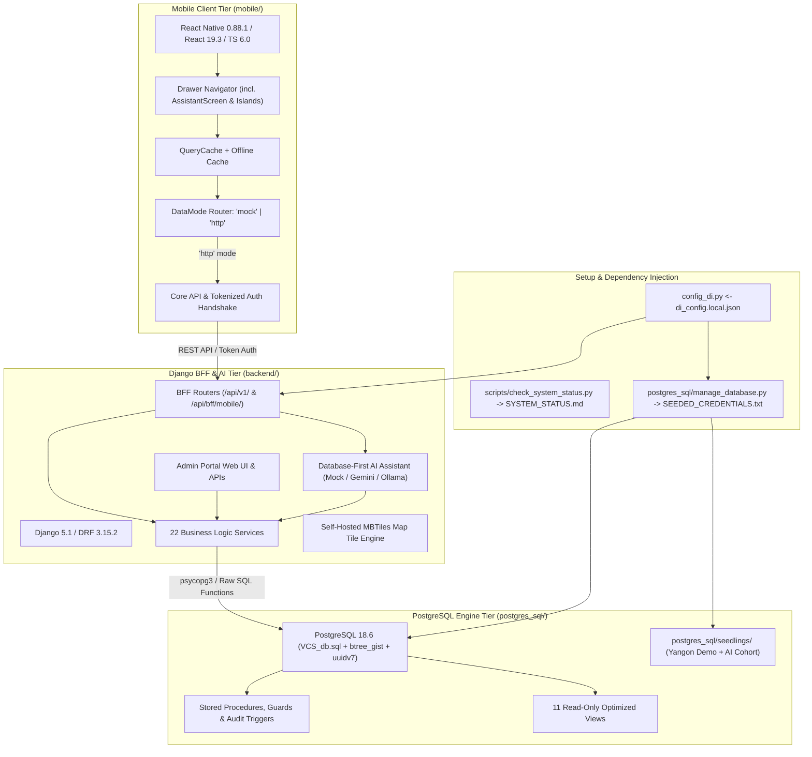

# Volunteer HR Management System — System Documentation Portal

> **Current Version:** v0.12.2+ (AI Assistant, QueryCache & New-Laptop Bootstrap)  
> **Last Updated:** 2026-11-26  
> **Target Repository:** `python_stack/`  
> **Active Branch:** `feature/ai-chat-cache-ml-insights`

---

## 1. System Architecture Overview

The **Volunteer HR Management System (CommonGround / Workshift / VCS)** is an enterprise-grade volunteer coordination platform consisting of three unified tiers plus a centralized Root Dependency Injection & Console Orchestration layer:



---

## 2. Current Project Status & Condition

| Subsystem | Version / Stack | Implementation Status | Quality & Verification Metrics |
|---|---|---|---|
| **Database Engine** | PostgreSQL 18.6 (`postgres_sql/VCS_db.sql`) | **Frozen & Verified (v0.12.0)** | 31 base tables (23 domain + 8 Django), 11 public views, 53 triggers, `btree_gist`, native `uuidv7()`, organized `postgres_sql/seedlings/`. |
| **Backend & BFF** | Django 5.1 / DRF 3.15.2 (`backend/`) | **Complete** | 22 service modules, `/api/v1/` & `/api/bff/mobile/` routes, tokenized OTP handshake, AES-256-GCM image streaming, self-hosted MBTiles tile proxy. |
| **AI & ML Layer** | `backend/ai/`, `recommendation_service.py`, `staffing_insight_service.py` | **Complete & Smoke-Tested** | Database-first / LLM-second assistant (`Mock`, `Gemini`, `Ollama`), versioned prompts (`vcs.shared.v2`), deterministic fallback, PII redaction. |
| **Mobile Client** | React Native 0.88.1 / React 19.3 / TS 6.0 (`mobile/`) | **Complete** | 25+ feature screens (incl. `AssistantScreen`), Dual-Mode (`mock`/`http`), `QueryCache`, offline cache, startup permission policy, **0 TypeScript errors, 46 suites / 658 tests passing**. |
| **New-Laptop Bootstrap & DI** | `config_di.py`, `di_config.local.json`, `postgres_sql/`, `scripts/` | **Complete** | Automated readiness probe (`SYSTEM_STATUS.md`), true DI JSON generator, unified `postgres_sql/manage_database.py` (DB creation, schema, migrations & mandatory Yangon + 500-user AI cohort seedlings -> `SEEDED_CREDENTIALS.txt`). |

---

## 3. New-Laptop Setup & Startup Playbook

### Step 1: Check System Prerequisites (`SYSTEM_STATUS.md`)
```powershell
python scripts\check_system_status.py
```
Inspects Python, `.venv`, pip packages, PostgreSQL 18+, Node.js `>= 22.11.0`, React Native `0.88.1`, JDK 17/21, Android Studio/SDK/NDK/ADB/AVDs, `di_config.local.json`, and `map/*.mbtiles`, reporting exact satisfaction percentage and refreshing [SYSTEM_STATUS.md](file:///c:/Users/USER/Documents/INTERN/Project/Volunteer_HR_Management/python_stack/SYSTEM_STATUS.md).

### Step 2: Install Python & Mobile Dependencies (Fresh Machine)
```powershell
python -m venv .venv
.\.venv\Scripts\python.exe -m pip install -r backend\requirements\local.txt

cd mobile
npm ci
cd ..
```

### Step 3: Create True Dependency Injection Config (`di_config.local.json`)
```powershell
.\.venv\Scripts\python.exe scripts\setup_di_config.py --interactive
```
Creates the gitignored root [di_config.local.json](file:///c:/Users/USER/Documents/INTERN/Project/Volunteer_HR_Management/python_stack/di_config.local.json) (instead of relying on [di_config.example.json](file:///c:/Users/USER/Documents/INTERN/Project/Volunteer_HR_Management/python_stack/di_config.example.json)) with database settings, map keys/tile templates, AI provider/API keys, runtime flags, and 6 distinct cryptographic secrets.

### Step 4: Create, Structure & Seed Local PostgreSQL Database (`SEEDED_CREDENTIALS.txt`)
```powershell
.\.venv\Scripts\python.exe postgres_sql\manage_database.py
```
Prompts for your local PostgreSQL username and password (`localhost` / `127.0.0.1`), creates `volunteer_coordination_db`, applies [VCS_db.sql](file:///c:/Users/USER/Documents/INTERN/Project/Volunteer_HR_Management/python_stack/postgres_sql/VCS_db.sql), runs Django migrations, seeds [postgres_sql/seedlings/](file:///c:/Users/USER/Documents/INTERN/Project/Volunteer_HR_Management/python_stack/postgres_sql/seedlings/README.md) re-keyed to your active DI secrets (with optional 500-user/150-event AI cohort via `--with-ai-cohort`), and writes rich Super Admin, Admin, Coordinator, and Volunteer credentials to `SEEDED_CREDENTIALS.txt` at the root.

### Step 5: Launch Backend, Metro & Android App (3 Terminals)
See [docs/NEW_LAPTOP_WINDOWS_SETUP_GUIDE.md](file:///c:/Users/USER/Documents/INTERN/Project/Volunteer_HR_Management/python_stack/docs/NEW_LAPTOP_WINDOWS_SETUP_GUIDE.md) for the complete Windows setup & 3-terminal launch commands (`backend\manage.py runserver 0.0.0.0:8000`, `cd mobile && npm start`, and `npm run android` or `npm run android:device`).

---

## 4. Documentation Suite Index

- [docs/V0_CLIENT_PROTOTYPE_FINAL_ANALYSIS.md](file:///c:/Users/USER/Documents/INTERN/Project/Volunteer_HR_Management/python_stack/docs/V0_CLIENT_PROTOTYPE_FINAL_ANALYSIS.md) — Version 0 (v0) client prototype final analysis, flow audit, and live verification matrix.
- [docs/NEW_LAPTOP_WINDOWS_SETUP_GUIDE.md](file:///c:/Users/USER/Documents/INTERN/Project/Volunteer_HR_Management/python_stack/docs/NEW_LAPTOP_WINDOWS_SETUP_GUIDE.md) — Clean Windows laptop installation guide (downloads, Windows environment variables, DI config, DB setup, and 3-terminal launch).
- [docs/README.md](file:///c:/Users/USER/Documents/INTERN/Project/Volunteer_HR_Management/python_stack/docs/README.md) — Authoritative documentation portal index.
- [SYSTEM_STATUS.md](file:///c:/Users/USER/Documents/INTERN/Project/Volunteer_HR_Management/python_stack/SYSTEM_STATUS.md) — Live environment readiness & dependency matrix for this machine.
- [docs/backend_analysis.md](file:///c:/Users/USER/Documents/INTERN/Project/Volunteer_HR_Management/python_stack/docs/backend_analysis.md) — Django 5.1 backend, AI/BFF routes, 22 services, and security.
- [docs/mobile_analysis.md](file:///c:/Users/USER/Documents/INTERN/Project/Volunteer_HR_Management/python_stack/docs/mobile_analysis.md) — React Native 0.88.1 client, DDD layers, Assistant, and QueryCache.
- [docs/full_database_details.md](file:///c:/Users/USER/Documents/INTERN/Project/Volunteer_HR_Management/python_stack/docs/full_database_details.md) — PostgreSQL 18.6 schema catalog (`postgres_sql/VCS_db.sql`).
- [docs/ai_ml_integration.md](file:///c:/Users/USER/Documents/INTERN/Project/Volunteer_HR_Management/python_stack/docs/ai_ml_integration.md) — AI Assistant, ML Recommendations, Staffing Insights, and QueryCache.
- [docs/tokenization_login_architecture.md](file:///c:/Users/USER/Documents/INTERN/Project/Volunteer_HR_Management/python_stack/docs/tokenization_login_architecture.md) — Zero-PII tokenized OTP handshake state machine.
- [docs/VCS_PROTOTYPE_RUNBOOK_2026-11-26.md](file:///c:/Users/USER/Documents/INTERN/Project/Volunteer_HR_Management/python_stack/docs/VCS_PROTOTYPE_RUNBOOK_2026-11-26.md) — Prototype startup, verification, and demo runbook.

---

## 5. Verification Quick Commands

```powershell
# Backend check & targeted AI/analytics tests
.\.venv\Scripts\python.exe backend\manage.py check
.\.venv\Scripts\python.exe backend\manage.py test ai.tests bff.coordinator.tests.test_staffing_insight bff.volunteer.tests.test_recommendations --noinput

# Mobile TypeScript & Jest suite (from mobile/)
cd mobile
npx tsc --noEmit
npm test -- --runInBand
```

---

*Volunteer HR Management System — Technical Documentation Portal.*
