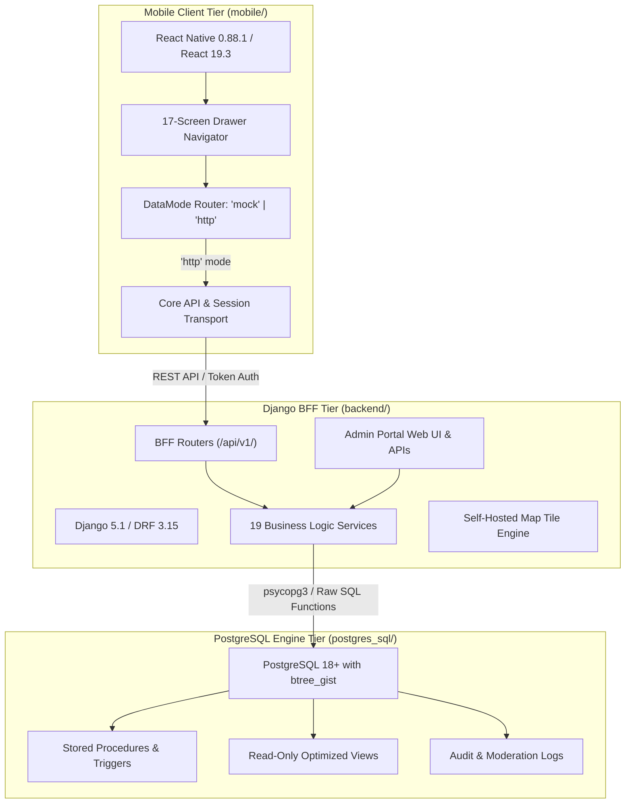

# Volunteer HR Management System — System Documentation Portal

> **Current Version:** v0.10.0 (Release-Ready)  
> **Last Updated:** 2026-11-16  
> **Target Repository:** `python_stack/`  

---

## 1. System Architecture Overview

The **Volunteer HR Management System (CommonGround / Workshift)** is an enterprise-grade volunteer coordination platform consisting of three unified tiers:



---

## 2. Current Project Status & Condition

| Subsystem | Version / Stack | Implementation Status | Quality & Verification Metrics |
|---|---|---|---|
| **Database Engine** | PostgreSQL 18+ (`postgres_sql/`) | **100% Complete (v0.6.0)** | 22 tables, 14 DB views, 28 stored functions/triggers, full `self_test.sql` coverage. |
| **Backend & BFF** | Django 5.1 / DRF 3.15 (`backend/`) | **100% Complete (v0.6.0)** | 19 service modules, 5 Django apps, OpenAPI 3.0 schema (206 KB), 11 Admin Web UI templates, unified URL dispatching (`/api/v1/`). |
| **Mobile Client** | React Native 0.88.1 / TS 6.0 (`mobile/`) | **100% Complete (v0.10.0)** | 17 Drawer screens, Dual-Mode (`mock`/`http`), Core API transport, TokenStore, DTOs & Mappers, HTTP Repositories, 0 type errors, **28 test suites / 365 tests passing (100%)**. |
| **BFF Integration** | React Native ↔ Django BFF | **100% Complete (Phases 0–9)** | Zero DB changes, zero backend changes, zero external dependencies, strict DRF allow-list compliance. |

---

## 3. Documentation Suite Index

This directory (`docs/`) contains comprehensive deep-dive analyses and verification audits for each system layer:

### Core System Documents
- [docs/mobile_analysis.md](file:///c:/Users/USER/Documents/INTERN/Project/Volunteer_HR_Management/python_stack/docs/mobile_analysis.md)  
  *Complete architectural breakdown of the React Native client: technology stack, design system, component primitives, navigation structure, domain business rules, dual-mode networking, DTOs & mappers, HTTP repositories, and the 28-suite test suite.*

- [docs/backend_analysis.md](file:///c:/Users/USER/Documents/INTERN/Project/Volunteer_HR_Management/python_stack/docs/backend_analysis.md)  
  *In-depth reference for the Django backend: project configuration, settings, PostgreSQL connection pooling, apps and models, 19 service modules, BFF endpoints, Admin Portal, OpenAPI schema, and URL routing.*

- [docs/database_deep_dive.md](file:///c:/Users/USER/Documents/INTERN/Project/Volunteer_HR_Management/python_stack/docs/database_deep_dive.md)  
  *Exhaustive catalog of the PostgreSQL database schema: entity-relationship diagrams, all 22 tables, stored procedures, triggers, state machines, view models, maintenance routines, and seed data.*

- [docs/mobile_bff_database_connectivity_audit.md](file:///c:/Users/USER/Documents/INTERN/Project/Volunteer_HR_Management/python_stack/docs/mobile_bff_database_connectivity_audit.md)  
  *Detailed audit and gap analysis of Mobile Client ↔ Django BFF ↔ PostgreSQL connectivity: event loading, event declaration, event creation, updates, volunteer acceptance, synchronization, full 38-capability scan, and map/geolocation preparation.*

### Baseline & Integration Audits (`docs/baseline/`)
- [docs/baseline/v0_10_0_phase_0_discovery_and_baseline_report.md](file:///c:/Users/USER/Documents/INTERN/Project/Volunteer_HR_Management/python_stack/docs/baseline/v0_10_0_phase_0_discovery_and_baseline_report.md)  
  *Phase 0 baseline discovery and freeze report documenting test baseline, pre-existing type errors, and non-invasive enforcement rules.*

- [docs/baseline/v0_10_0_implementation_feasibility_report.md](file:///c:/Users/USER/Documents/INTERN/Project/Volunteer_HR_Management/python_stack/docs/baseline/v0_10_0_implementation_feasibility_report.md)  
  *Pre-execution feasibility audit identifying technical precautions, serializer query parameter mappings (`starts_after`, `starts_before`, `upcoming`), and contract freezing.*

- [docs/baseline/v0_10_0_final_completion_summary.md](file:///c:/Users/USER/Documents/INTERN/Project/Volunteer_HR_Management/python_stack/docs/baseline/v0_10_0_final_completion_summary.md)  
  *Executive summary and phase-by-phase delivery matrix for all 10 integration phases (Phases 0–9), test suite metrics, and verification results.*

---

## 4. Subsystems Summary

### 4.1 Database Layer (`postgres_sql/`)
- **Schema Engine:** PostgreSQL 18+ with `btree_gist` extension for exclusion constraints and native `uuidv7()`.
- **Key Tables:** `users`, `events`, `event_posts`, `event_applications`, `coordinator_assignments`, `attendance`, `attendance_geo_attempts`, `qr_tokens`, `audit_logs`.
- **Core Stored Logic:** Stored functions manage auto-assignment algorithms, geofence Haversine calculations, coordinator handover with owner-as-monitor constraints, and rating updates.
- **Data Privacy:** Raw phone numbers are strictly hashed (HMAC) and AES encrypted; volunteer contact details and physical capability profiles are shielded behind T2 privacy gates.

### 4.2 Backend & BFF Layer (`backend/`)
- **Framework:** Django 5.1 with Django REST Framework 3.15.2.
- **Architecture:** Unmanaged Django models (`managed = False`) mapped to PostgreSQL tables and views; all business logic concentrated in `services/`.
- **BFF Endpoints:** Mounted at `/api/v1/`, `/api/bff/mobile/`, and `/api/`:
  - `auth/`: OTP request, verification, token issuance, logout.
  - `volunteer/`: Public event search, charity taxonomies, user profile allow-list, availability rules, application submit/withdraw.
  - `checkin/`: Onboarding briefing & acknowledgment, QR tokens, GPS geo check-in, checkout, event feedback.
  - `coordinator/`: Coordinator application, metrics, event CRUD & lifecycle transitions, applicant review, auto/manual post assignment, attendance roster.
- **Admin Portal:** Web UI (`/admin-dashboard/`) with 11 HTML template views for administrative approvals, moderation, and system settings.

### 4.3 Mobile Client Layer (`mobile/`)
- **Framework:** React Native 0.88.1, React 19.3, TypeScript 6.0.
- **Dual-Mode Data Architecture:**
  - `DataMode = 'mock'`: Uses in-memory repositories with realistic simulated delays and offline fixtures.
  - `DataMode = 'http'`: Communicates with live Django BFF endpoints via `ApiClient` and HTTP repositories.
- **Navigation Shell:** Custom 17-screen Drawer Navigation with role-based screen mounting (Volunteer vs Coordinator) and QA demo persona switcher.
- **Quality Gates:** 0 TypeScript compiler errors (`npx tsc --noEmit`), 28 test suites / 365 tests passing (100%).

---

## 5. Quickstart & Verification Playbook

### 5.1 Mobile Client Verification
```powershell
# Navigate to mobile subproject
cd mobile

# Run TypeScript static typechecking (Enforces 0 errors)
npx tsc --noEmit

# Run Jest unit and integration test suites
npm test -- --watchAll=false
```

### 5.2 Running the Mobile App
```powershell
cd mobile

# Start Metro Bundler
npx react-native start

# Run on Android Emulator (points to http://10.0.2.2:8000/api/v1)
npx react-native run-android
```

### 5.3 Backend Development Server
```powershell
# Activate Python virtual environment
.venv\Scripts\Activate.ps1

# Start Django development server
python backend/manage.py runserver 0.0.0.0:8000

# Access Swagger interactive API documentation
# http://127.0.0.1:8000/api/docs/
```

### 5.4 Database Verification
```powershell
# Execute PostgreSQL self-test suite
psql -U postgres -d volunteer_coordination_db -f postgres_sql/self_test.sql
```

---

*Volunteer HR Management System — Technical Documentation Portal.*
