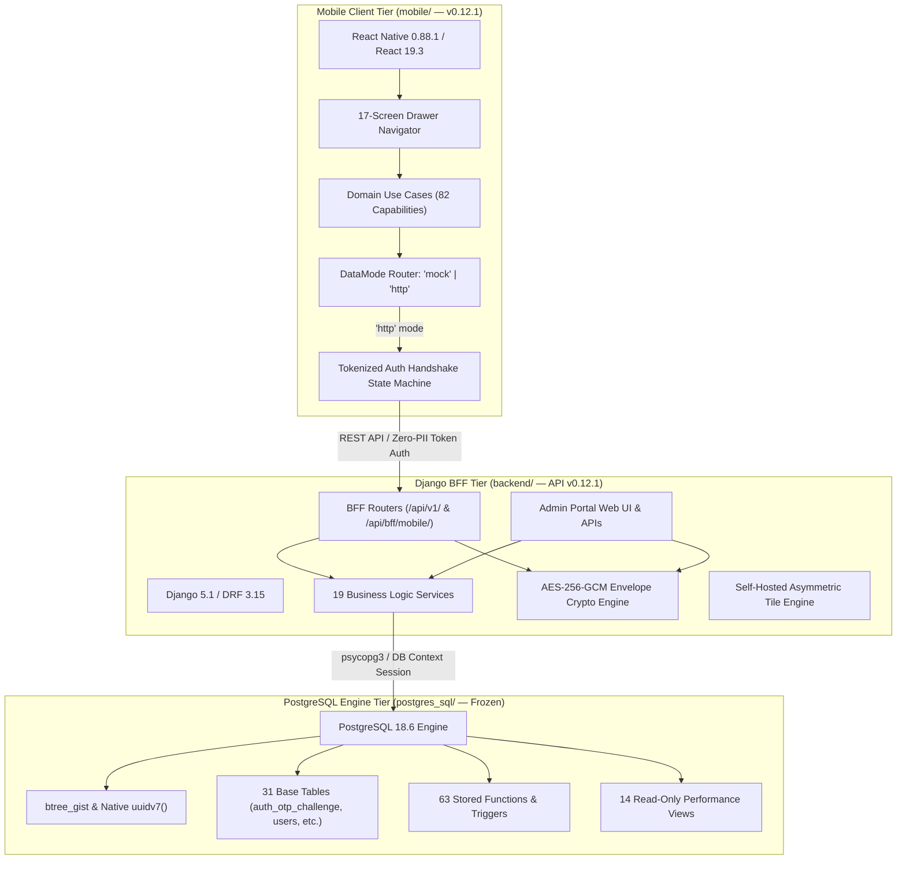

# Volunteer HR Management System — Technical Documentation Portal

> **Release Version:** v0.12.1 (Stabilized & Release-Ready)  
> **Last Updated:** 2026-11-22  
> **Target Repository:** `python_stack/docs/`  
> **Candidate SHA:** `9d2ecc8` / `99db25a` (branch `main`)  
> **Database Engine:** PostgreSQL 18.6 (Schema Frozen & Immutable)  
> **Backend Framework:** Django 5.1 / DRF 3.15.2 (API v0.12.1)  
> **Mobile Client:** React Native 0.88.1 / React 19.3 / TypeScript 6.0 (App v0.12.1)  

---

## 1. Documentation Portal Overview

This directory (`docs/`) serves as the central technical reference repository for the **Volunteer HR Management System (CommonGround / Workshift)**. It contains exhaustive architectural audits, security specifications, database catalogs, mobile client analyses, and live integration test records.

```
python_stack/docs/
├── README.md                               # This documentation portal index
├── backend_analysis.md                     # Django 5.1 backend, BFF routes, services & security
├── mobile_analysis.md                      # React Native client architecture, screens, DDD layers
├── full_database_details.md                # PostgreSQL 18.6 catalog: 31 tables, 14 views, 63 functions
├── tokenization_login_architecture.md      # Zero-PII auth handshake & OTP session state machine
└── integration/
    └── v0_12_0_real_http_integration_report.md # 14-scenario real-HTTP socket integration test report
```

---

## 2. Document Catalog & Deep-Dive Directory

| Document | Core Focus | Key Architectural Elements |
|---|---|---|
| [docs/backend_analysis.md](file:///c:/Users/USER/Documents/INTERN/Project/Volunteer_HR_Management/python_stack/docs/backend_analysis.md) | **Backend & BFF Tier** | Django 5.1 & DRF 3.15 settings, 19 business services, unified `/api/v1/` and `/api/bff/mobile/` routes, `DbContextMiddleware`, AES-256-GCM verification image envelope encryption (`VIMG\x01`), streaming admin decrypt, and 662 passing automated backend tests. |
| [docs/mobile_analysis.md](file:///c:/Users/USER/Documents/INTERN/Project/Volunteer_HR_Management/python_stack/docs/mobile_analysis.md) | **Mobile Client Tier** | React Native 0.88.1 & TS 6.0 client, 17 Drawer navigation screens, DDD presentation/domain/data tiers, pure bidirectional mappers, dual-mode runtime (`mock` vs `http`), 82 role capability parity (43 Volunteer + 39 Coordinator), 36 Jest suites / 588 passing tests, 0 type errors. |
| [docs/full_database_details.md](file:///c:/Users/USER/Documents/INTERN/Project/Volunteer_HR_Management/python_stack/docs/full_database_details.md) | **Database Layer** | Exhaustive PostgreSQL 18.6 schema catalog: all 31 base tables, 14 views, 63 domain stored procedures and triggers, exclusion constraints (`btree_gist`), native `uuidv7()` primary keys, and immutable frozen schema policy. |
| [docs/tokenization_login_architecture.md](file:///c:/Users/USER/Documents/INTERN/Project/Volunteer_HR_Management/python_stack/docs/tokenization_login_architecture.md) | **Security & Auth** | Zero-cleartext phone tokenization, ephemeral `auth_session_token` with 180s TTL, row-level locking state machine, `OtpDeliveryAdapter` boundary, asynchronous decoupled SMS dispatch, and sub-500ms latency budget compliance. |
| [docs/integration/v0_12_0_real_http_integration_report.md](file:///c:/Users/USER/Documents/INTERN/Project/Volunteer_HR_Management/python_stack/docs/integration/v0_12_0_real_http_integration_report.md) | **Integration Verification** | Real TCP network HTTP test execution results across 14 live scenarios without mock stubs (tokenized handshake, replay defense, production dev-code suppression, coordinator check-in, owner-as-monitor isolation, encrypted upload/decrypt). |

---

## 3. System Architecture & Topology



---

## 4. Subsystem Verification & Quality Metrics

As of **v0.12.1 Stabilization**, all system components meet strict production readiness gates:

| Subsystem | Stack & Version | Implementation Status | Quality & Verification Evidence |
|---|---|---|---|
| **Database Engine** | PostgreSQL 18.6 (`postgres_sql/`) | **100% Frozen & Complete** | 31 base tables, 14 views, 63 stored functions/triggers, `uuidv7()` active, preflight check PASS (`scripts/db_preflight_check.py`). |
| **Backend & BFF** | Django 5.1 / DRF 3.15.2 (`backend/`) | **100% Complete (API v0.12.1)** | 19 business services, OpenAPI 3.0 schema (206 KB), tokenized OTP challenge endpoints, AES-256-GCM image streaming, **662 automated tests passing (100%)**. |
| **Mobile Client** | React Native 0.88.1 / TS 6.0 (`mobile/`) | **100% Complete (App v0.12.1)** | 17 Drawer screens, 82 role capabilities, pure mappers, dual-mode networking, **0 TypeScript errors, 36 Jest suites / 588 tests passing (100%)**. |
| **Live Integration** | Real TCP Socket (`fetch` HTTP) | **100% Verified** | **14 / 14 real HTTP integration scenarios passing (100%)** via `scripts/run_real_http_suite.py` against live Django + PostgreSQL 18.6. |
| **Security & Privacy** | AES-256-GCM / HMAC-SHA256 | **100% Enforced** | Server-side encrypted verification images (`VIMG\x01`), blind index phone hashing, single-use `auth_session_token` with 180s TTL, script safety refusal guards. |

---

## 5. Security Architecture & Invariants

1. **Frozen Database Contract:**
   - Absolute immutability of `volunteer_coordination_db`.
   - All tests and fixtures execute strictly against isolated disposable database `test_volunteer_coordination_db`.
   - Preflight verification confirmed via `scripts/db_preflight_check.py`.
2. **Tokenized Authentication (Zero-PII Wire Transmission):**
   - Direct cleartext phone number transmission during verification is eliminated.
   - Client requests challenge via `POST /api/v1/auth/tokenized/request-otp/`, receiving ephemeral `auth_session_token` (180s TTL).
   - Verification (`POST /api/v1/auth/tokenized/verify-otp/`) transmits only `auth_session_token` and `code`.
   - OTP replay safely rejected with `409 challenge_consumed`.
3. **Encrypted Verification Image Storage:**
   - Uploaded verification JPEGs are sanitized in-memory and wrapped in a versioned AES-256-GCM binary envelope (`VIMG\x01`).
   - Stored in private directory `VERIFICATION_MEDIA_ROOT` outside public web media root.
   - Admin access decrypts in-memory on the fly via `GET /api/v1/admin/verification-images/<id>/file/`; non-admin access is rejected with `404/401`.
4. **Owner-as-Monitor Access Gate:**
   - Event owners who have handed over active coordination to another coordinator are restricted to read-only monitoring mode (HTTP 403 Forbidden on operational mutations).

---

## 6. Associated Reference Documents & Runbooks

For additional operational runbooks, stabilization reports, and deep architectural analyses:

- **Full Stabilization Report:** [v0_12_0_stabilization_report.md](file:///c:/Users/USER/Documents/INTERN/Project/Volunteer_HR_Management/python_stack/v0_12_0_stabilization_report.md)
- **Key Management & Rotation Runbook:** [reference/key_management_runbook.md](file:///c:/Users/USER/Documents/INTERN/Project/Volunteer_HR_Management/python_stack/reference/key_management_runbook.md)
- **Database Migration & Safety Guide:** [reference/v0_12_0_database_migration_guide.md](file:///c:/Users/USER/Documents/INTERN/Project/Volunteer_HR_Management/python_stack/reference/v0_12_0_database_migration_guide.md)
- **Database Deep Dive & Schema Spec:** [reference/database_deep_dive.md](file:///c:/Users/USER/Documents/INTERN/Project/Volunteer_HR_Management/python_stack/reference/database_deep_dive.md)
- **Preflight Baseline Artifact:** [artifacts/v0_12_0_db_preflight_99db25a.md](file:///c:/Users/USER/Documents/INTERN/Project/Volunteer_HR_Management/python_stack/artifacts/v0_12_0_db_preflight_99db25a.md)
- **Remaining Operational Tasks:** [reference/v0_12_0_unfinished_remaining_operations.md](file:///c:/Users/USER/Documents/INTERN/Project/Volunteer_HR_Management/python_stack/reference/v0_12_0_unfinished_remaining_operations.md)

---

*Volunteer HR Management System Technical Documentation Suite — Authoritative Index.*
