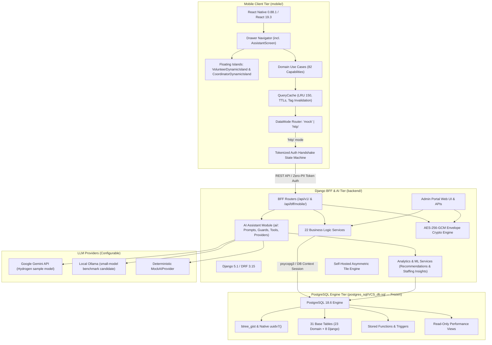

# Volunteer HR Management System — Technical Documentation Portal

> **Release Baseline:** v0.12.2 Core + AI/ML & Query Cache Integration  
> **Last Updated:** 2026-11-25  
> **Target Repository:** `python_stack/docs/`  
> **Active Branch:** `feature/ai-chat-cache-ml-insights`  
> **Database Engine:** PostgreSQL 18.6 (Schema Frozen & Immutable — `postgres_sql/VCS_db.sql`)  
> **Backend Framework:** Django 5.1 / DRF 3.15.2 (`backend/`)  
> **Mobile Client:** React Native 0.88.1 / React 19.3 / TypeScript 6.0 (`mobile/`)  

---

## 1. Documentation Portal Overview

This directory (`docs/`) serves as the authoritative technical reference repository for the **Volunteer HR Management System (CommonGround / Workshift / VCS)**. All legacy drafts, transient handoff work orders, and historical logs have been archived in `old_doc/`.

```
python_stack/docs/
├── README.md                               # This documentation portal index
├── ai_ml_integration.md                    # AI Assistant, ML Recommendations, Staffing Insights & QueryCache
├── backend_analysis.md                     # Django 5.1 backend, AI/BFF routes, 22 services & security
├── mobile_analysis.md                      # React Native client, DDD layers, Assistant & QueryCache
├── full_database_details.md                # PostgreSQL 18.6 schema catalog & frozen contract
├── tokenization_login_architecture.md      # Zero-PII auth handshake & OTP session state machine
├── GEMINI_4_HYDROGEN_PROTOTYPE_WORK_ORDER_2026-11-26.md # Branch-scoped AI implementation handoff
├── VCS_PROTOTYPE_RUNBOOK_2026-11-26.md     # Safe local startup, verification & demo sequence
└── audit/                                  # 2026-11-24 AI/DB Readiness & Bootstrap Audit Reports
    ├── DB_SOURCE_OF_TRUTH_REPORT.md
    ├── DISPOSABLE_BOOTSTRAP_COMPARISON_PLAN.md
    ├── FINAL_VCS_AI_HANDOFF_REPORT.md
    └── SESSION_AUDIT_LOG_20261124.md
```

---

## 2. Document Catalog & Deep-Dive Directory

### Core Architecture & Feature Documentation

| Document | Core Focus | Key Architectural Elements |
|---|---|---|
| [docs/ai_ml_integration.md](file:///c:/Users/USER/Documents/INTERN/Project/Volunteer_HR_Management/python_stack/docs/ai_ml_integration.md) | **AI & ML Integration** | Role-scoped read-only AI Assistant (`Mock`/`Ollama`/`Gemini` with `thought_signature` support), versioned role prompts (`vcs.*.v1`), PII redaction, bounded tool calling, Explainable Recommendations (`recommendation-v1`), Staffing Gap & Coverage Insights, and Mobile `QueryCache`. |
| [docs/backend_analysis.md](file:///c:/Users/USER/Documents/INTERN/Project/Volunteer_HR_Management/python_stack/docs/backend_analysis.md) | **Backend & BFF Tier** | Django 5.1 & DRF 3.15 settings, `ai` app, 22 business services, unified `/api/v1/` and `/api/bff/mobile/` routes (`auth`, `assistant`, `volunteer`, `checkin`, `coordinator`, `admin`), `DbContextMiddleware`, and AES-256-GCM verification image encryption (`VIMG\x01`). |
| [docs/mobile_analysis.md](file:///c:/Users/USER/Documents/INTERN/Project/Volunteer_HR_Management/python_stack/docs/mobile_analysis.md) | **Mobile Client Tier** | React Native 0.88.1 & TS 6.0 client, Drawer navigation with `AssistantScreen`, DDD presentation/domain/data tiers, dual-mode runtime (`mock` vs `http`), `VolunteerDynamicIsland` & `CoordinatorDynamicIsland`, and bounded `QueryCache` with tag invalidation. |
| [docs/full_database_details.md](file:///c:/Users/USER/Documents/INTERN/Project/Volunteer_HR_Management/python_stack/docs/full_database_details.md) | **Database Layer** | Exhaustive PostgreSQL 18.6 schema catalog (canonical `postgres_sql/VCS_db.sql`): 31 base tables (23 domain + 8 Django), views, domain stored procedures & triggers, `btree_gist`, native `uuidv7()`, and immutable frozen schema policy. |
| [docs/tokenization_login_architecture.md](file:///c:/Users/USER/Documents/INTERN/Project/Volunteer_HR_Management/python_stack/docs/tokenization_login_architecture.md) | **Security & Auth** | Zero-cleartext phone tokenization, ephemeral `auth_session_token` with 180s TTL, row-level locking state machine, `OtpDeliveryAdapter` boundary, and sub-500ms latency budget compliance. |

### Prototype Handoff & Operator Runbook

| Document | Purpose |
|---|---|
| [GEMINI_4_HYDROGEN_PROTOTYPE_WORK_ORDER_2026-11-26.md](GEMINI_4_HYDROGEN_PROTOTYPE_WORK_ORDER_2026-11-26.md) | Detailed, branch-only Gemini 4 Hydrogen implementation work order for the database-first, role-aware assistant, recommendation/staffing verification, client integration, security boundaries and release gates. |
| [VCS_PROTOTYPE_RUNBOOK_2026-11-26.md](VCS_PROTOTYPE_RUNBOOK_2026-11-26.md) | Operator instructions to verify the branch and local PostgreSQL target, start Django and React Native, use mock/Gemini modes safely, rehearse volunteer/coordinator scenarios and run tests without mutating the frozen database. |

**Implementation status note:** The existing assistant implementation described in `ai_ml_integration.md` currently uses bounded model-selected tool calls. The Gemini work order specifies a proposed backend-owned intent/data-retrieval flow in which the LLM receives only an authorised DTO. That architecture is a target for the next implementation pass, not a claim that it is already complete.

### Audit & Readiness Reports (`docs/audit/`)

| Document | Focus |
|---|---|
| [docs/audit/FINAL_VCS_AI_HANDOFF_REPORT.md](file:///c:/Users/USER/Documents/INTERN/Project/Volunteer_HR_Management/python_stack/docs/audit/FINAL_VCS_AI_HANDOFF_REPORT.md) | Master 2026-11-24 AI/DB readiness & implementation sign-off (13/13 gates passed, 58 AI/analytics/DB tests passed, live Gemini smoke test verified). |
| [docs/audit/DB_SOURCE_OF_TRUTH_REPORT.md](file:///c:/Users/USER/Documents/INTERN/Project/Volunteer_HR_Management/python_stack/docs/audit/DB_SOURCE_OF_TRUTH_REPORT.md) | Read-only PostgreSQL 18.6 audit reconciling `postgres_sql/VCS_db.sql` with live `volunteer_coordination_db`. |
| [docs/audit/DISPOSABLE_BOOTSTRAP_COMPARISON_PLAN.md](file:///c:/Users/USER/Documents/INTERN/Project/Volunteer_HR_Management/python_stack/docs/audit/DISPOSABLE_BOOTSTRAP_COMPARISON_PLAN.md) | Phase D disposable bootstrap schema parity comparison plan and verification procedure. |
| [docs/audit/SESSION_AUDIT_LOG_20261124.md](file:///c:/Users/USER/Documents/INTERN/Project/Volunteer_HR_Management/python_stack/docs/audit/SESSION_AUDIT_LOG_20261124.md) | Chronological input/output execution log for the 2026-11-24 AI & DB audit session. |

---

## 3. System Architecture & Topology



---

## 4. Current Project Situation & Verification Summary

As of **2026-11-25** (`feature/ai-chat-cache-ml-insights`), all core v0.12.2 capabilities and the AI/ML & QueryCache integration are implemented and verified:

| Subsystem | Stack & Location | Current Status | Verification Evidence |
|---|---|---|---|
| **Database Engine** | PostgreSQL 18.6 (`postgres_sql/VCS_db.sql`) | **Frozen & Verified** | 31 base tables (23 domain + 8 Django), 11 public views in live DB, 53 triggers, 438 constraints, `uuidv7()` active; 100% disposable bootstrap parity & preflight PASS (`docs/audit/FINAL_VCS_AI_HANDOFF_REPORT.md`). |
| **Backend & BFF** | Django 5.1 / DRF 3.15.2 (`backend/`) | **Complete** | 22 business services, unified `/api/v1/` and `/api/bff/mobile/` routes, tokenized OTP auth, AES-256-GCM image streaming, self-hosted map tile engine. |
| **AI & ML Layer** | `backend/ai/`, `bff/assistant/`, `recommendation_service.py`, `staffing_insight_service.py` | **Complete & Smoke-Tested** | Role-scoped read-only AI Assistant (`Mock`, `Ollama`, `Gemini`), versioned prompts (`vcs.*.v1`), PII redaction, `recommendation-v1`, staffing gap insights; 58 AI/analytics/DB tests passing + live Gemini 200 OK smoke test. |
| **Mobile Client** | React Native 0.88.1 / TS 6.0 (`mobile/`) | **Complete** | 25 feature screens (including `AssistantScreen`), 82 role capabilities, `VolunteerDynamicIsland` & `CoordinatorDynamicIsland`, `QueryCache` (LRU 150, TTLs, tag/prefix invalidation, account-scope clear). |
| **Security & Privacy** | AES-256-GCM / HMAC-SHA256 / `scope_policy.py` | **Enforced** | Server-side encrypted verification images (`VIMG\x01`), blind index phone hashing, single-use `auth_session_token` (180s TTL), Privacy Rule BR-PRIV-T4, AI PII redaction & zero chat persistence. |

---

## 5. Security Architecture & Invariants

1. **Frozen Database Contract:**
   - Absolute immutability of `volunteer_coordination_db`; canonical DDL is `postgres_sql/VCS_db.sql`.
   - All tests execute strictly against isolated disposable database `test_volunteer_coordination_db`.
   - Preflight verification confirmed via `scripts/db_preflight_check.py`.
2. **Tokenized Authentication (Zero-PII Wire Transmission):**
   - Client requests challenge via `POST /api/v1/auth/tokenized/request-otp/`, receiving ephemeral `auth_session_token` (180s TTL).
   - Verification (`POST /api/v1/auth/tokenized/verify-otp/`) transmits only `auth_session_token` and `code`.
   - OTP replay is rejected with `409 challenge_consumed`.
3. **Encrypted Verification Image Storage:**
   - Uploaded verification JPEGs are sanitized in-memory and wrapped in a versioned AES-256-GCM binary envelope (`VIMG\x01`) in `VERIFICATION_MEDIA_ROOT`.
   - Admin access decrypts in-memory on the fly via `GET /api/v1/admin/verification-images/<id>/file/`.
4. **AI Assistant Zero-Persistence & Scope Enforcement:**
   - No chat messages or prompts are persisted to the database.
   - Actor scope (`volunteer`, `coordinator`, `admin`, `super_admin`) is derived strictly server-side in `scope_policy.py` and re-verified on every tool execution.
   - All tool payloads and user prompts pass through `sanitize_ai_data()` to strip sensitive fields and Myanmar phone numbers.
5. **Front-Camera Verification Invariant:**
   - Verification selfies strictly invoke the native front-facing camera; photo library selection is disabled.

---

## 6. Historical Documents Archive (`old_doc/`)

All prior planning documents, v0.12.x completion/stabilization reports, and intermediate AI/DB handoff work orders have been consolidated into a single concise summary:
- [old_doc/README.md](file:///c:/Users/USER/Documents/INTERN/Project/Volunteer_HR_Management/python_stack/old_doc/README.md) — Historical timeline, resolved technical pitfalls, and remaining production rollout items.

---

*Volunteer HR Management System Technical Documentation Suite — Authoritative Portal.*
