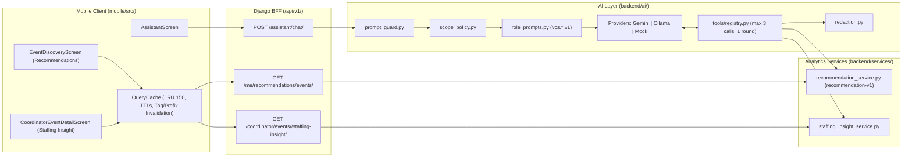

# AI & ML Integration Architecture — Volunteer HR Management System

> **Last Updated:** 2026-11-25  
> **Active Branch:** `feature/ai-chat-cache-ml-insights`  
> **Backend Scope:** `backend/ai/`, `backend/bff/assistant/`, `backend/services/recommendation_service.py`, `backend/services/staffing_insight_service.py`  
> **Mobile Scope:** `mobile/src/features/assistant/`, `mobile/src/data/cache/`, `mobile/src/data/http/`, `mobile/src/features/events/`, `mobile/src/features/coordinator/`  

---

## 1. Overview & Architectural Principles

The Volunteer Coordination System (VCS) integrates **conversational AI** and **deterministic, explainable ML/analytics** while preserving strict database immutability, zero chat persistence, and server-side role boundaries:

1. **Read-Only AI Assistant:** The assistant (`POST /api/v1/assistant/chat/`) is strictly read-only. It never mutates database state, never persists chat messages or prompts, and never accepts client-supplied role or tool overrides.
2. **Deterministic Analytics & Recommendations:** Volunteer event matching (`recommendation_service.py`) and coordinator staffing readiness (`staffing_insight_service.py`) are computed deterministically from authoritative PostgreSQL tables and views (`VPublicEvents`, `VEventSummary`, `VEventPostCapacity`).
3. **LLM-as-Explainer Boundary:** LLMs (`GeminiProvider`, `OllamaProvider`, `MockAIProvider`) summarize only tool outputs returned by `execute_tool()` and never invent counts, dates, eligibility, or policies.
4. **Zero External SDK Bloat:** Both `GeminiProvider` and `OllamaProvider` use Python's standard library `urllib.request` over HTTPS/HTTP with zero external AI SDK dependencies.
5. **Bounded Mobile Caching:** The mobile client uses an in-memory `QueryCache` (LRU, TTLs, single-flight deduplication, and tag/prefix invalidation) to keep recommendations, staffing insights, and event feeds responsive without stale cross-account leaks.



---

## 2. Role-Scoped AI Assistant (`backend/ai/` & `backend/bff/assistant/`)

### 2.1 Request Lifecycle (`process_chat_message`)

Implemented in [chat_service.py](file:///c:/Users/USER/Documents/INTERN/Project/Volunteer_HR_Management/python_stack/backend/ai/services/chat_service.py) and exposed via [views.py](file:///c:/Users/USER/Documents/INTERN/Project/Volunteer_HR_Management/python_stack/backend/bff/assistant/views.py):

1. **Feature Gate & Throttling:** `AssistantChatView` requires `[IsAuthenticated, IsActiveUser]`, enforces `ScopedRateThrottle` (`throttle_scope = 'assistant'`, default `20/min` via `AI_RATE_LIMIT_PER_MINUTE`), and checks `settings.AI_ENABLED`.
2. **Input & History Guard (`prompt_guard.py`):**
   - `sanitize_user_prompt()` trims whitespace and enforces `MAX_MESSAGE_LENGTH = 2000`.
   - `validate_conversation_history()` accepts at most `MAX_HISTORY_MESSAGES = 4` completed turns with `role in {"user", "assistant"}` (rejects `system` or `tool` roles from client payloads).
3. **Server-Side Scope & Prompt Assembly (`scope_policy.py` & `role_prompts.py`):**
   - `determine_actor_scope(actor)` resolves the actor's role from database flags (`is_admin`, `is_superuser`, and `CoordinatorProfiles(status="approved")`): `super_admin`, `admin`, `coordinator`, or `volunteer`.
   - `build_role_system_instruction(scope, language)` combines `SHARED_SYSTEM_POLICY` (`vcs.shared.v1`) with the role-specific template:
     - `vcs.volunteer.v1`
     - `vcs.coordinator.v1`
     - `vcs.admin.v1`
     - `vcs.super_admin.v1`
4. **Bounded Single-Round Tool Execution:**
   - First provider call receives the conversation, system instruction, and `get_available_tools_for_actor(actor)`.
   - If the provider requests `> 3` tool calls, the oversized batch is rejected (`too_many_tool_calls`) to avoid breaking provider call/result pairing.
   - Up to 3 read-only tools execute via `execute_tool(actor, tool_name, arguments)`, which re-runs `verify_tool_access()` on every call.
   - Tool results (plus `provider_turn` for Gemini `thought_signature` continuity) are passed to a second provider call **without** tool schemas so the model summarizes authoritative facts without chaining further loops.
5. **Deep-Link Sources & Suggested Actions:**
   - `search_events`, `get_event_detail`, and `get_recommendations` populate `sources` (`type: "event"`) and `suggested_actions` (`type: "open_event"`).
   - `get_staffing_insight` populates `sources` (`type: "staffing_insight"`) and `suggested_actions` (`type: "open_staffing"`).

### 2.2 AI Providers (`backend/ai/providers/`)

| Provider | Class | Default Model | Transport & Key Features |
|---|---|---|---|
| **Google Gemini** | `GeminiProvider` ([gemini_provider.py](file:///c:/Users/USER/Documents/INTERN/Project/Volunteer_HR_Management/python_stack/backend/ai/providers/gemini_provider.py)) | `gemini-3.5-flash-lite` | REST `v1beta/models/{model}:generateContent` via `urllib.request`; passes API key strictly in `x-goog-api-key` header; preserves `provider_turn` (`thought_signature`) across function-calling turns; maps HTTP 429/5xx/timeouts to safe user-facing errors without leaking keys or URLs. |
| **Local Ollama** | `OllamaProvider` ([ollama_provider.py](file:///c:/Users/USER/Documents/INTERN/Project/Volunteer_HR_Management/python_stack/backend/ai/providers/ollama_provider.py)) | `qwen3.5:4b` | Native `/api/chat` on `AI_OLLAMA_BASE_URL` (default `http://127.0.0.1:11434`, `keep_alive="5m"`); normalizes uppercase JSON schema types (`OBJECT` → `object`) for local tool calling. |
| **Mock Provider** | `MockAIProvider` ([mock_provider.py](file:///c:/Users/USER/Documents/INTERN/Project/Volunteer_HR_Management/python_stack/backend/ai/providers/mock_provider.py)) | `default` | Deterministic offline provider for unit/integration tests and CI (`@override_settings(AI_PROVIDER="mock")`). |

### 2.3 Allowlisted Tools & Scope Matrix (`tools/registry.py` & `scope_policy.py`)

| Tool Name | Volunteer | Coordinator | Admin | Super Admin | Backing Source |
|---|---|---|---|---|---|
| `search_events` | ✅ | ✅ | ✅ | ✅ | `query_service.list_public_events()` |
| `get_event_detail` | ✅ | ✅ | ✅ | ✅ | `query_service` public event detail |
| `get_my_applications` | ✅ | ✅ | ❌ | ❌ | `EventApplications` (actor's own) |
| `get_my_assignments` | ✅ | ✅ | ❌ | ❌ | `Assignments` (actor's own, ordered by `-created_at`) |
| `get_recommendations` | ✅ | ✅ | ❌ | ❌ | `recommendation_service.get_recommendations_for_user()` |
| `get_staffing_insight` | ❌ | ✅ (managed event) | ❌ | ✅ | `staffing_insight_service.get_staffing_insight()` |
| `get_system_help` | ✅ | ✅ | ✅ | ✅ | `system_help.get_system_help_content()` |

### 2.4 PII Redaction (`security/redaction.py`)

`sanitize_ai_data()` recursively strips keys matching `AI_NEVER_EXPOSE_FIELDS` (case- and punctuation-normalized, covering `NEVER_EXPOSE_FIELDS` plus `phone`, `phoneenc`, `phonehash`, `emergencycontactname`, `emergencycontactphone`, `bloodtype`, `verificationimage*`, `password`, `tokenhash`, `codehash`, `authsessiontoken`, `devcode`, `sessionsecret`, `latitude`, `longitude`, `lat`, `lng`, `coordinates`, `homearea`, `landmarktext`, `georadiusm`) and masks Myanmar phone numbers (`+959`, `959`, `09...`) with `[REDACTED_PHONE]`.

### 2.5 Configuration & Smoke Test Command

Configured in [base.py](file:///c:/Users/USER/Documents/INTERN/Project/Volunteer_HR_Management/python_stack/backend/config/settings/base.py):
- `AI_ENABLED` (default `true`)
- `AI_PROVIDER` (default `'mock'` if no `AI_API_KEY`/`GEMINI_API_KEY`, else `'gemini'`; supports `'mock'`, `'ollama'`, `'gemini'`)
- `AI_MODEL` (default `'qwen3.5:4b'` for Ollama, `'gemini-3.5-flash-lite'` otherwise)
- `AI_API_KEY` / `GEMINI_API_KEY` (stored only in untracked `.env`)
- `AI_TIMEOUT_SECONDS` (`45`), `AI_MAX_OUTPUT_TOKENS` (`800`), `AI_RATE_LIMIT_PER_MINUTE` (`20`)

Isolated smoke test CLI ([ai_smoke_test.py](file:///c:/Users/USER/Documents/INTERN/Project/Volunteer_HR_Management/python_stack/backend/ai/management/commands/ai_smoke_test.py)) reports only safe telemetry (provider, model, HTTP status, latency, token counts):
```powershell
.\.venv\Scripts\python.exe backend\manage.py ai_smoke_test --provider=mock
.\.venv\Scripts\python.exe backend\manage.py ai_smoke_test --provider=gemini
```

---

## 3. ML & Predictive Analytics Features

### 3.1 Feature 1: Explainable Volunteer-to-Event Recommendations

- **Service:** [recommendation_service.py](file:///c:/Users/USER/Documents/INTERN/Project/Volunteer_HR_Management/python_stack/backend/services/recommendation_service.py) (`POLICY_VERSION = "recommendation-v1"`)
- **Endpoints:** `GET /api/v1/me/recommendations/events/` and `GET /api/v1/recommendations/events/`
- **Eligibility Gate (Database-Authoritative):**
  - Requires authenticated, active user (`account_status == "active"`).
  - Filters `VPublicEvents` (`status__in=["published", "active"]`, `end_at__gt=now`, `spots_remaining__gt=0`, open application deadline), excluding events where the user already has a pending/accepted application or assigned/confirmed assignment.
  - Calls `check_user_availability_for_event(user, event_id)` (PostgreSQL availability & schedule-conflict functions) and verifies open `VEventPostCapacity` (`remaining > 0`).
- **Explainable Scoring Weights (Total = 100):**

| Signal | Weight | Calculation |
|---|---|---|
| `skill_match` | **35** | Proportional overlap between `user.skills` and `post.required_skills` (or `0.7 * 35` if no specialized skills required). |
| `charity_interest` | **25** | Full 25 points if `UserCharityInterests` overlaps `event.charity_fields`. |
| `availability` | **25** | Full 25 points if `VolunteerAvailabilityExceptions` or `VolunteerAvailabilityRules` explicitly covers the event window. |
| `region_fit` | **10** | Full 10 points on case-insensitive substring match between `user.home_area` and `event.location_name`. |
| `role_fit` | **5** | Full 5 points if `post.new_volunteers_allowed` & `user.new_to_volunteer`, or `post.leader_needed` & `user.has_leader_experience`. |

- **Output Labels:** `strong` (`>= 75`), `moderate` (`>= 50`), `exploratory` (`< 50`), returned with human-readable `reasons` (up to 5) and `matched_post_ids`.

### 3.2 Feature 2: Event Staffing Gap & Coverage Insight Engine

- **Service:** [staffing_insight_service.py](file:///c:/Users/USER/Documents/INTERN/Project/Volunteer_HR_Management/python_stack/backend/services/staffing_insight_service.py)
- **Endpoints:** `GET /api/v1/events/<event_id>/staffing-insight/` and `GET /api/v1/coordinator/events/<event_id>/staffing-insight/`
- **Authoritative Data Sources:** Reads `Events`, `VEventSummary`, `VEventPostCapacity`, `EventApplications`, and `Assignments` (including `assigned`, `confirmed`, and `completed` statuses when computing accepted-unassigned backlog).
- **Operational Signals:**
  - `STAFFING_GAP_NEAR_START` (`high`): `open_slots > 0` and `0 <= hours_until_start <= 72`.
  - `STAFFING_GAP` (`medium`): `open_slots > 0` outside the 72h window.
  - `ACCEPTED_UNASSIGNED` (`medium`): Accepted applications not yet assigned to a post.
  - `APPLICATION_BACKLOG` (`high`): Pending applications when deadline passed or `hours_until_start <= 48`.
  - `POST_COVERAGE_IMBALANCE` (`low`): At least one post is full (`status == "full"` or `remaining == 0`) while another open post still has remaining slots.
- **Readiness Classification:** `critical` (`coverage_percent < 50%` near/past deadline or within 48h of start), `warning` (`coverage_percent < 80%` or any open gap), or `healthy`.

---

## 4. Mobile Client Integration & `QueryCache`

### 4.1 Assistant & Analytics UI (`mobile/src/`)

- **AI Assistant Screen:** [AssistantScreen.tsx](file:///c:/Users/USER/Documents/INTERN/Project/Volunteer_HR_Management/python_stack/mobile/src/features/assistant/screens/AssistantScreen.tsx) (mounted in `MainDrawerNavigator.tsx` as `"Assistant"`). Supports quick prompts, bounded conversation context, suggested action buttons (`open_event` → `EventDetail`, `open_staffing` → `CoordinatorEventDetail`), and dual-mode repositories (`HttpAssistantRepository` via `POST /api/v1/assistant/chat/` and `MockAssistantRepository`).
- **Recommendations UI:** `EventDiscoveryScreen.tsx` fetches `repository.getRecommendations(10, forceRefresh)` and renders a recommendations header section when no manual filters are active.
- **Staffing Insights UI:** `CoordinatorEventDetailScreen.tsx` displays staffing coverage and readiness signals fetched via `coordinatorApi` (`coordinator/events/${eventId}/staffing-insight/`).

### 4.2 Bounded `QueryCache` (`mobile/src/data/cache/`)

Implemented in [QueryCache.ts](file:///c:/Users/USER/Documents/INTERN/Project/Volunteer_HR_Management/python_stack/mobile/src/data/cache/QueryCache.ts) and [cachePolicy.ts](file:///c:/Users/USER/Documents/INTERN/Project/Volunteer_HR_Management/python_stack/mobile/src/data/cache/cachePolicy.ts):

- **Capacity & Eviction:** Bounded in-memory LRU cache (`maxEntries = 150`).
- **Single-Flight & Epoch Protection:** Deduplicates concurrent `getOrFetch()` calls and prevents stale in-flight requests from repopulating data after `clear()` or `clearAccountScope()` (invoked in `UserContext.tsx` on logout and role switch).
- **Configured TTLs (`CACHE_TTL`):**
  - `CHARITY_TAXONOMY`: 60m | `VOLUNTEER_PROFILE` / `VOLUNTEER_AVAILABILITY`: 60s
  - `PUBLIC_EVENTS_PAGE` / `RECOMMENDATIONS`: 45s | `PUBLIC_EVENT_DETAIL` / `VOLUNTEER_DASHBOARD`: 30s
  - `VOLUNTEER_APPLICATIONS` / `VOLUNTEER_ASSIGNMENTS` / `COORDINATOR_EVENTS` / `COORDINATOR_APPLICATIONS` / `STAFFING_INSIGHT`: 20s
  - `COORDINATOR_DETAILS` / `COORDINATOR_EVENT_DETAIL`: 15s
- **Invalidation:** `HttpEventRepository` and `HttpCoordinatorRepository` invalidate `cacheTags` (`events`, `recommendations`, `assignments`, `dashboard`, `coordinator`, `event(id)`, `staffing(id)`) and `account:me:staffing:` prefixes on mutations.

---

## 5. Verification & Test Coverage

- **Backend AI, Analytics & Readiness Suite:** Verified in [FINAL_VCS_AI_HANDOFF_REPORT.md](file:///c:/Users/USER/Documents/INTERN/Project/Volunteer_HR_Management/python_stack/docs/audit/FINAL_VCS_AI_HANDOFF_REPORT.md) with **58 passed tests** (`ai.tests`, `bff.coordinator.tests.test_staffing_insight`, `bff.volunteer.tests.test_recommendations`, `tests.test_script_safety_guards`).
- **Mobile Cache & Assistant Tests:** Covered by `mobile/src/data/cache/__tests__/queryCache.test.ts`, `mobile/src/features/assistant/__tests__/AssistantScreen.test.tsx`, `mobile/src/data/http/__tests__/volunteerReadIntegration.test.tsx`, and `mobile/src/data/http/__tests__/coordinatorWorkspace.test.tsx`.
