# Mobile Client Analysis — Volunteer HR Management System
> **Generated:** 2026-11-15 | **Target folder:** `python_stack/mobile/` | **Stack:** React Native 0.88.1 / React 19.3 / TypeScript 6.0

---

## Table of Contents
1. [Executive Summary](#1-executive-summary)
2. [Technology Stack & Package Dependencies](#2-technology-stack--package-dependencies)
3. [Architecture & Directory Organization](#3-architecture--directory-organization)
4. [Design System & Theming Architecture](#4-design-system--theming-architecture)
5. [Shared Component Library](#5-shared-component-library)
6. [Navigation & Application Shell](#6-navigation--application-shell)
7. [Domain Models & Business Rule Alignment](#7-domain-models--business-rule-alignment)
8. [Feature-by-Feature Implementation](#8-feature-by-feature-implementation)
   - [8.1 Dashboard Feature](#81-dashboard-feature)
   - [8.2 Events Discovery & Event Detail Feature](#82-events-discovery--event-detail-feature)
   - [8.3 Volunteer Applications & Assignments](#83-volunteer-applications--assignments)
   - [8.4 Profile, Availability & Verification](#84-profile-availability--verification)
   - [8.5 Coordinator Workspace & Operations](#85-coordinator-workspace--operations)
   - [8.6 Settings & Friends Placeholders](#86-settings--friends-placeholders)
9. [Data Layer: Contracts, Mocks & State Fixtures](#9-data-layer-contracts-mocks--state-fixtures)
10. [Test Coverage & Quality Assurance](#10-test-coverage--quality-assurance)
11. [Current Implementation vs. Backend Integration Gap](#11-current-implementation-vs-backend-integration-gap)
12. [Step-by-Step Backend Integration Roadmap](#12-step-by-step-backend-integration-roadmap)

---

## 1. Executive Summary

The mobile client is a **modern React Native application written in strict TypeScript**, implementing the **CommonGround Mobile UI Design Specification**. 

Currently, the mobile side is in a **complete design and UI-state implementation phase**:
- **Design & UI Layer:** 100% completed. All screens, workflows, modals, visual tokens, animations, responsive layouts, and typography systems have been built.
- **Navigation Architecture:** 100% completed. A custom 17-screen Drawer Navigation shell is fully operative with contextual permissions and QA demo profile switching.
- **Contract & Domain Layer:** 100% completed. Full TypeScript interfaces mirror the backend database entities, privacy rules (e.g. T2 capability shielding, attendance-backed verification, and owner-as-monitor constraints).
- **Backend / Network Connectivity:** **0% (Pure Mock / In-Memory).** All data interactions currently flow through in-memory mock repositories (`MockEventRepository`, `MockCoordinatorRepository`, etc.) backed by realistic fixtures. No HTTP requests (e.g. `axios`, `fetch`) are sent to the Django BFF backend yet.

---

## 2. Technology Stack & Package Dependencies

**Source:** `mobile/package.json`

| Dependency | Version | Purpose |
|---|---|---|
| `react` | `19.3.0` | React core library |
| `react-native` | `0.88.1` | Native mobile runtime framework |
| `typescript` | `^6.0.3` | Type checking and language support |
| `@react-navigation/native` | `^7.5.1` | Navigation container and routing core |
| `@react-navigation/drawer` | `^7.14.4` | Primary app navigation shell (side drawer) |
| `react-native-gesture-handler` | `^3.5.0` | High-performance touch gesture recognition |
| `react-native-reanimated` | `^4.7.1` | Fluid, declarative 60+ FPS UI animations |
| `react-native-safe-area-context`| `^5.5.2` | Screen edge, notch, and home-bar inset handling |
| `react-native-screens` | `^4.30.1` | Native view container optimization |
| `react-native-worklets` | `0.13.1` | Worklet runtime for reanimated threading |
| `jest` / `@types/jest` | `^29.6.3` | Unit and integration test runner |

---

## 3. Architecture & Directory Organization

The codebase follows **Domain-Driven Design (DDD) & Clean Architecture** principles, maintaining strict separation between presentation, domain, and data layers:

```
mobile/src/
├── app/                        # App lifecycle, providers & global contexts
│   ├── AppProviders.tsx        # Composition of SafeArea, Theme, and User providers
│   ├── AppRoot.tsx             # Root component with NavigationContainer & StatusBar
│   ├── TemporaryRootScreen.tsx # Development fallback rendering ComponentGalleryScreen
│   └── UserContext.tsx         # Active user session & QA role switching (Volunteer vs Coordinator)
├── data/                       # Data layer abstractions and implementations
│   ├── contracts/              # Repository interfaces (Contracts)
│   │   ├── coordinatorRepository.ts
│   │   ├── dashboardRepository.ts
│   │   ├── eventRepository.ts
│   │   ├── profileRepository.ts
│   │   └── index.ts
│   └── mock/                   # In-memory mock repositories and state fixtures
│       ├── fixtures/           # Static demo data (demoUsers, eventFixtures, etc.)
│       ├── MockCoordinatorRepository.ts
│       ├── MockDashboardRepository.ts
│       ├── MockEventRepository.ts
│       ├── MockProfileRepository.ts
│       └── mockUtils.ts        # ID generation, deep clone, and simulated clock
├── domain/                     # Pure domain models (Type definitions & business rules)
│   └── models/
│       ├── availability.ts     # Weekly rules & date exception types
│       ├── coordinator.ts      # Coordinator metrics, wizard draft, T2 capabilities
│       ├── dashboard.ts        # Dashboard metrics, verified activities
│       ├── event.ts            # Events, posts, physical levels, categories
│       ├── profile.ts          # Volunteer profile, allow-list fields, preferences
│       ├── verification.ts     # ID verification slots and statuses
│       └── index.ts
├── features/                   # Feature modules (Screens & specialized components)
│   ├── coordinator/            # Coordinator workspace, wizard, applications, attendance
│   ├── dashboard/              # Volunteer dashboard, stats, upcoming shifts
│   ├── events/                 # Event discovery, filtering, detail, apply flow
│   ├── friends/                # Social & peer volunteering placeholders
│   ├── profile/                # Volunteer profile view/edit, availability, ID verification
│   └── settings/               # App preferences, theme switcher, mock logout
├── navigation/                 # Navigation structure & custom drawer UI
│   ├── MainDrawerContent.tsx   # Custom drawer layout with profile header & QA switcher
│   ├── MainDrawerNavigator.tsx # Drawer Navigator mounting 17 screens
│   ├── navigationTypes.ts      # Type-safe parameter lists for all routes
│   └── routeNames.ts           # Constants defining route names
├── shared/                     # Reusable design system components & utilities
│   ├── components/             # Reusable UI primitives (AppButton, AppCard, AppText, etc.)
│   ├── layout/                 # ScreenContainer, AppHeader
│   └── utils/                  # Date/time formatters, profile validators, Myanmar timezone
└── theme/                      # Styling tokens, light/dark themes, theme provider
    ├── darkTheme.ts            # Night mode (Figma Slate: #070B14)
    ├── lightTheme.ts           # Day mode (Blue + Cream: #FAF4E8)
    ├── tokens.ts               # Spacing, radius, typography, hexToRgba
    ├── ThemeProvider.tsx       # ThemeContext, system preference detection
    ├── themeStorage.ts         # Theme preference persistence
    └── useAppTheme.ts          # Theme consumer hook
```

---

## 4. Design System & Theming Architecture

The mobile app implements the **CommonGround Mobile UI Specification**, featuring custom, cohesive branding with first-class Light and Dark themes.

### 4.1 Theme Modes
- **Light Theme ("Day · Blue + Cream"):**
  - Background: Warm cream (`#FAF4E8`)
  - Surface: Pristine off-white (`#FFFDF8`), Raised surface (`#F3EAD8`)
  - Text Primary: Deep navy (`#0E1A33`), Text Secondary (`#56607A`)
  - Accent / Primary: Royal Blue (`#2563EB`)
- **Dark Theme ("Night · Figma Slate"):**
  - Background: Deep void (`#070B14`)
  - Surface: Dark slate (`#0F172A`), Raised surface (`#151F33`)
  - Text Primary: Pure slate white (`#F8FAFC`), Text Secondary (`#94A3B8`)
  - Accent / Primary: Bright sky blue (`#3B82F6`)

### 4.2 Design Tokens (`theme/tokens.ts`)
- **Spacing:** Fixed 8-point harmonic grid:
  - `xs: 4`, `sm: 8`, `md: 12`, `lg: 16`, `xl: 20`, `xxl: 24`, `xxxl: 32`
- **Border Radius:**
  - `card: 20`, `button: 14`, `input: 12`, `squircle: 13`, `sheet: 28`, `pill: 9999`
- **Typography Tokens:**
  - `hero` (24px / bold 800), `heading` (20px / 800), `title` (16px / 700), `body` (14px / 400), `caption` (12px / 400), `label` (11px / 700), `eyebrow` (9px / 800 uppercase), `metric` (26px / 800)
- **Visual Effects:**
  - `hexToRgba(hex, alpha)` helper used across components to produce 13% opacity tint backgrounds and 28% opacity matching borders for badges and pill indicators.

---

## 5. Shared Component Library

All primitives are located in `shared/components/` and are fully previewable via `ComponentGalleryScreen.tsx`:

| Component | Variants / Options | Description |
|---|---|---|
| `AppButton` | `primary`, `secondary`, `outline`, `warning`, `danger`, `ghost` | Accessible touchable with loading spinners, elevation shadows, and icon adornments. |
| `AppCard` | `default`, `raised`, `outlined`, `hero`, `alert`, `metric` | Card container with radial gradient orbs (`heroOrb`) and metric glows (`metricGlow`). |
| `AppIcon` | 30+ semantic names (`calendar`, `location`, `spark`, `check`, etc.) | **Monochrome typographic glyph system** (unicode symbols) ensuring platform independence without emoji color distortion. |
| `AppInput` | Text input, Multiline, Validation errors | Themed input box with floating or fixed labels, clear buttons, and focus borders. |
| `AppText` | 8 typography variants, 5 font weights | Standardized typography component respecting font scale and line heights. |
| `StatusBadge` | `emerald`, `amber`, `rose`, `sky`, `indigo`, `blue`, `muted` | Capsule status pill with 13% tint background and 28% border matching the design spec. |
| `EmptyState` / `ErrorState` / `LoadingState` | Standardized state templates | Empty illustrations, retry action handlers, and themed loading indicators. |
| `FilterChip` / `SegmentedControl` | Active, inactive states | Horizontal scrolling category chips and tab controls. |
| `SearchInput` | Debounced query input | Search bar with search icon and instant clear button. |
| `SectionHeader` | Title + action link | Standard list section divider with optional "View All" actions. |
| `RatingSummary` | Star indicator + count | Displays aggregate star rating averages while adhering to privacy rules. |
| `DatePickerModal` | Date / Time picker | Modal sheet for selecting dates and time slots. |
| `ScreenContainer` | `scroll?: boolean`, safe area insets | Screen wrapper handling status bar/notch padding and background color. |

---

## 6. Navigation & Application Shell

**Config:** `navigation/MainDrawerNavigator.tsx` & `navigation/MainDrawerContent.tsx`

### 6.1 Navigation Structure
The application utilizes a **Side Drawer Navigator** (`@react-navigation/drawer`) containing **17 registered screens**:

```mermaid
graph TD
  Drawer[Main Drawer Navigator] --> MainNav[Main Navigation]
  Drawer --> AccountNav[My Account]
  Drawer --> CoordNav[Coordinator Workspace]
  Drawer --> PrefNav[Preferences]

  MainNav --> Dashboard[Dashboard]
  MainNav --> Events[Events Discovery]
  MainNav --> Friends[Friends]

  AccountNav --> MyApplications[My Applications]
  AccountNav --> MyAssignments[My Assignments]
  AccountNav --> Profile[Profile]
  AccountNav --> Availability[Availability Rules]
  AccountNav --> Verification[Verification & Coordinator Status]

  CoordNav --> CoordWorkspace[Coordinator Overview]
  CoordNav --> CoordEvents[Coordinator Events]
  CoordNav --> CreateWizard[Create Event Wizard - 7 Steps]
  CoordNav --> CoordDetail[Event Management Detail]
  CoordNav --> CoordApps[Applications Review]
  CoordNav --> CoordAssign[Shift Assignments & Auto-Assign]
  CoordNav --> CoordAttend[Attendance Roster & Geo Review]

  PrefNav --> Settings[Settings & Theme]
```



### 6.2 Custom Drawer & QA Role Switcher (`MainDrawerContent.tsx`)
- Displays current user avatar squircle, display name, email, and live status badges (`Active Volunteer`, `Approved Coordinator`).
- Dynamically hides or displays the entire **Coordinator** navigation section depending on whether `isCoordinator` is true in `UserContext`.
- **QA Demo Profile Switcher:** At the bottom of the drawer (enabled in `__DEV__`), allows one-tap switching between:
  1. `ordinaryVolunteerUser`: Standard volunteer (non-coordinator).
  2. `approvedCoordinatorUser`: Full coordinator privileges.
  3. `pendingCoordinatorUser`: Coordinator application submitted and pending approval.

---

## 7. Domain Models & Business Rule Alignment

The domain models in `src/domain/models/` enforce several core architectural and privacy rules defined by the backend database triggers:

1. **Strict T2 Semi-Private Capability Shielding (`coordinator.ts`):**
   - Volunteer capabilities (physical capabilities, language, vision, heavy lifting, contact details) are stored as `VolunteerT2Capabilities`.
   - **Enforced Rule:** `CoordinatorApplicationItem.t2Capabilities` is strictly undefined unless `status === 'accepted'`. Coordinators cannot browse semi-private volunteer data prior to application acceptance.
2. **Attendance-Backed Activity Verification (`dashboard.ts`):**
   - In `CompletedActivity`, having `assignment.status === 'completed'` alone is **NOT** treated as proof of work.
   - The UI requires `attendanceStatus === 'completed'` and `verifiedHours` from verified check-in records.
3. **Owner-as-Monitor Constraint (`coordinator.ts`):**
   - The model tracks `isOwnerAsMonitor: boolean`.
   - When an event owner delegates coordination to another coordinator, the original owner becomes a monitor (read-only); mutation actions are rejected or hidden.
4. **Read-Only System Attributes vs. Profile Allow-List (`profile.ts`):**
   - `id`, `accountStatus`, `verificationStatus`, `coordinatorStatus`, `isAdmin`, and `ratingAverage` are declared `readonly` and cannot be edited by the user.
   - Only documented allow-list fields (`displayName`, `preferredLanguage`, `homeArea`, `skills`, `charityInterests`, `capabilities`, `supportPreferences`, `donationPreferences`) can be modified in `ProfileEditScreen`.

---

## 8. Feature-by-Feature Implementation

### 8.1 Dashboard Feature (`features/dashboard/`)
- **Hero Card:** Greeting with contextual time of day, active badges, and statistics summary.
- **Activity Stats Grid:** 3-column metric cards showing *Shifts Completed*, *Events Attended*, and *Upcoming*.
- **Coordinator Portal Entry:** Subtle high-priority banner shown only if the active profile is an approved coordinator.
- **Aggregate Rating Summary:** Displays average community stars (e.g. 4.9 ★) with an explicit notice: *"Individual ratings and authored feedback rows remain private per governance rules."*
- **Upcoming Commitments:** Shift schedule cards with event location, role, and a functional **Cancel Participation** modal (with warning that it updates local mock session only).
- **Recent Completed Activities:** Displays verified attendance activities.

### 8.2 Events Discovery & Event Detail Feature (`features/events/`)
- **Event Discovery Screen:**
  - Real-time search query filtering by title or location.
  - Charity category filter chips (13 categories: Teaching, Food Distribution, Elderly Care, Animal Welfare, Environment, etc.).
  - Support perk toggles (Meals provided, Lodging provided, Travel support).
  - List of rich event cards displaying start/end times, organizer, remaining open spots, and tags.
- **Event Detail Screen:**
  - Full schedule window with start/end datetimes and application deadlines.
  - Location landmark details and OpenStreetMap geographic preview box.
  - Organization support amenities grid (meals, lodging, travel, compensation note).
  - Available Roles & Posts cards with remaining capacity and physical effort rating (None, Light, Medium, Heavy).
  - Volunteer Application Modal allowing volunteers to write a note and submit an application for a specific post.

### 8.3 Volunteer Applications & Assignments (`features/events/`)
- **My Applications Screen:** Filter tabs (*All*, *Pending*, *Accepted*, *Waitlisted*, *Rejected*). Allows volunteers to withdraw active applications.
- **My Assignments Screen:** Shows scheduled and confirmed shifts, event details, attendance confirmation status, and past verified volunteer hours.

### 8.4 Profile, Availability & Verification (`features/profile/`)
- **Profile Screen:**
  - Visual avatar with auto-generated initials.
  - Verification and coordinator status badges.
  - Volunteer capabilities checklist (Heavy lifting, outdoor work, eyesight, leadership experience).
  - Support & compensation preferences (Unpaid acceptance, meals, travel).
  - Blood type and voluntary donation willingness badges.
- **Profile Edit Screen:** Form with validation enforcing allow-list constraints and emergency contact formatting.
- **Availability Screen:**
  - **Weekly Recurring Schedule:** Monday through Sunday rule toggles with custom start/end time slots.
  - **Date Exceptions & Blackouts:** Add specific calendar blackout dates (e.g. holidays or exams) where the volunteer is unavailable.
- **Verification & Coordinator Status Screen:**
  - Document & Selfie upload slots (*Mock Selfie*, *ID / License*, *Driver's License*).
  - Live verification status pill (`None`, `Pending`, `Verified`, `Rejected`).
  - Coordinator application submission section with motivation/qualification note.

### 8.5 Coordinator Workspace & Operations (`features/coordinator/`)
- **Coordinator Overview Screen:** Live metric cards (*Total Events*, *Active Events*, *Drafts*, *Pending Applications*, *Accepted Applicants*, *Checked In Today*).
- **Coordinator Events Screen:** Lists events with status pills (`draft`, `published`, `active`, `completed`, `cancelled`, `monitor`). Quick filter bar.
- **Create Event Wizard Screen (`CreateEventWizardScreen.tsx` - 1,369 lines):**
  - **7-step guided workflow:**
    1. *Basics:* Title, description, purpose type (Charity vs Help Wanted), taxonomy codes.
    2. *Location:* Venue name, landmark text, latitude/longitude, geofence radius (meters), geo check-in toggle, open-window minutes.
    3. *Schedule:* Start/end dates, application deadline with Myanmar ISO timezone calculation (`dateTimeUtils.ts`).
    4. *Capacity & Acceptance:* Acceptance mode (`manual` vs `auto`), auto-assign toggle, group size, leader selection strategy (`none`, `first_assigned`, `highest_rated`), max participants.
    5. *Support:* Meals, lodging, travel support toggles, compensation classification (`unpaid`, `stipend`, `travel_reimbursement`).
    6. *Onboarding:* Onboarding briefing text, mandatory pre-shift acknowledgment toggle, QR registration toggle.
    7. *Review & Submit:* Comprehensive summary card before creating the draft event.
- **Applications Review Screen:**
  - Per-event applicant roster.
  - Actions: Accept, Reject, Waitlist.
  - T2 Capabilities Summary: Shows detailed volunteer qualifications only when accepted.
- **Assignments & Auto-Assignment Screen:**
  - Unassigned accepted volunteers vs. active assigned shifts.
  - Trigger "Run Auto-Assignment" algorithm preview.
  - Manual assignment modal (assign volunteer to specific post, assign group code, assign group leader).
- **Attendance & Check-in Roster Screen:**
  - Shift roster showing attendance status (`scheduled`, `pending_confirmation`, `checked_in`, `checked_out`, `no_show`).
  - **Geo-attempt Review Modal:** Review GPS distance from event coordinates, timestamp, and confirm/reject pending geo check-ins.
  - **Manual Check-In Modal:** Coordinator on-site manual check-in with notes.

### 8.6 Settings & Friends Placeholders
- **Settings Screen:** Theme selection toggle (*System*, *Light*, *Dark*) with real-time UI updates, and demo session logout.
- **Friends Screen:** Clean placeholder with typography explaining future community features.

---

## 9. Data Layer: Contracts, Mocks & State Fixtures

The data layer uses the **Repository Pattern**:

```
Screen / Hook  ──>  Contract (Interface)  ──>  Mock Implementation (In-Memory Fixtures)
                                           └── [Future: ApiRepository via Axios/Fetch]
```

### 9.1 Contracts (`data/contracts/`)
- `eventRepository.ts`: Defines `getEvents()`, `getEventById()`, `applyToPost()`, `getUserApplications()`, `withdrawApplication()`, `getUserAssignments()`, `cancelAssignment()`.
- `coordinatorRepository.ts`: Defines 15 coordinator methods covering metrics, event lifecycle transitions, applications, assignments, and attendance.
- `profileRepository.ts`: Defines profile getters/setters, availability rules, and coordinator application.
- `dashboardRepository.ts`: Defines `getSummary()` and `cancelParticipation()`.

### 9.2 In-Memory Mock Repositories (`data/mock/`)
- Implement all contract methods using local fixture data (`eventFixtures.ts`, `demoUsers.ts`, etc.).
- Maintain state within the active app session (e.g. creating an event in the wizard adds it to the mock store so it immediately appears in the events list).
- Incorporate simulated asynchronous delays (`mockUtils.ts` via simulated promises) to ensure loading indicators and error states function realistically.

---

## 10. Test Coverage & Quality Assurance

The mobile test suite is located in `mobile/__tests__/` and contains **12 specialized test suites**:

| Test File | Focus Area |
|---|---|
| `App.test.tsx` | App boot and root rendering |
| `theme.test.tsx` | Theme tokens, dark/light colors, `hexToRgba`, and theme storage persistence |
| `sharedComponents.test.tsx` | `AppButton`, `AppCard`, `AppText`, `StatusBadge`, and icon glyph rendering |
| `navigation.test.tsx` | Drawer navigation routing, screen mounting, and parameter passing |
| `dashboard.test.tsx` | Volunteer dashboard metrics, upcoming commitments, and cancellation modal |
| `events.test.tsx` | Event discovery, category filtering, post capacity, and apply modal |
| `profile.test.tsx` | Profile allow-list field editing, validation rules, and availability rules |
| `coordinator.test.tsx` | Coordinator overview metrics, event listing, and status transitions |
| `coordinatorOperations.test.tsx` | Application decisions, auto-assignment, and geo attendance confirmations |
| `mockIdentityAndState.test.tsx` | QA user preset switching (`volunteer` vs `coordinator`) and state isolation |
| `scheduleTimezone.test.tsx` | Myanmar timezone formatting and schedule validation |
| `settings.test.tsx` | Theme selection options and preference saving |

---

## 11. Current Implementation vs. Backend Integration Gap

| Component / Layer | Mobile Current Status | Backend Django BFF Endpoint | Integration Gap |
|---|---|---|---|
| **Authentication** | Demo User Context (`volunteer` / `coordinator`) | `POST /api/bff/mobile/auth/otp/request/`<br>`POST /api/bff/mobile/auth/otp/verify/` | Needs Phone OTP Login Screen + Token Storage (EncryptedStorage/Keychain). |
| **Public Events** | `MockEventRepository.getEvents()` | `GET /api/bff/mobile/volunteer/events/`<br>`GET /api/bff/mobile/volunteer/charity-fields/` | Replace mock fixtures with HTTP GET requests to query service views. |
| **Event Details** | `MockEventRepository.getEventById()` | `GET /api/bff/mobile/volunteer/events/<id>/`<br>`GET /api/bff/mobile/volunteer/events/<id>/posts/` | Connect to backend view endpoints; wire post capacity calculations. |
| **Apply to Event** | `MockEventRepository.applyToPost()` | `POST /api/bff/mobile/volunteer/events/<id>/apply/` | Send application request with auth token to create `event_applications` row. |
| **My Applications** | `MockEventRepository.getUserApplications()` | `GET /api/bff/mobile/volunteer/me/applications/`<br>`POST .../applications/<id>/withdraw/` | Map to backend applications endpoint. |
| **My Assignments** | `MockEventRepository.getUserAssignments()` | `GET /api/bff/mobile/volunteer/me/assignments/`<br>`POST .../assignments/<id>/cancel/` | Connect to backend assignments endpoint. |
| **Profile & Settings** | `MockProfileRepository.getProfile()` | `GET /api/bff/mobile/volunteer/me/`<br>`PATCH /api/bff/mobile/volunteer/me/` | Connect editable profile fields with backend allow-list. |
| **Availability** | `MockProfileRepository.getAvailability()` | `GET /api/bff/mobile/volunteer/me/availability/`<br>`PUT /api/bff/mobile/volunteer/me/availability/` | Connect weekly rules and date exceptions to PostgreSQL tables. |
| **ID Verification** | Mock Image Slots (JPEG) | `POST /api/bff/mobile/volunteer/me/verification-images/` | Add native image picker (`react-native-image-picker`) and multipart upload. |
| **Coordinator CRUD** | `MockCoordinatorRepository` | `GET /api/bff/mobile/coordinator/events/`<br>`POST /api/bff/mobile/coordinator/events/` | Wire 7-step wizard payload to event creation endpoint. |
| **Applications Review** | `MockCoordinatorRepository` | `POST /api/bff/mobile/coordinator/applications/<id>/accept/` | Wire accept/reject/waitlist decisions to backend stored functions. |
| **Assignment Engine** | `MockCoordinatorRepository` | `POST /api/bff/mobile/coordinator/events/<id>/auto-assign/` | Connect to `run_auto_assignment()` backend trigger endpoint. |
| **Attendance & QR** | Mock Attendance List | `POST /api/bff/mobile/checkin/attendance/qr-checkin/`<br>`POST .../coordinator/attendance/<id>/confirm/` | Connect camera QR scanner and geo confirmation review to backend. |
| **Geo Check-in** | Mock GPS coordinates | `POST /api/bff/mobile/checkin/attendance/geo-checkin/` | Integrate `react-native-geolocation-service` to send device coordinates. |

---

## 12. Step-by-Step Backend Integration Roadmap

When moving from the current design-only phase to a full live connected mobile client, follow these steps:

### Phase 1: Network & Auth Infrastructure
1. **HTTP Client Setup:** Install `axios` and create `src/data/api/apiClient.ts` configured with base URL `http://<backend-ip>:8000/api/bff/mobile/`.
2. **Token Storage:** Install `react-native-keychain` or `react-native-mmkv` to securely store the DRF Token upon OTP verification. Add request interceptor to attach `Authorization: Token <key>`.
3. **Login Screen:** Create `PhoneOtpLoginScreen.tsx` implementing the 2-step phone number input and 4-digit OTP verification flow.

### Phase 2: Implement Real API Repositories
Because the mobile app uses the **Repository Pattern**, swapping from mock data to the backend requires **zero changes to screen components**:
1. Implement `ApiEventRepository` fulfilling `EventRepository`.
2. Implement `ApiCoordinatorRepository` fulfilling `CoordinatorRepository`.
3. Implement `ApiProfileRepository` fulfilling `ProfileRepository`.
4. Implement `ApiDashboardRepository` fulfilling `IDashboardRepository`.
5. Update `AppProviders.tsx` / screen dependency injection to pass the API repositories instead of the mock singletons.

### Phase 3: Native Hardware Integration
1. **Device GPS:** Install `react-native-geolocation-service` to capture real device latitude, longitude, and accuracy for `geo_check_in`.
2. **Camera & QR:** Install `react-native-vision-camera` to scan coordinator QR tokens for instant check-in.
3. **File & Image Upload:** Install `react-native-image-picker` to select ID and selfie photos for identity verification.

---

*Analysis generated from: `mobile/package.json`, `mobile/src/theme/*`, `mobile/src/navigation/*`, `mobile/src/shared/*`, `mobile/src/domain/models/*`, `mobile/src/data/contracts/*`, `mobile/src/data/mock/*`, `mobile/src/features/**/*`, and `mobile/__tests__/*`. Total files analyzed: 60+ TypeScript and React Native modules.*
