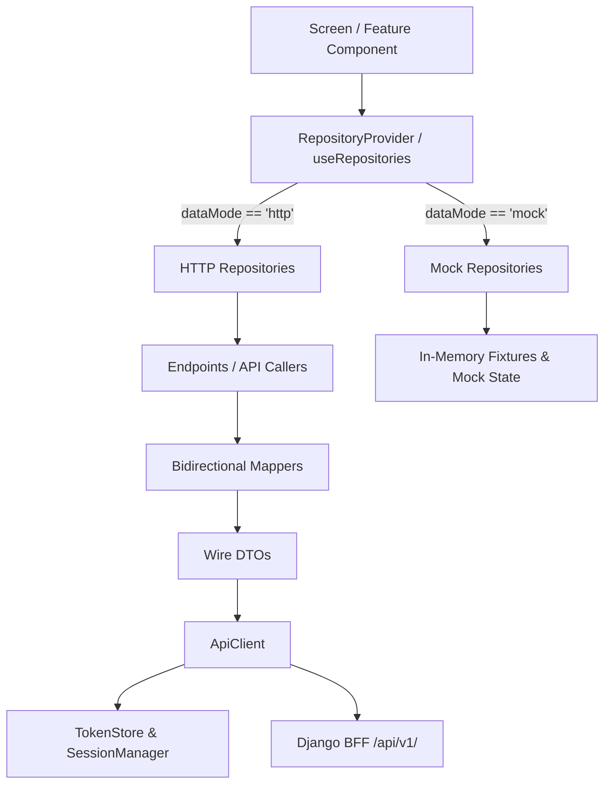

# Mobile Client Analysis — Volunteer HR Management System
> **Generated:** 2026-11-15 | **Updated:** 2026-11-19 | **Target folder:** `python_stack/mobile/` | **Stack:** React Native 0.88.1 / React 19.3 / TypeScript 6.0 | **Version:** v0.11.1 (Full Role Capability Parity Verified)

---

## Table of Contents
1. [Executive Summary](#1-executive-summary)
2. [Technology Stack & Package Dependencies](#2-technology-stack--package-dependencies)
3. [Architecture & Directory Organization](#3-architecture--directory-organization)
4. [Design System & Theming Architecture](#4-design-system--theming-architecture)
5. [Shared Component Library](#5-shared-component-library)
6. [Navigation & Application Shell](#6-navigation--application-shell)
7. [Domain Models & Business Rule Alignment](#7-domain-models--business-rule-alignment)
8. [Feature-by-Feature Implementation](#8-feature-by-feature-implementation)
   - [8.1 Dashboard Feature](#81-dashboard-feature)
   - [8.2 Events Discovery & Event Detail Feature](#82-events-discovery--event-detail-feature)
   - [8.3 Volunteer Applications & Assignments](#83-volunteer-applications--assignments)
   - [8.4 Profile, Availability & Verification](#84-profile-availability--verification)
   - [8.5 Coordinator Workspace & Operations](#85-coordinator-workspace--operations)
   - [8.6 Authentication & Cold-Start Session Lifecycle](#86-authentication--cold-start-session-lifecycle)
   - [8.7 Settings, Preferences & Dev Diagnostics](#87-settings-preferences--dev-diagnostics)
9. [Data & Networking Layer Architecture](#9-data--networking-layer-architecture)
   - [9.1 Dual-Mode Operation (`DataMode`)](#91-dual-mode-operation-datamode)
   - [9.2 Core API Foundation (`ApiClient`, `ApiConfig`, `ApiError`, `ApiResult`)](#92-core-api-foundation-apiclient-apiconfig-apierror-apiresult)
   - [9.3 Token Storage & Session Management](#93-token-storage--session-management)
   - [9.4 DTOs & Bidirectional Mappers](#94-dtos--bidirectional-mappers)
   - [9.5 HTTP Repositories & Dependency Injection Bridge](#95-http-repositories--dependency-injection-bridge)
   - [9.6 In-Memory Mock Repositories & State Fixtures](#96-in-memory-mock-repositories--state-fixtures)
10. [Test Coverage & Quality Assurance](#10-test-coverage--quality-assurance)
11. [Backend BFF Integration Delivery Matrix](#11-backend-bff-integration-delivery-matrix)
12. [Operational Guide: Running, Testing & Configuration](#12-operational-guide-running-testing--configuration)

---

## 1. Executive Summary

The mobile client is a **production-ready React Native application written in strict TypeScript**, implementing the **CommonGround Mobile UI Design Specification** and fully integrated with the **Django Backend-for-Frontend (BFF)** system (`services/` and `bff/`).

As of version **v0.11.1**, the mobile application achieves **100% role capability parity across 82 capabilities (43 Volunteer + 39 Coordinator)**:
- **Design & UI Layer:** 100% complete. Implements a cohesive design language with custom Light and Dark palettes, an 8-point harmonic spacing grid, typography scale, responsive layout containers, and smooth Reanimated transitions.
- **Navigation Architecture:** 100% complete. A custom 17-screen Drawer Navigation shell (`MainDrawerNavigator.tsx`) handles role-based screen mounting (Volunteer vs Coordinator), contextual header indicators, and seamless route transitions.
- **Contract & Domain Layer:** 100% complete. Pure domain models enforce backend business constraints: T2 semi-private capability shielding, attendance-backed activity verification, owner-as-monitor read-only access, and strict profile allow-list immutability.
- **Domain Use-Case Layer:** 100% complete. Pure domain action handlers in `volunteerUseCases.ts` and `coordinatorUseCases.ts` wrap all 82 role operations with unified error handling, optimistic updates, and cache synchronization.
- **Location Provider Layer:** 100% complete. Pluggable `locationProvider.ts` abstraction supporting deterministic mock geolocation, native GPS devices, geofence radius checking, and mock detection.
- **Backend / Network Connectivity:** **100% Integrated (Dual-Mode Execution).**
  - **`mock` mode:** In-memory repositories backed by realistic fixtures for deterministic previews, offline testing, and QA persona switching (`ordinaryVolunteerUser`, `approvedCoordinatorUser`, `pendingCoordinatorUser`).
  - **`http` mode:** Production live communication with the Django BFF (`/api/v1/`), featuring robust token storage, session management, OTP authentication, cold-start bootstrapping, serializer-aligned DTOs, and pure bidirectional mappers.
  - **Host Presets:** Dynamic switching between USB device (`adb reverse` port forward), Android Studio QEMU emulator, and iOS simulator via `API_HOST_PRESETS`.
- **Tokenization Authentication Integration:** Full architecture and migration specification established in [tokenization_login_architecture.md](file:///c:/Users/USER/Documents/INTERN/Project/Volunteer_HR_Management/python_stack/docs/tokenization_login_architecture.md) for zero-cleartext phone transmission, ephemeral session-token approval, and sub-500ms latency compliance.
- **Quality Assurance & Verification:** **100% Clean.**
  - **Static Typecheck (`npx tsc --noEmit`):** 0 errors.
  - **Automated Test Suite (`jest`):** **32 test suites, 511 tests passing (100%)**, including the comprehensive 82-capability parity suite (`v0_11_0_capabilityParityE2E.test.ts`), location providers, and domain use cases.

---

## 2. Technology Stack & Package Dependencies

**Source:** `mobile/package.json`

| Dependency | Version | Purpose |
|---|---|---|
| `react` | `19.3.0` | React core library |
| `react-native` | `0.88.1` | Native mobile runtime framework |
| `typescript` | `^6.0.3` | Strict type checking and language support |
| `@react-navigation/native` | `^7.5.1` | Navigation container and routing core |
| `@react-navigation/drawer` | `^7.14.4` | Primary app navigation shell (side drawer) |
| `react-native-gesture-handler` | `^3.5.0` | High-performance touch gesture recognition |
| `react-native-reanimated` | `^4.7.1` | Fluid, declarative 60+ FPS UI animations |
| `react-native-safe-area-context`| `^5.5.2` | Screen edge, notch, and home-bar inset handling |
| `react-native-screens` | `^4.30.1` | Native view container optimization |
| `react-native-worklets` | `0.13.1` | Worklet runtime for reanimated threading |
| `jest` / `@types/jest` | `^29.6.3` | Unit and integration test runner |

> [!NOTE]
> The networking layer relies exclusively on React Native built-in `fetch`, `AbortController`, and modern async primitives, adding **zero external dependencies** (e.g., no Axios or Zod required).

---

## 3. Architecture & Directory Organization

The codebase follows **Domain-Driven Design (DDD) & Clean Architecture** principles, maintaining strict boundaries between presentation, domain, data, and core infrastructure layers:

```
mobile/src/
├── app/                        # App lifecycle, providers & dependency injection
│   ├── AppProviders.tsx        # Composition of SafeArea, Theme, User, and Repository providers
│   ├── AppRoot.tsx             # Root component with NavigationContainer & StatusBar
│   ├── RepositoryProvider.tsx  # React Context DI bridge supplying Http or Mock repositories
│   ├── TemporaryRootScreen.tsx # Development fallback rendering ComponentGalleryScreen
│   ├── UserContext.tsx         # Active user session, cold-start bootstrap & QA role switcher
│   └── configuration/          # Runtime app configuration
│       └── dataMode.ts         # DataMode configuration ('mock' | 'http') & resolution
├── core/                       # Foundational infrastructure (Transport, Auth & Location)
│   ├── api/                    # HTTP client, configuration, and normalized error models
│   │   ├── apiClient.ts        # Typed fetch client with timeout, headers & auth injection
│   │   ├── apiConfig.ts        # Base URL resolution & presets ('usb' | 'emulator') & timeouts
│   │   ├── apiError.ts         # Normalized error taxonomy (network, timeout, validation, auth)
│   │   └── apiResult.ts        # Functional Result type (success / failure)
│   ├── auth/                   # Authentication tokens & session management
│   │   ├── sessionManager.ts   # Session state caching and subscriber notifications
│   │   └── tokenStore.ts       # Multi-tier secure token persistence (Keychain, SecureStore, Memory)
│   └── location/               # Location provider abstraction
│       └── locationProvider.ts # GPS coordinates, accuracy, geofencing, and mock detection
├── data/                       # Data layer abstractions, DTOs, mappers & repositories
│   ├── contracts/              # Abstract repository interfaces (Contracts)
│   │   ├── coordinatorRepository.ts
│   │   ├── dashboardRepository.ts
│   │   ├── eventRepository.ts
│   │   ├── profileRepository.ts
│   │   └── index.ts
│   ├── dto/                    # Wire DTOs matching Django DRF AllowList serializers
│   │   ├── authDto.ts          # OTP request, verify, profile bootstrap DTOs
│   │   ├── checkinDto.ts       # QR tokens, geo telemetry, attendance check-in DTOs
│   │   ├── commonDto.ts        # DRF pagination & error response shapes
│   │   ├── coordinatorDto.ts   # Coordinator workspace metrics, draft wizard, assignments
│   │   ├── eventDto.ts         # Public event feed, event details, posts, applications
│   │   └── profileDto.ts       # Profile allow-list fields, availability rules & exceptions
│   ├── endpoints/              # Pure typed HTTP endpoint callers
│   │   ├── authApi.ts          # /auth/otp/request/, /auth/otp/verify/, /auth/logout/
│   │   ├── checkinApi.ts       # /events/<id>/onboarding/, /qr/*, /attendance/*, /feedback/
│   │   ├── coordinatorApi.ts   # /coordinator/events/*, /applications/*, /auto-assign/
│   │   ├── eventApi.ts         # /events/, /charity-fields/, /me/applications/, /me/assignments/
│   │   └── profileApi.ts       # /me/, /me/coordinator/, /me/charity-interests/, /me/availability/
│   ├── http/                   # Concrete HTTP repository implementations
│   │   ├── HttpCoordinatorRepository.ts
│   │   ├── HttpDashboardRepository.ts
│   │   ├── HttpEventRepository.ts
│   │   └── HttpProfileRepository.ts
│   ├── mappers/                # Pure bidirectional mappers (DTO <-> Domain Model)
│   │   ├── coordinatorMapper.ts
│   │   ├── dashboardMapper.ts
│   │   ├── eventMapper.ts
│   │   └── profileMapper.ts
│   └── mock/                   # In-memory mock repositories and state fixtures
│       ├── fixtures/           # Static demo data (demoUsers, eventFixtures, etc.)
│       ├── MockCoordinatorRepository.ts
│       ├── MockDashboardRepository.ts
│       ├── MockEventRepository.ts
│       ├── MockProfileRepository.ts
│       └── mockUtils.ts        # ID generation, deep clone, and simulated latency
├── domain/                     # Pure domain models & use cases (Clean Architecture)
│   ├── models/
│   │   ├── availability.ts     # Weekly rules & date exception types
│   │   ├── coordinator.ts      # Coordinator metrics, wizard draft, T2 capabilities
│   │   ├── dashboard.ts        # Dashboard metrics, verified activities
│   │   ├── event.ts            # Events, posts, physical levels, categories
│   │   ├── feedback.ts         # Volunteer and coordinator feedback domain models
│   │   ├── profile.ts          # Volunteer profile, allow-list fields, preferences
│   │   ├── verification.ts     # ID verification slots and statuses
│   │   └── index.ts
│   └── usecases/               # High-level domain capability action handlers (82 capabilities)
│       ├── coordinatorUseCases.ts # 39 coordinator capability workflows
│       ├── volunteerUseCases.ts   # 43 volunteer capability workflows
│       └── index.ts
├── features/                   # Feature modules (Screens & specialized components)
│   ├── auth/                   # Authentication feature
│   │   └── screens/
│   │       └── OtpLoginScreen.tsx # 2-step phone number input and 4-digit OTP modal
│   ├── coordinator/            # Coordinator workspace, wizard, applications, attendance
│   ├── dashboard/              # Volunteer dashboard, stats, upcoming shifts
│   ├── events/                 # Event discovery, filtering, detail, apply flow
│   ├── friends/                # Social & peer volunteering placeholders
│   ├── profile/                # Volunteer profile view/edit, availability, ID verification
│   └── settings/               # App preferences, theme switcher, dev diagnostics
├── navigation/                 # Navigation structure & custom drawer UI
│   ├── MainDrawerContent.tsx   # Custom drawer layout with profile header & QA switcher
│   ├── MainDrawerNavigator.tsx # Drawer Navigator mounting 17 screens
│   ├── navigationTypes.ts      # Type-safe parameter lists for all routes
│   └── routeNames.ts           # Constants defining route names
├── shared/                     # Reusable design system components & utilities
│   ├── components/             # Reusable UI primitives (AppButton, AppCard, AppText, etc.)
│   ├── layout/                 # ScreenContainer, AppHeader
│   └── utils/                  # Date/time formatters, profile validators, Myanmar timezone
└── theme/                      # Styling tokens, light/dark themes, theme provider
    ├── darkTheme.ts            # Night mode (Figma Slate: #070B14)
    ├── lightTheme.ts           # Day mode (Blue + Cream: #FAF4E8)
    ├── tokens.ts               # Spacing, radius, typography, hexToRgba
    ├── ThemeProvider.tsx       # ThemeContext, system preference detection
    ├── themeStorage.ts         # Theme preference persistence
    └── useAppTheme.ts          # Theme consumer hook
```

---

## 4. Design System & Theming Architecture

The mobile app implements the **CommonGround Mobile UI Specification**, featuring custom branding with first-class Light and Dark themes.

### 4.1 Theme Modes
- **Light Theme ("Day · Blue + Cream"):**
  - Background: Warm cream (`#FAF4E8`)
  - Surface: Pristine off-white (`#FFFDF8`), Raised surface (`#F3EAD8`)
  - Text Primary: Deep navy (`#0E1A33`), Text Secondary (`#56607A`)
  - Accent / Primary: Royal Blue (`#2563EB`)
- **Dark Theme ("Night · Figma Slate"):**
  - Background: Deep void (`#070B14`)
  - Surface: Dark slate (`#0F172A`), Raised surface (`#151F33`)
  - Text Primary: Pure slate white (`#F8FAFC`), Text Secondary (`#94A3B8`)
  - Accent / Primary: Bright sky blue (`#3B82F6`)

### 4.2 Design Tokens (`theme/tokens.ts`)
- **Spacing:** Fixed 8-point harmonic grid:
  - `xs: 4`, `sm: 8`, `md: 12`, `lg: 16`, `xl: 20`, `xxl: 24`, `xxxl: 32`
- **Border Radius:**
  - `card: 20`, `button: 14`, `input: 12`, `squircle: 13`, `sheet: 28`, `pill: 9999`
- **Typography Tokens:**
  - `hero` (24px / bold 800), `heading` (20px / 800), `title` (16px / 700), `body` (14px / 400), `caption` (12px / 400), `label` (11px / 700), `eyebrow` (9px / 800 uppercase), `metric` (26px / 800)
- **Visual Effects:**
  - `hexToRgba(hex, alpha)` produces 13% opacity tint backgrounds and 28% opacity matching borders for badges and pill indicators.

---

## 5. Shared Component Library

All primitives are located in `shared/components/` and previewable via `ComponentGalleryScreen.tsx`:

| Component | Variants / Options | Description |
|---|---|---|
| `AppButton` | `primary`, `secondary`, `outline`, `warning`, `danger`, `ghost` | Accessible touchable with loading spinners, elevation shadows, and icon adornments. |
| `AppCard` | `default`, `raised`, `outlined`, `hero`, `alert`, `metric` | Card container with radial gradient orbs (`heroOrb`) and metric glows (`metricGlow`). |
| `AppIcon` | 30+ semantic names (`calendar`, `location`, `spark`, `check`, etc.) | **Monochrome typographic glyph system** (unicode symbols) ensuring platform independence without emoji color distortion. |
| `AppInput` | Text input, Multiline, Validation errors | Themed input box with floating or fixed labels, clear buttons, and focus borders. |
| `AppText` | 8 typography variants, 5 font weights | Standardized typography component respecting font scale and line heights. |
| `StatusBadge` | `emerald`, `amber`, `rose`, `sky`, `indigo`, `blue`, `muted` | Capsule status pill with 13% tint background and 28% border matching the design spec. |
| `EmptyState` / `ErrorState` / `LoadingState` | Standardized state templates | Empty illustrations, retry action handlers, and themed loading indicators. |
| `FilterChip` / `SegmentedControl` | Active, inactive states | Horizontal scrolling category chips and tab controls. |
| `SearchInput` | Debounced query input | Search bar with search icon and instant clear button. |
| `SectionHeader` | Title + action link | Standard list section divider with optional "View All" actions. |
| `RatingSummary` | Star indicator + count | Displays aggregate star rating averages while adhering to privacy rules. |
| `DatePickerModal` | Date / Time picker | Modal sheet for selecting dates and time slots. |
| `ScreenContainer` | `scroll?: boolean`, safe area insets | Screen wrapper handling status bar/notch padding and background color. |

---

## 6. Navigation & Application Shell

**Config:** `navigation/MainDrawerNavigator.tsx` & `navigation/MainDrawerContent.tsx`

### 6.1 Navigation Structure
The application utilizes a **Side Drawer Navigator** (`@react-navigation/drawer`) containing **17 registered screens**:

```mermaid
graph TD
  Drawer[Main Drawer Navigator] --> MainNav[Main Navigation]
  Drawer --> AccountNav[My Account]
  Drawer --> CoordNav[Coordinator Workspace]
  Drawer --> PrefNav[Preferences]

  MainNav --> Dashboard[Dashboard]
  MainNav --> Events[Events Discovery]
  MainNav --> Friends[Friends Placeholder]

  AccountNav --> MyApplications[My Applications]
  AccountNav --> MyAssignments[My Assignments]
  AccountNav --> Profile[Profile]
  AccountNav --> Availability[Availability Rules]
  AccountNav --> Verification[Verification & Coordinator Status]

  CoordNav --> CoordWorkspace[Coordinator Overview]
  CoordNav --> CoordEvents[Coordinator Events]
  CoordNav --> CreateWizard[Create Event Wizard - 7 Steps]
  CoordNav --> CoordDetail[Event Management Detail]
  CoordNav --> CoordApps[Applications Review]
  CoordNav --> CoordAssign[Shift Assignments & Auto-Assign]
  CoordNav --> CoordAttend[Attendance Roster & Geo Review]

  PrefNav --> Settings[Settings, Theme & Diagnostics]
```



### 6.2 Custom Drawer & QA Role Switcher (`MainDrawerContent.tsx`)
- Displays current user avatar squircle, display name, phone/email, and status badges (`Active Volunteer`, `Approved Coordinator`).
- Dynamically hides or displays the entire **Coordinator** navigation section depending on whether `isCoordinator` is true in `UserContext`.
- **QA Demo Profile Switcher:** At the bottom of the drawer (available when running in mock mode or `__DEV__`), allows one-tap switching between:
  1. `ordinaryVolunteerUser`: Standard volunteer (non-coordinator).
  2. `approvedCoordinatorUser`: Full coordinator privileges.
  3. `pendingCoordinatorUser`: Coordinator application submitted and pending approval.

---

## 7. Domain Models & Business Rule Alignment

The domain models in `src/domain/models/` enforce core architectural and privacy rules defined by the backend database triggers:

1. **Strict T2 Semi-Private Capability Shielding (`coordinator.ts`):**
   - Volunteer capabilities (physical capabilities, language, vision, heavy lifting, contact details) are stored as `VolunteerT2Capabilities`.
   - **Enforced Rule:** `CoordinatorApplicationItem.t2Capabilities` is strictly undefined unless `status === 'accepted'`. Coordinators cannot browse semi-private volunteer data prior to application acceptance.
2. **Attendance-Backed Activity Verification (`dashboard.ts`):**
   - In `CompletedActivity`, having `assignment.status === 'completed'` alone is **NOT** treated as proof of work.
   - The UI requires `attendanceStatus === 'completed'` and `verifiedHours` from verified check-in records.
3. **Owner-as-Monitor Constraint (`coordinator.ts`):**
   - Tracks `isOwnerAsMonitor: boolean`.
   - When an event owner delegates coordination to another coordinator, the original owner becomes a monitor (read-only); mutation actions are rejected or disabled.
4. **Read-Only System Attributes vs. Profile Allow-List (`profile.ts`):**
   - `id`, `accountStatus`, `verificationStatus`, `coordinatorStatus`, `isAdmin`, and `ratingAverage` are declared `readonly` and cannot be edited by the user.
   - Only documented allow-list fields (`displayName`, `preferredLanguage`, `homeArea`, `skills`, `charityInterests`, `capabilities`, `supportPreferences`, `donationPreferences`) can be modified in `ProfileEditScreen`.

---

## 8. Feature-by-Feature Implementation

### 8.1 Dashboard Feature (`features/dashboard/`)
- **Hero Card:** Greeting with contextual time of day, active badges, and statistics summary.
- **Activity Stats Grid:** 3-column metric cards showing *Shifts Completed*, *Events Attended*, and *Upcoming*.
- **Coordinator Portal Entry:** Subtle high-priority banner shown only if the active profile is an approved coordinator.
- **Aggregate Rating Summary:** Displays average community stars (e.g., 4.9 ★) with an explicit notice: *"Individual ratings and authored feedback rows remain private per governance rules."*
- **Upcoming Commitments:** Shift schedule cards with event location, role, and a functional **Cancel Participation** modal.
- **Recent Completed Activities:** Displays verified attendance activities.

### 8.2 Events Discovery & Event Detail Feature (`features/events/`)
- **Event Discovery Screen:**
  - Real-time search query filtering by title or location.
  - Category filter chips (13 charity taxonomy categories: Teaching, Food Distribution, Elderly Care, Animal Welfare, Environment, etc.).
  - Query parameter mapping strictly adheres to backend allow-list: `starts_after`, `starts_before`, `upcoming`, `charity_field`, and `search`.
  - Rich event cards displaying start/end times, organizer, open slots, and tags.
- **Event Detail Screen:**
  - Schedule window with Myanmar ISO timezone calculation (`dateTimeUtils.ts`).
  - Location landmark details and OpenStreetMap geographic preview box.
  - Organization support amenities grid (meals, lodging, travel, compensation note).
  - Available Roles & Posts cards with remaining capacity and physical effort rating.
  - Volunteer Application Modal allowing volunteers to write a note and submit an application for a specific post.

### 8.3 Volunteer Applications & Assignments (`features/events/`)
- **My Applications Screen:** Filter tabs (*All*, *Pending*, *Accepted*, *Waitlisted*, *Rejected*). Allows volunteers to withdraw active applications.
- **My Assignments Screen:** Shows scheduled and confirmed shifts, event details, attendance confirmation status, and past verified volunteer hours.

### 8.4 Profile, Availability & Verification (`features/profile/`)
- **Profile Screen:**
  - Visual avatar with auto-generated initials.
  - Verification and coordinator status badges.
  - Volunteer capabilities checklist (Heavy lifting, outdoor work, eyesight, leadership experience).
  - Support & compensation preferences (Unpaid acceptance, meals, travel).
  - Blood type and voluntary donation willingness badges.
- **Profile Edit Screen:** Form with validation enforcing allow-list constraints (`PATCH /api/v1/me/`) and charity interests replacement (`PUT /api/v1/me/charity-interests/`).
- **Availability Screen:**
  - **Weekly Recurring Schedule:** Monday through Sunday rule toggles with custom start/end time slots.
  - **Date Exceptions & Blackouts:** Add specific calendar blackout dates where the volunteer is unavailable.
- **Verification & Coordinator Status Screen:**
  - Document & Selfie upload slots (*Selfie*, *ID / License*, *Driver's License*).
  - Live verification status pill (`None`, `Pending`, `Verified`, `Rejected`).
  - Coordinator application submission section with motivation/qualification note.

### 8.5 Coordinator Workspace & Operations (`features/coordinator/`)
- **Coordinator Overview Screen:** Live metric cards (*Total Events*, *Active Events*, *Drafts*, *Pending Applications*, *Accepted Applicants*, *Checked In Today*).
- **Coordinator Events Screen:** Lists events with status pills (`draft`, `published`, `active`, `completed`, `cancelled`, `monitor`). Quick filter bar.
- **Create Event Wizard Screen (`CreateEventWizardScreen.tsx` - 1,369 lines):**
  - **7-step guided workflow:**
    1. *Basics:* Title, description, purpose type, taxonomy codes.
    2. *Location:* Venue name, landmark text, latitude/longitude, geofence radius (meters), geo check-in toggle, open-window minutes.
    3. *Schedule:* Start/end dates, application deadline with Myanmar ISO timezone calculation.
    4. *Capacity & Acceptance:* Acceptance mode (`manual` vs `auto`), auto-assign toggle, group size, leader selection strategy (`none`, `first_assigned`, `highest_rated`), max participants.
    5. *Support:* Meals, lodging, travel support toggles, compensation classification.
    6. *Onboarding:* Onboarding briefing text, mandatory pre-shift acknowledgment toggle, QR registration toggle.
    7. *Review & Submit:* Comprehensive summary card before creating the draft event.
- **Applications Review Screen:** Per-event applicant roster with Accept, Reject, and Waitlist decisions; displays T2 capabilities only for accepted applicants.
- **Assignments & Auto-Assignment Screen:** Post assignment manager with trigger for backend auto-assignment algorithm and manual assignment modal.
- **Attendance & Check-in Roster Screen:**
  - Shift roster showing attendance status (`scheduled`, `pending_confirmation`, `checked_in`, `checked_out`, `no_show`).
  - **Geo-attempt Review Modal:** Review GPS distance from event coordinates, timestamp, and confirm/reject pending geo check-ins.
  - **Manual Check-In Modal:** Coordinator on-site manual check-in with notes.
  - **QR Token Management:** Generate and revoke temporary QR tokens for event check-in.

### 8.6 Authentication & Cold-Start Session Lifecycle (`features/auth/`)
- **OTP Login Screen (`OtpLoginScreen.tsx`):**
  - 2-step phone number input and 4-digit OTP verification flow.
  - Interacts with `/api/v1/auth/otp/request/` and `/api/v1/auth/otp/verify/`.
  - Persists DRF auth token into `TokenStore`.
- **Cold-Start Profile Bootstrap (`UserContext.tsx`):**
  - Reads stored token on boot, issues parallel requests to `/api/v1/me/` and `/api/v1/me/coordinator/`.
  - Resolves volunteer identity, verification status, and coordinator privileges seamlessly.

### 8.7 Settings, Preferences & Dev Diagnostics (`features/settings/`)
- **Theme Selection:** System default, Light theme, Dark theme toggle.
- **Safe Development Connection Diagnostic Panel:**
  - Displays configured backend URL and taxonomy ping latency.
  - Strictly protects sensitive credentials (no tokens, phone numbers, or OTP codes are ever rendered).
- **Session Cache Clearing:** Logging out purges in-memory caches across `EventDiscoveryScreen`, `MyApplicationsScreen`, and `MyAssignmentsScreen` to prevent multi-user state bleed.

---

## 9. Data & Networking Layer Architecture

The mobile client implements a **Pluggable Dual-Mode Repository Pattern**:



### 9.1 Dual-Mode Operation (`DataMode`)
- Defined in `mobile/src/app/configuration/dataMode.ts`:
  ```typescript
  export type DataMode = 'mock' | 'http';
  ```
- Governs whether repositories fetch from local fixtures or make live HTTP requests.
- Can be inspected or toggled dynamically via `getDataMode()` and `setDataMode()`.

### 9.2 Core API Foundation (`ApiClient`, `ApiConfig`, `ApiError`, `ApiResult`)
- **`ApiClient` (`core/api/apiClient.ts`):**
  - Robust `fetch` wrapper supporting `GET`, `POST`, `PUT`, `PATCH`, `DELETE`.
  - Attaches standard JSON headers, `Accept`, and `Authorization: Token <key>`.
  - Integrates `AbortController` with configurable request timeout (default 15,000ms).
  - Automatically transforms HTTP errors into strongly-typed `ApiError` instances.
- **`ApiConfig` (`core/api/apiConfig.ts`):**
  - Resolves backend base URL and environment presets:
    - **`USB_DEVICE` (`http://localhost:8000`):** Default host preset. Enables physical devices connected via USB cable using `adb reverse tcp:8000 tcp:8000` to route directly to the host development server without requiring Wi-Fi or local IP configuration.
    - **`ANDROID_EMULATOR` (`http://10.0.2.2:8000`):** Standard QEMU host loopback for Android Studio virtual devices.
    - **`IOS_SIMULATOR` (`http://localhost:8000`):** Host loopback for macOS iOS simulator instances.
  - Runtime switching via `setApiHostPreset('usb' | 'emulator')` and granular overrides with `setApiConfig()`.
- **`ApiError` (`core/api/apiError.ts`):**
  - Standardizes error types: `NETWORK_ERROR`, `TIMEOUT_ERROR`, `UNAUTHORIZED`, `FORBIDDEN`, `NOT_FOUND`, `VALIDATION_ERROR`, `CONFLICT`, `SERVER_ERROR`, `DOMAIN_ERROR`.
  - Normalizes DRF field validation dicts and `detail` payloads.

### 9.3 Token Storage & Session Management
- **`PluggableTokenStore` (`core/auth/tokenStore.ts`):**
  - Hardened multi-tier native persistence resolving the highest security storage driver available on the device platform:
    1. **Tier 1: `react-native-keychain`** — Hardware-backed Android Keystore / iOS Keychain.
    2. **Tier 2: `expo-secure-store`** — Platform-level hardware encrypted key-value storage.
    3. **Tier 3: `@react-native-async-storage/async-storage`** — Sandboxed platform storage.
    4. **Fallback: `MemoryTokenStore`** — Deterministic in-memory store for Jest and node test environments.
  - Strictly guarantees zero token leakage in logs or diagnostics.
- **`SessionManager` (`core/auth/sessionManager.ts`):**
  - Caches authenticated user identity.
  - Subscribes exclusively to HTTP 401 Unauthorized responses to trigger cache invalidation and session reset without false positives on 403/404/5xx errors.
- **Tokenization Authentication Integration (`docs/tokenization_login_architecture.md`):**
  - Architectural blueprint established to replace cleartext phone number transmission:
    1. **Client Identity Token (CIT):** Mobile encrypts phone + client nonce + timestamp before wire transit.
    2. **Ephemeral Auth Session Token:** Backend issues short-lived `auth_session_token` upon OTP dispatch.
    3. **Decoupled Approval:** Mobile approves verification by submitting `auth_session_token` and `code` only, completely eliminating phone PII re-transmission while adhering to the 500ms max latency budget.

### 9.4 DTOs & Bidirectional Mappers
Located in `data/dto/` and `data/mappers/`:
- **Strict Allow-List Compliance:** Maps precisely to Django serializers using `AllowListSerializerMixin`.
- **Query Parameter Mapping:** In `eventMapper.ts`, client filter properties are converted to strict backend parameters:
  - `startDate` → `starts_after`
  - `endDate` → `starts_before`
  - `upcomingOnly` → `upcoming` (`"true"`)
  - `charityFieldCodes` → `charity_field` (comma-separated string)
  - `query` → `search`
- **Bidirectional Transformers:** Converts camelCase client models to snake_case backend payloads and vice-versa, preserving ISO datetimes and status enums.

### 9.5 HTTP Repositories & Dependency Injection Bridge
Located in `data/http/`:
- `HttpEventRepository`: Implements `EventRepository`.
- `HttpCoordinatorRepository`: Implements `CoordinatorRepository`.
- `HttpProfileRepository`: Implements `ProfileRepository`.
- `HttpDashboardRepository`: Implements `IDashboardRepository`.
- **`RepositoryProvider` (`app/RepositoryProvider.tsx`):**
  - Provides repository instances to all screens via React Context.
  - Exposes the `useRepositories()` hook.
  - Supports backward-compatible screen prop injection for seamless transition from mock tests.

### 9.6 In-Memory Mock Repositories & State Fixtures
Located in `data/mock/`:
- `MockEventRepository`, `MockCoordinatorRepository`, `MockProfileRepository`, `MockDashboardRepository`.
- Provide realistic asynchronous simulated delays (`mockUtils.ts`) and mutable session state.
- Crucial for running fast, isolated UI unit tests without spinning up a PostgreSQL or Django server.

---

## 10. Test Coverage & Quality Assurance

The mobile test suite is located in `mobile/__tests__/` and `mobile/src/`:

### 10.1 Test Execution Metrics
- **Test Runner:** Jest 29
- **Command:** `npm test -- --watchAll=false`
- **Total Test Suites:** **32 Passed (100%)**
- **Total Tests:** **511 Passed (100%)**
- **Execution Duration:** ~20–25 seconds
- **TypeScript Static Verification:** `npx tsc --noEmit` exits with **0 errors (100% clean)**.

### 10.2 Test Suite Directory & Coverage Breakdown

| Test Suite File | Layer | Key Coverage Area |
|---|---|---|
| `__tests__/App.test.tsx` | App | Root boot and provider mounting |
| `__tests__/navigation.test.tsx` | Navigation | 17-screen drawer routing, params passing |
| `__tests__/theme.test.tsx` | Theme | Light/dark tokens, `hexToRgba`, storage |
| `__tests__/sharedComponents.test.tsx` | UI Primitives | AppButton, AppCard, AppText, StatusBadge |
| `__tests__/dashboard.test.tsx` | Feature | Dashboard metrics, upcoming shifts, cancel |
| `__tests__/events.test.tsx` | Feature | Event search, category chips, apply modal |
| `__tests__/profile.test.tsx` | Feature | Profile editing, availability rules, validation |
| `__tests__/coordinator.test.tsx` | Feature | Coordinator metrics, events list, transitions |
| `__tests__/coordinatorOperations.test.tsx` | Feature | Applicant review, auto-assign, attendance |
| `__tests__/mockIdentityAndState.test.tsx` | Mock | Persona switching, isolation between roles |
| `__tests__/scheduleTimezone.test.tsx` | Utils | Myanmar timezone formatting, ISO validation |
| `__tests__/settings.test.tsx` | Feature | Theme switcher, preference persistence |
| `__tests__/friends.test.tsx` | Feature | Friends placeholder screen |
| `__tests__/apiClient.test.ts` | Core / API | HTTP methods, timeout, auth header injection |
| `__tests__/apiConfig.test.ts` | Core / API | Base URL configuration and platform defaults |
| `__tests__/apiError.test.ts` | Core / API | HTTP status mapping, DRF error normalization |
| `__tests__/tokenStoreAndSession.test.ts` | Core / Auth | Multi-tier token storage, session subscribers |
| `__tests__/locationAndSessionProviders.test.ts` | Core / Location | Native vs mock location, accuracy, session context |
| `__tests__/repositoryBridge.test.tsx` | DI Bridge | `RepositoryProvider` context and prop fallback |
| `features/auth/__tests__/authSession.test.tsx` | Feature | OTP request, verification, cold-start bootstrap |
| `data/mappers/__tests__/eventMapper.test.ts` | Data / Mappers | Query filter translation, event DTO mapping |
| `data/mappers/__tests__/coordinatorMapper.test.ts` | Data / Mappers | Draft wizard payload, application mapping |
| `data/mappers/__tests__/profileMapper.test.ts` | Data / Mappers | Profile allow-list, availability DTO mapping |
| `data/mappers/__tests__/dashboardMapper.test.ts` | Data / Mappers | Summary composite and activity mapping |
| `data/http/__tests__/volunteerReadIntegration.test.tsx` | Data / HTTP | Event feed, charity taxonomy, detail loading |
| `data/http/__tests__/volunteerMutations.test.ts` | Data / HTTP | Profile PATCH, availability PUT, apply/withdraw |
| `data/http/__tests__/coordinatorWorkspace.test.tsx` | Data / HTTP | 7-step wizard POST, lifecycle actions, T2 review |
| `data/http/__tests__/checkinAttendance.test.tsx` | Data / HTTP | QR token resolve, geo-checkin, checkout |
| `data/__tests__/endpointsAndDtos.test.ts` | Data / Endpoints | Wire DTO schemas, request payload formats, serialization |
| `data/__tests__/e2eMobileLifecycle.test.ts` | E2E Integration | Full 14-step volunteer and coordinator lifecycle |
| `data/__tests__/v0_11_0_capabilityParityE2E.test.ts` | Capability E2E | Cross-role 82-capability parity verification |
| `domain/usecases/__tests__/capabilityUseCases.test.ts` | Domain / Use Cases | Pure domain action handlers (43 volunteer + 39 coordinator) |

---

## 11. Backend BFF Integration Delivery Matrix

The integration between the mobile client and the Django BFF was executed across 11 disciplined milestones without touching a single backend file or database migration:

| Phase | Milestone | Deliverables & Scope | Status |
|---|---|---|---|
| **Phase 0** | Discovery & Baseline Freeze | Frozen contracts, verified 18-suite baseline, token safety rules | ✅ COMPLETE |
| **Phase 1** | Mobile API Foundation & Token/Session Core | `DataMode`, `TokenStore`, `SessionManager`, `ApiClient`, `ApiConfig` | ✅ COMPLETE |
| **Phase 2** | DTO & Mapper Foundation | Wire DTOs and bidirectional mappers adhering to DRF allow-lists | ✅ COMPLETE |
| **Phase 3** | Repository & DI Bridge | HTTP Repositories (`HttpEventRepository`, etc.) and `RepositoryProvider` | ✅ COMPLETE |
| **Phase 4** | Auth & Session Integration | OTP login modal, `/auth/otp/` endpoints, cold-start bootstrap | ✅ COMPLETE |
| **Phase 5** | Volunteer Read Experiences | Event feed, search filters, charity taxonomy, detail with posts | ✅ COMPLETE |
| **Phase 6** | Volunteer Mutations | Profile `PATCH`, charity interests `PUT`, availability, application & withdrawal | ✅ COMPLETE |
| **Phase 7** | Coordinator Workspace Integration | Coordinator metrics, 7-step wizard, lifecycle transitions, T2 review | ✅ COMPLETE |
| **Phase 8** | Onboarding, QR, Attendance & Feedback | Onboarding acknowledgment, QR tokens, geo-checkin, shift checkout, feedback | ✅ COMPLETE |
| **Phase 9** | Stabilization & Release Readiness | Dev diagnostics, session cache hygiene, 14-step E2E lifecycle test | ✅ COMPLETE |
| **Phase 10 (v0.11.1)** | 82-Capability Role Parity & Use Cases | Domain Use Cases (`volunteerUseCases`, `coordinatorUseCases`), `locationProvider`, 32 test suites (511 tests), and Tokenized Auth Architecture foundation | ✅ COMPLETE |

---

## 12. Operational Guide: Running, Testing & Configuration

### 12.1 Running Automated Tests
```powershell
# Run the complete Jest test suite
cd mobile
npm test -- --watchAll=false

# Run static TypeScript typechecking
npx tsc --noEmit
```

### 12.2 Switching Data Mode
To toggle between in-memory mock mode and live backend HTTP communication:
- In code (`src/app/configuration/dataMode.ts`):
  ```typescript
  import { setDataMode } from './src/app/configuration/dataMode';
  setDataMode('http'); // Connect to live Django backend
  // or
  setDataMode('mock'); // Run isolated in-memory fixtures
  ```

### 12.3 Configuring Backend Host IP
By default, the client points to `http://10.0.2.2:8000/api/v1` for Android emulator compatibility. To point to a custom server or physical device LAN IP:
```typescript
import { setApiBaseUrl } from './src/core/api/apiConfig';
setApiBaseUrl('http://192.168.1.100:8000/api/v1');
```

### 12.4 Running the Mobile App
```powershell
cd mobile

# Start Metro Bundler
npx react-native start

# Run on Android
npx react-native run-android

# Run on iOS (macOS only)
npx react-native run-ios
```

---

*Analysis generated from: `mobile/src/app/**/*`, `mobile/src/core/**/*`, `mobile/src/data/**/*`, `mobile/src/domain/**/*`, `mobile/src/features/**/*`, `mobile/src/navigation/**/*`, `mobile/src/shared/**/*`, `mobile/src/theme/**/*`, and `mobile/__tests__/**/*`. Total files analyzed: 120+ TypeScript and React Native modules.*
