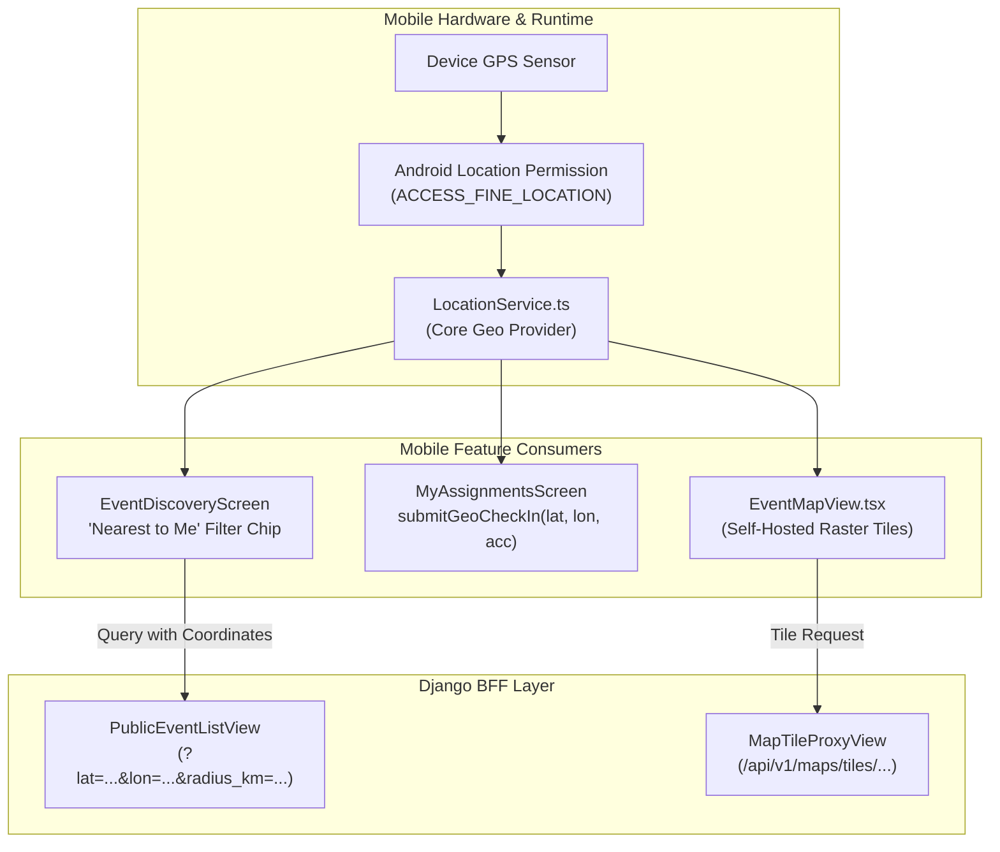

# Mobile Client ↔ Backend BFF ↔ PostgreSQL Database Connectivity Audit & Gap Analysis

> **Audit Date:** 2026-11-16  
> **Target Subsystems:** `mobile/` (React Native 0.88.1 / TypeScript 6.0), `backend/` (Django 5.1 / DRF 3.15), `postgres_sql/` (PostgreSQL 14+), `docs/`  
> **Audited Baseline:** Mobile v0.10.0 Dual-Mode, Backend v0.6.0 BFF API, Database v0.5.2 Unified Schema  
> **Scope:** Full-stack connectivity, operational lifecycle validation, coordinator & volunteer capability scanning, state synchronization, and map/geolocation readiness.

---

## 1. Executive Summary & Problem Formulation

In the Volunteer HR Management System (**CommonGround / Workshift**), the **Admin Portal Web UI** (`backend/admin_portal/`) operates with direct server-side access to Django ORM models and PostgreSQL stored procedures, resulting in verified, reliable database connectivity.

However, the **Mobile Client** (`mobile/`) communicates with the database through a multi-tier **Backend-for-Frontend (BFF)** architecture:
```
[React Native Client] ──HTTP REST──> [Django BFF Layer] ──Service Layer──> [PostgreSQL 14+ Engine]
```

### 1.1 Root Causes of Mobile Connection Downsides

Our comprehensive source-code and database audit across `postgres_sql/`, `backend/`, and `mobile/` reveals why mobile database connectivity feels imperfect and identifies the exact areas where functional disconnects exist:

1. **Default `DataMode` Isolation (`'mock'` vs `'http'`):**
   In [mobile/src/app/configuration/dataMode.ts](file:///C:/Users/USER/Documents/INTERN/Project/Volunteer_HR_Management/python_stack/mobile/src/app/configuration/dataMode.ts#L7), `currentDataMode` is initialized to `'mock'`. When users launch the app on an emulator or physical device, all data loads from in-memory mock fixtures unless manually toggled in Settings (`SettingsScreen.tsx`).
2. **Missing Event Declaration (Event Posts / Slots):**
   PostgreSQL enforces a strict database trigger [trg_events_before_update()](file:///C:/Users/USER/Documents/INTERN/Project/Volunteer_HR_Management/python_stack/postgres_sql/updated_volunteer_coordination_system_Database.sql#L2126-L2128):
   ```sql
   IF NEW.status = 'published' THEN
       IF NOT EXISTS (SELECT 1 FROM event_posts p WHERE p.event_id = NEW.id AND p.status <> 'closed') THEN
           RAISE EXCEPTION 'publish_requires_post: add at least one open post before publishing';
       END IF;
   ```
   While the backend exposes endpoints to create and manage posts (`POST /api/v1/coordinator/events/{id}/posts/`), the mobile app **completely lacks** any UI or repository contract to declare or create event posts. As a direct result, **no event created in mobile can ever be published**; attempting to publish results in a database exception.
3. **Absence of Event Modification UI:**
   There is no Edit Event screen in the mobile client. Once an event is created in `draft` status, its title, description, schedule, location, capacity, and perks cannot be updated from the mobile UI, even though `PATCH /api/v1/coordinator/events/{id}/` is implemented in the BFF.
4. **Volunteer Accepting UI State Desynchronization Bug:**
   In [HttpCoordinatorRepository.ts](file:///C:/Users/USER/Documents/INTERN/Project/Volunteer_HR_Management/python_stack/mobile/src/data/http/HttpCoordinatorRepository.ts#L379), `updateApplicationStatus()` calls the BFF but omits returning `data` in the result. In [CoordinatorApplicationsScreen.tsx](file:///C:/Users/USER/Documents/INTERN/Project/Volunteer_HR_Management/python_stack/mobile/src/features/coordinator/screens/CoordinatorApplicationsScreen.tsx#L143), the component checks `if (result.success && result.data)`. Because `result.data` is `undefined`, the application state in the UI is never updated until an explicit screen reload.
5. **Hardcoded Telemetry & Missing Device Geolocation Access:**
   In [MyAssignmentsScreen.tsx](file:///C:/Users/USER/Documents/INTERN/Project/Volunteer_HR_Management/python_stack/mobile/src/features/events/screens/MyAssignmentsScreen.tsx#L330-L334), geo check-in submits hardcoded coordinates `(16.805, 96.155, 15)` rather than querying device GPS. Furthermore, [AndroidManifest.xml](file:///C:/Users/USER/Documents/INTERN/Project/Volunteer_HR_Management/python_stack/mobile/android/app/src/main/AndroidManifest.xml) lacks `ACCESS_FINE_LOCATION` and `ACCESS_COARSE_LOCATION` permissions.
6. **Strict BFF Allow-List Blocking Geo Queries:**
   In [backend/services/query_service.py](file:///C:/Users/USER/Documents/INTERN/Project/Volunteer_HR_Management/python_stack/backend/services/query_service.py#L141-L142), `list_public_events()` strictly rejects any filter parameter not in its allowlist. Spatial query parameters (`latitude`, `longitude`, `radius_km`) currently trigger a `400 DomainError: Unsupported filter`.

---

## 2. Core Functional Flow Verification (User Focus Areas)

### 2.1 Event Loading
- **Database Engine:** `v_public_events` view filters `events` where `deleted_at IS NULL AND status IN ('published', 'active')`, aggregating `charity_fields` as `TEXT[]`.
- **Backend BFF:** [PublicEventListView](file:///C:/Users/USER/Documents/INTERN/Project/Volunteer_HR_Management/python_stack/backend/bff/volunteer/views.py#L63) (`GET /api/v1/events/`) and [PublicEventDetailView](file:///C:/Users/USER/Documents/INTERN/Project/Volunteer_HR_Management/python_stack/backend/bff/volunteer/views.py#L81) (`GET /api/v1/events/{id}/`).
- **Mobile Integration:**
  - `HttpEventRepository.getEvents()` formats query parameters: `search`, `charity_field`, `status`, `meals_provided`, `lodging_provided`, `travel_support_provided`, `starts_after`, `starts_before`.
  - [EventDiscoveryScreen.tsx](file:///C:/Users/USER/Documents/INTERN/Project/Volunteer_HR_Management/python_stack/mobile/src/features/events/screens/EventDiscoveryScreen.tsx) renders the feed with pull-to-refresh and scroll position caching.
  - [EventDetailScreen.tsx](file:///C:/Users/USER/Documents/INTERN/Project/Volunteer_HR_Management/python_stack/mobile/src/features/events/screens/EventDetailScreen.tsx) loads full details, posts, and current user application state.
- **Identified Downsides & Deficits:**
  - **No Geo-Proximity Filtering:** No distance calculation or sorting by proximity to user.
  - **Pagination Truncation:** Mobile only requests the first page (up to 20 events); infinite scroll pagination is not wired up.
  - **Draft/Cancelled Isolation:** Volunteers cannot see drafts (correct by design), but coordinators must switch to the Coordinator workspace to view their drafts.

### 2.2 Event Declaration (Posts, Roles, Capacity, Skills)
- **Database Engine:** `event_posts` table defines roles (`title`, `required_headcount`, `physical_level`, `required_skills`, `status`, `priority`).
  - Trigger `trg_01_posts_status` automatically transitions status between `'open'` and `'full'` based on assigned counts.
  - Trigger `trg_01_events_before_update` forbids publishing any event that has zero open posts.
- **Backend BFF:**
  - `CoordinatorEventPostsView` (`GET/POST /api/v1/coordinator/events/{id}/posts/`).
  - `EventPostDetailView` (`PATCH /api/v1/posts/{post_id}/`).
  - `EventPostCloseView` (`POST /api/v1/posts/{post_id}/close/`).
- **Mobile Integration:**
  - `coordinatorApi.getEventPosts()` exists and is used in detail views.
- **CRITICAL DEFICIT:**
  - `coordinatorApi.ts` has **no methods** to create, patch, or close posts.
  - `CoordinatorRepository` interface defines **no post management methods**.
  - `HttpCoordinatorRepository.ts` has **no post management implementations**.
  - Neither `CreateEventWizardScreen.tsx` nor `CoordinatorEventDetailScreen.tsx` provides an interface to declare or add roles.
  - **Operational Impact:** Coordinators creating an event on mobile are deadlocked; they cannot publish the event from mobile because they cannot add posts.

### 2.3 Event Creation
- **Database Engine:** `events` table inserts require `owner_id` to be an approved coordinator (`is_approved_coordinator()`). Initial status is forced to `'draft'` by `trg_events_before_insert()`.
- **Backend BFF:** [CoordinatorEventListCreateView](file:///C:/Users/USER/Documents/INTERN/Project/Volunteer_HR_Management/python_stack/backend/bff/coordinator/views.py#L65) (`POST /api/v1/coordinator/events/`).
- **Mobile Integration:**
  - [CreateEventWizardScreen.tsx](file:///C:/Users/USER/Documents/INTERN/Project/Volunteer_HR_Management/python_stack/mobile/src/features/coordinator/screens/CreateEventWizardScreen.tsx) provides a 7-step wizard:
    1. Basics (title, description, purpose, charity categories)
    2. Location (name, landmark, coordinates, geofence radius)
    3. Schedule (timezone-aware start, end, deadline in Myanmar Time `+06:30`)
    4. Capacity (acceptance mode, auto-assign flag, group size, max participants)
    5. Support (meals, lodging, travel, compensation)
    6. Onboarding (instructions, acknowledgment flag, QR registration)
    7. Review & Submit
  - Calls `HttpCoordinatorRepository.createDraftEvent()` -> `coordinatorApi.createEvent()`.
- **Identified Downsides & Deficits:**
  - Coordinates default to Yangon centre `'16.8000'`, `'96.1500'` without interactive map placement.
  - Post/slot definition is absent from the wizard (see 2.2).

### 2.4 Event Updates
- **Database Engine:** `events` table supports updates in `draft`, `published`, and `active` states. Once `completed` or `cancelled`, triggers lock all operational columns (frozen state).
- **Backend BFF:** [CoordinatorEventDetailView](file:///C:/Users/USER/Documents/INTERN/Project/Volunteer_HR_Management/python_stack/backend/bff/coordinator/views.py#L90) (`PATCH /api/v1/coordinator/events/{id}/`).
- **Mobile Integration:**
  - Status transitions are implemented in [CoordinatorEventDetailScreen.tsx](file:///C:/Users/USER/Documents/INTERN/Project/Volunteer_HR_Management/python_stack/mobile/src/features/coordinator/screens/CoordinatorEventDetailScreen.tsx#L90) via `transitionEventStatus()`:
    - Draft -> `published` (`POST /api/v1/events/{id}/publish/`)
    - Published -> `active` (`POST /api/v1/events/{id}/activate/`)
    - Active -> `completed` (`POST /api/v1/events/{id}/complete/`)
    - Any -> `cancelled` (`POST /api/v1/events/{id}/cancel/`)
- **CRITICAL DEFICIT:**
  - **No General Event Edit Screen:** There is no UI to edit event metadata (title, timing, location, capacity, or onboarding text) after creation.
  - `CoordinatorRepository` interface lacks an `updateEvent()` method, although `coordinatorApi.updateEvent()` is declared in the API transport layer.

### 2.5 Volunteer Accepting (Application Decision Flow)
- **Database Engine:** `event_applications` table.
  - Allowed status transitions: `pending -> accepted | rejected | waitlisted | withdrawn`.
  - When accepted, if `events.auto_assign_enabled = TRUE`, trigger `trg_50_applications_after` automatically inserts a row into `assignments` and `attendance`.
- **Backend BFF:**
  - `GET /api/v1/coordinator/events/{id}/applications/`
  - `POST /api/v1/coordinator/applications/{id}/accept/`
  - `POST /api/v1/coordinator/applications/{id}/reject/`
  - `POST /api/v1/coordinator/applications/{id}/waitlist/`
- **Mobile Integration:**
  - [CoordinatorApplicationsScreen.tsx](file:///C:/Users/USER/Documents/INTERN/Project/Volunteer_HR_Management/python_stack/mobile/src/features/coordinator/screens/CoordinatorApplicationsScreen.tsx) lists applications with status filter tabs (`all`, `pending`, `accepted`, `waitlisted`, `rejected`).
- **CRITICAL DEFICIT (Desynchronization Bug):**
  - In `HttpCoordinatorRepository.updateApplicationStatus()`:
    ```typescript
    const res = await coordinatorApi.decideApplication(applicationId, action, {}, this.client);
    if (!res.ok) return { success: false, message: res.error.message };
    return { success: true, message: `Application ${status} successfully` }; // Missing data!
    ```
  - In `CoordinatorApplicationsScreen.handleUpdateStatus()`:
    ```typescript
    const result = await repo.updateApplicationStatus(applicationId, targetStatus);
    if (result.success && result.data) { // Fails because result.data is undefined!
      setApplications(prev => prev.map(a => (a.id === applicationId ? result.data! : a)));
    }
    ```
  - **Result:** After tapping Accept or Reject, the network request succeeds in the database, but the mobile screen fails to update the row's status badge.

### 2.6 Volunteer and Event Synchronization
- **Database Invariants:**
  - PostgreSQL exclusion constraint: `EXCLUDE USING gist (user_id WITH =, tstzrange(...) WITH &&)` prevents overlapping shifts for any volunteer across concurrent events.
  - `v_event_post_capacity` dynamically syncs remaining slots: `remaining_headcount = required_headcount - assigned_count`.
  - Cancelling an event cascades status updates to all related applications (`expired`) and assignments (`cancelled`).
- **Mobile Synchronization Gaps:**
  - **Manual Assignment Parameters:** In [CoordinatorAssignmentsScreen.tsx](file:///C:/Users/USER/Documents/INTERN/Project/Volunteer_HR_Management/python_stack/mobile/src/features/coordinator/screens/CoordinatorAssignmentsScreen.tsx#L146), manual assignment hardcodes group code `'GRP-C'` and `isGroupLeader = false` without an assignment modal for post selection.
  - **Cross-Screen Cache Invalidation:** When a volunteer applies or withdraws on `EventDetailScreen`, the cache in `MyApplicationsScreen` remains stale unless manually refreshed with pull-to-refresh.

---

## 3. Comprehensive End-to-End Capability Scan

The tables below contrast every single database capability with its implementation in the Django BFF and the React Native Mobile Client.

### 3.1 Volunteer Capabilities Matrix

| # | Volunteer Activity | PostgreSQL Engine | Django BFF Endpoint | Mobile HTTP Repo & Transport | Mobile Screen & UI | Status & Verdict |
|---|---|---|---|---|---|---|
| **V-01** | OTP Request & Login | `auth_otp` rate-limit trigger (5/hr) | `POST /api/v1/auth/otp/request/` | `authApi.requestOtp()` | `OtpLoginScreen.tsx` | **Connected & Operational** |
| **V-02** | OTP Verification & Token | `verify_otp()` function, DRF token issuance | `POST /api/v1/auth/otp/verify/` | `authApi.verifyOtp()`, `TokenStore` | `OtpLoginScreen.tsx` | **Connected & Operational** |
| **V-03** | View Own Profile | `users`, `v_coordinator_stats` | `GET /api/v1/me/` | `HttpProfileRepository.getProfile()` | `ProfileScreen.tsx` | **Connected & Operational** |
| **V-04** | Update Profile & Skills | `users` allow-list update, normalized skills | `PATCH /api/v1/me/` | `HttpProfileRepository.updateProfile()` | `ProfileEditScreen.tsx` | **Connected & Operational** |
| **V-05** | Manage Charity Interests | `user_charity_interests` junction | `GET/PUT /api/v1/me/charity-interests/` | `profileApi.setCharityInterests()` | `ProfileEditScreen.tsx` | **Connected & Operational** |
| **V-06** | Weekly Availability Rules | `volunteer_availability_rules` | `GET/POST /api/v1/me/availability/rules/` | `HttpProfileRepository.addWeeklyRule()` | `AvailabilityScreen.tsx` | **Connected & Operational** |
| **V-07** | Availability Date Exceptions | `volunteer_availability_exceptions` | `POST/DELETE /api/v1/me/availability/exceptions/` | `HttpProfileRepository.addException()` | `AvailabilityScreen.tsx` | **Connected & Operational** |
| **V-08** | Verification Document Upload | `user_verification_images`, trigger | `POST /api/v1/me/verification-images/` | `HttpProfileRepository.uploadVerificationImage()` | `VerificationCoordinatorStatusScreen.tsx` | **UI Placeholder Only** (No Camera/File picker) |
| **V-09** | Apply for Coordinator Role | `coordinator_profiles` (`status='pending'`) | `POST /api/v1/me/coordinator/` | `HttpProfileRepository.submitCoordinatorApplication()` | `VerificationCoordinatorStatusScreen.tsx` | **Connected & Operational** |
| **V-10** | Browse & Search Events | `v_public_events` view | `GET /api/v1/events/` | `HttpEventRepository.getEvents()` | `EventDiscoveryScreen.tsx` | **Connected** (Missing Geo filter) |
| **V-11** | View Event Details & Posts | `events`, `event_posts`, capacity view | `GET /api/v1/events/{id}/` | `HttpEventRepository.getEventById()` | `EventDetailScreen.tsx` | **Connected & Operational** |
| **V-12** | Apply to Event Post | `event_applications`, auto-accept trigger | `POST /api/v1/events/{id}/apply/` | `HttpEventRepository.applyToPost()` | `EventDetailScreen.tsx` (Apply Modal) | **Connected & Operational** |
| **V-13** | View & Withdraw Applications | `event_applications` (`status='withdrawn'`) | `GET /api/v1/me/applications/`, `POST withdraw/` | `HttpEventRepository.withdrawApplication()` | `MyApplicationsScreen.tsx` | **Connected & Operational** |
| **V-14** | View Shifts & Confirm Shift | `assignments` (`status='confirmed'`) | `GET /api/v1/me/assignments/`, `POST confirm/` | `HttpEventRepository.confirmAssignment()` | `MyAssignmentsScreen.tsx` | **Connected & Operational** |
| **V-15** | Cancel Shift Participation | `assignments` (`status='cancelled'`), trigger | `POST /api/v1/assignments/{id}/cancel/` | `HttpEventRepository.cancelAssignment()` | `MyAssignmentsScreen.tsx` | **Connected & Operational** |
| **V-16** | Onboarding Briefing & Ack | `onboarding_acknowledgments`, versioning | `GET/POST /api/v1/events/{id}/onboarding/` | `HttpEventRepository.acknowledgeOnboarding()` | `MyAssignmentsScreen.tsx` (Modal) | **Connected & Operational** |
| **V-17** | Geofence Check-In | `attendance_geo_attempts`, Haversine calc | `POST /api/v1/attendance/geo-checkin/` | `HttpEventRepository.submitGeoCheckIn()` | `MyAssignmentsScreen.tsx` | **Partially Connected** (Hardcoded Coordinates) |
| **V-18** | QR Token Check-In | `qr_tokens` hash lookup, `attendance` | `POST /api/v1/qr/redeem/` | `HttpEventRepository.redeemQrToken()` | `MyAssignmentsScreen.tsx` (Manual text input) | **Connected** (No Camera Scanner) |
| **V-19** | Shift Checkout | `attendance` checkout timestamp | `POST /api/v1/attendance/{id}/checkout/` | `HttpEventRepository.checkOutAttendance()` | `MyAssignmentsScreen.tsx` | **Connected & Operational** |
| **V-20** | Submit Event Feedback | `feedback` table (direction `volunteer_to_event`)| `POST /api/v1/events/{id}/feedback/` | `HttpEventRepository.submitEventFeedback()` | `MyAssignmentsScreen.tsx` (Rating Modal) | **Connected & Operational** |
| **V-21** | Volunteer Dashboard & Stats | `assignments`, `attendance`, `feedback` | Aggregated `/me/assignments/`, `/me/attendance/` | `HttpDashboardRepository.getDashboardSummary()`| `DashboardScreen.tsx` | **Connected & Operational** |

---

### 3.2 Coordinator Capabilities Matrix

| # | Coordinator Activity | PostgreSQL Engine | Django BFF Endpoint | Mobile HTTP Repo & Transport | Mobile Screen & UI | Status & Verdict |
|---|---|---|---|---|---|---|
| **C-01** | Coordinator Dashboard Metrics | `v_event_summary`, `v_coordinator_stats` | `GET /api/v1/coordinator/events/{id}/summary/` | `HttpCoordinatorRepository.getOverviewMetrics()` | `CoordinatorOverviewScreen.tsx` | **Connected & Operational** |
| **C-02** | View Managed Events List | `events` where `current_coordinator_id = user` | `GET /api/v1/coordinator/events/` | `HttpCoordinatorRepository.getMyEvents()` | `CoordinatorEventsScreen.tsx` | **Connected & Operational** |
| **C-03** | Create Draft Event | `events` insert (`status='draft'`) | `POST /api/v1/coordinator/events/` | `HttpCoordinatorRepository.createDraftEvent()` | `CreateEventWizardScreen.tsx` | **Connected** (No post creation) |
| **C-04** | Declare Roles / Posts | `event_posts` table (headcount, skills, level) | `POST /api/v1/coordinator/events/{id}/posts/` | **Missing in Repo & Transport** | **Missing in Mobile UI** | **BLOCKING GAP** (Prevents Publishing) |
| **C-05** | Edit Event Details | `events` update (when not frozen) | `PATCH /api/v1/coordinator/events/{id}/` | Declared in `coordinatorApi`, missing in Repo | **Missing in Mobile UI** | **GAP** (No Edit Screen) |
| **C-06** | Publish Draft Event | `events.status = 'published'` (Trigger check) | `POST /api/v1/events/{id}/publish/` | `HttpCoordinatorRepository.transitionEventStatus()`| `CoordinatorEventDetailScreen.tsx` | **Connected** (Fails if 0 posts) |
| **C-07** | Activate Event (Shift Live) | `events.status = 'active'` | `POST /api/v1/events/{id}/activate/` | `HttpCoordinatorRepository.transitionEventStatus()`| `CoordinatorEventDetailScreen.tsx` | **Connected & Operational** |
| **C-08** | Complete Event | `events.status = 'completed'` (Cascades attendance) | `POST /api/v1/events/{id}/complete/` | `HttpCoordinatorRepository.transitionEventStatus()`| `CoordinatorEventDetailScreen.tsx` | **Connected & Operational** |
| **C-09** | Cancel Event | `events.status = 'cancelled'` (Cascades applications)| `POST /api/v1/events/{id}/cancel/` | `HttpCoordinatorRepository.transitionEventStatus()`| `CoordinatorEventDetailScreen.tsx` | **Connected & Operational** |
| **C-10** | Handover Event Coordination | `change_event_coordinator()`, audit history | `POST /api/v1/events/{id}/handover/` | `HttpCoordinatorRepository.handoverEvent()` | **No UI Action Button** | **Transport Ready, Missing UI** |
| **C-11** | Retake Event Coordination | Owner reverts coordinator assignment | `POST /api/v1/events/{id}/retake/` | `HttpCoordinatorRepository.retakeEvent()` | **No UI Action Button** | **Transport Ready, Missing UI** |
| **C-12** | Review Applications | `event_applications`, volunteer profile check | `GET /api/v1/coordinator/events/{id}/applications/` | `HttpCoordinatorRepository.getApplications()` | `CoordinatorApplicationsScreen.tsx` | **Connected & Operational** |
| **C-13** | Accept / Reject Applicant | `event_applications` decision triggers | `POST /api/v1/coordinator/applications/{id}/accept/`| `HttpCoordinatorRepository.updateApplicationStatus()`| `CoordinatorApplicationsScreen.tsx` | **BUG: UI Fails to Update Card** |
| **C-14** | Auto-Assign Volunteers | `run_auto_assignment()` stored function | `POST /api/v1/coordinator/events/{id}/auto-assign/` | `HttpCoordinatorRepository.runAutoAssignment()` | `CoordinatorAssignmentsScreen.tsx` | **Connected & Operational** |
| **C-15** | Manual Assign Volunteer | `assign_manually()` stored function | `POST /api/v1/coordinator/events/{id}/manual-assign/`| `HttpCoordinatorRepository.assignVolunteerManually()`| `CoordinatorAssignmentsScreen.tsx` | **Connected** (Hardcoded Group Code) |
| **C-16** | View Assignments & Unassigned | `assignments`, `v_accepted_unassigned` view | `GET /coordinator/events/{id}/assignments/` | `HttpCoordinatorRepository.getAssignments()` | `CoordinatorAssignmentsScreen.tsx` | **Connected & Operational** |
| **C-17** | Attendance Roster Board | `attendance` table joined with users | `GET /coordinator/events/{id}/attendance/` | `HttpCoordinatorRepository.getAttendanceRoster()` | `CoordinatorAttendanceScreen.tsx` | **Connected & Operational** |
| **C-18** | Confirm / Reject Geo Check-In | `confirm_attendance()`, `reject_attendance()` | `POST /coordinator/attendance/{id}/confirm/` | `HttpCoordinatorRepository.confirmGeoAttendance()` | `CoordinatorAttendanceScreen.tsx` | **Connected & Operational** |
| **C-19** | Manual Volunteer Check-In | `record_manual_checkin()` function | `POST /api/v1/attendance/manual-checkin/` | `HttpCoordinatorRepository.manualCheckIn()` | `CoordinatorAttendanceScreen.tsx` | **Connected & Operational** |
| **C-20** | Generate Coordinator QR Token | `qr_tokens` table insert (hashed token) | `POST /coordinator/events/{id}/qr-tokens/` | `HttpCoordinatorRepository.createQrToken()` | **No UI Generator Modal** | **Transport Ready, Missing UI** |
| **C-21** | Revoke QR Token | `qr_tokens.revoked_at = now()` | `POST /coordinator/qr-tokens/{id}/revoke/` | `HttpCoordinatorRepository.revokeQrToken()` | **No UI Action Button** | **Transport Ready, Missing UI** |
| **C-22** | View Coordinator Feedback | `feedback` summary directed to coordinator | `GET /api/v1/coordinator/feedback/` | Missing in Coordinator Repo | **Missing in Mobile UI** | **BFF Ready, Missing UI** |

---

## 4. Map & Geo-Coordination Phase Preparation

As instructed, the interactive mapping engine and coordinate tracking will be fully debugged in a subsequent phase. However, our audit analyzed the architectural space and identified required prerequisites.

### 4.1 Current System State
1. **PostgreSQL Database:**
   - Stores `latitude`, `longitude`, `geo_radius_m` (20m to 5,000m), and `geo_checkin_enabled` on `events`.
   - Function `haversine_distance_m(lat1, lon1, lat2, lon2)` calculates distances with sub-meter precision.
   - Fraud prevention logs GPS fixes to `attendance_geo_attempts`, rejecting fixes older than 60s, fixes with accuracy > 100m, or mock location provider flags.
2. **Backend & Tile Server:**
   - Self-hosted OpenStreetMap tile proxy implemented in [backend/admin_portal/map_views.py](file:///C:/Users/USER/Documents/INTERN/Project/Volunteer_HR_Management/python_stack/backend/admin_portal/map_views.py):
     - `GET /api/v1/maps/catalog/`: Lists available offline region bounding boxes.
     - `GET /api/v1/maps/tiles/{z}/{x}/{y}.png`: Streams PNG map tiles.
     - `GET /api/v1/maps/regions/{region_code}/download/`: Bundles region tiles for offline sync.
3. **Mobile Client Limitations:**
   - **Hardcoded Coordinates:** [MyAssignmentsScreen.tsx](file:///C:/Users/USER/Documents/INTERN/Project/Volunteer_HR_Management/python_stack/mobile/src/features/events/screens/MyAssignmentsScreen.tsx#L330-L334) hardcodes Yangon coordinates `(16.805, 96.155, 15)`.
   - **Missing Permissions:** [AndroidManifest.xml](file:///C:/Users/USER/Documents/INTERN/Project/Volunteer_HR_Management/python_stack/mobile/android/app/src/main/AndroidManifest.xml) does not declare location permissions.
   - **No Spatial Querying in BFF:** `query_service.list_public_events()` raises `400 DomainError` if `lat`, `lng`, or `radius_km` are passed.

### 4.2 Structural Space Reservation Architecture
To cleanly integrate device location and nearest-event filtering without breaking existing contracts:



1. **Native Permissions:** Add location permissions to `mobile/android/app/src/main/AndroidManifest.xml`:
   ```xml
   <uses-permission android:name="android.permission.ACCESS_FINE_LOCATION" />
   <uses-permission android:name="android.permission.ACCESS_COARSE_LOCATION" />
   ```
2. **Core Location Provider:** Create `mobile/src/core/location/locationService.ts` to encapsulate native geolocation checks with graceful fallback to location permission requests.
3. **BFF Spatial Query Support:** Extend `backend/services/query_service.py` to allow optional `lat`, `lon`, and `radius_km` parameters, calculating distances via PostgreSQL `haversine_distance_m()` and ordering by proximity.

---

## 5. Prioritized Action Plan & Remediation Roadmap

Based on this audit, here is the phased resolution plan to achieve complete database parity on the mobile side:

### Priority 1: Critical Bug Fixes & Operational Unblockers
1. **Fix Application Decision UI Bug:**
   Update `HttpCoordinatorRepository.updateApplicationStatus()` to return `{ success: true, message: ..., data: updatedItem }` so `CoordinatorApplicationsScreen` updates immediately upon accepting/rejecting applicants.
2. **Add Post Declaration Interface:**
   - Add `createPost(eventId, postData)`, `updatePost(postId, data)`, and `closePost(postId)` to `coordinatorApi.ts` and `CoordinatorRepository`.
   - Mount a "Role & Post Management" section in `CoordinatorEventDetailScreen.tsx` with an "Add Role / Post" modal.
   - **Impact:** Unblocks the `publish_requires_post` database constraint, allowing coordinators to publish events created on mobile.
3. **Configurable Default Data Mode:**
   Allow setting default `DataMode = 'http'` via environment variable or build configuration so production APK builds do not boot into `'mock'` mode by default.

### Priority 2: Event Update & Coordination Polish
4. **Implement Event Metadata Edit Screen:**
   - Add `updateEvent(eventId, draft)` to `CoordinatorRepository`.
   - Provide an "Edit Event" modal or screen in `features/coordinator/` allowing modifications to title, schedule, capacity, and onboarding text.
5. **Dynamic Manual Assignment Picker:**
   Replace the hardcoded `'GRP-C'` manual assignment in `CoordinatorAssignmentsScreen.tsx` with a post and group selector dialog.
6. **Coordinator QR Token Generator UI:**
   Wire `createQrToken()` to a generator modal in `CoordinatorAttendanceScreen.tsx`, displaying the generated token string for volunteer walk-ins and check-ins.

### Priority 3: Geolocation & Map Coordination (Future Phase)
7. **Device GPS Telemetry:**
   Wire native GPS reading into `MyAssignmentsScreen.handleSubmitGeoCheckIn()` to replace hardcoded `(16.805, 96.155)`.
8. **Nearest Event Filtering:**
   Add spatial query parameter handling to `query_service.list_public_events()` and wire the "Nearest" filter chip on `EventDiscoveryScreen.tsx`.
9. **Map Tile Component:**
   Build a custom raster tile map component connecting to `/api/v1/maps/tiles/{z}/{x}/{y}.png`.

---

## 6. Document Metadata & Verification Reference

- **Generated For:** Volunteer HR Management Project Documentation Repository
- **Cross-Referenced Source Files:**
  - Database: [postgres_sql/updated_volunteer_coordination_system_Database.sql](file:///C:/Users/USER/Documents/INTERN/Project/Volunteer_HR_Management/python_stack/postgres_sql/updated_volunteer_coordination_system_Database.sql)
  - Backend Services: [backend/services/event_service.py](file:///C:/Users/USER/Documents/INTERN/Project/Volunteer_HR_Management/python_stack/backend/services/event_service.py), [backend/services/assignment_service.py](file:///C:/Users/USER/Documents/INTERN/Project/Volunteer_HR_Management/python_stack/backend/services/assignment_service.py), [backend/services/query_service.py](file:///C:/Users/USER/Documents/INTERN/Project/Volunteer_HR_Management/python_stack/backend/services/query_service.py)
  - Backend BFF: [backend/bff/coordinator/views.py](file:///C:/Users/USER/Documents/INTERN/Project/Volunteer_HR_Management/python_stack/backend/bff/coordinator/views.py), [backend/bff/volunteer/views.py](file:///C:/Users/USER/Documents/INTERN/Project/Volunteer_HR_Management/python_stack/backend/bff/volunteer/views.py), [backend/bff/checkin/views.py](file:///C:/Users/USER/Documents/INTERN/Project/Volunteer_HR_Management/python_stack/backend/bff/checkin/views.py)
  - Mobile Data Layer: [mobile/src/data/http/HttpCoordinatorRepository.ts](file:///C:/Users/USER/Documents/INTERN/Project/Volunteer_HR_Management/python_stack/mobile/src/data/http/HttpCoordinatorRepository.ts), [mobile/src/data/http/HttpEventRepository.ts](file:///C:/Users/USER/Documents/INTERN/Project/Volunteer_HR_Management/python_stack/mobile/src/data/http/HttpEventRepository.ts), [mobile/src/data/endpoints/coordinatorApi.ts](file:///C:/Users/USER/Documents/INTERN/Project/Volunteer_HR_Management/python_stack/mobile/src/data/endpoints/coordinatorApi.ts)
  - Mobile Screens: [CoordinatorEventDetailScreen.tsx](file:///C:/Users/USER/Documents/INTERN/Project/Volunteer_HR_Management/python_stack/mobile/src/features/coordinator/screens/CoordinatorEventDetailScreen.tsx), [CoordinatorApplicationsScreen.tsx](file:///C:/Users/USER/Documents/INTERN/Project/Volunteer_HR_Management/python_stack/mobile/src/features/coordinator/screens/CoordinatorApplicationsScreen.tsx), [CoordinatorAssignmentsScreen.tsx](file:///C:/Users/USER/Documents/INTERN/Project/Volunteer_HR_Management/python_stack/mobile/src/features/coordinator/screens/CoordinatorAssignmentsScreen.tsx), [MyAssignmentsScreen.tsx](file:///C:/Users/USER/Documents/INTERN/Project/Volunteer_HR_Management/python_stack/mobile/src/features/events/screens/MyAssignmentsScreen.tsx)
