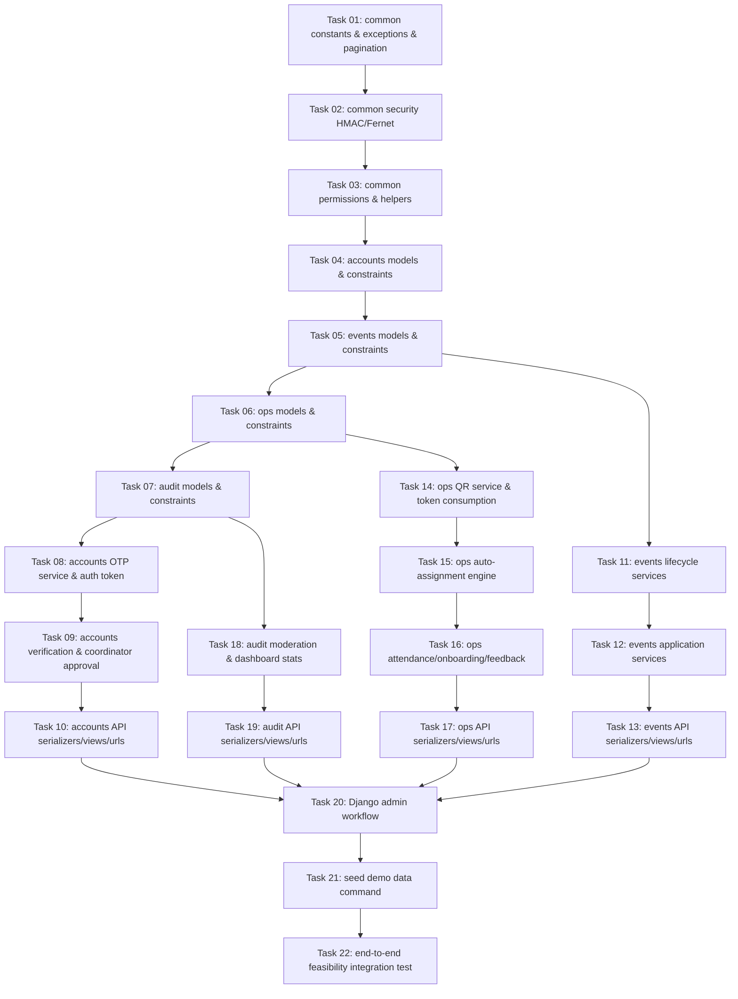

# MASTER IMPLEMENTATION PLAN & GEMINI FLASH EXECUTION KIT
**Project:** Volunteer Coordination System (PEC HR) v0.5  
**Role:** Principal Software Architect  
**Target Execution Model:** Gemini Flash (Optimized for zero hallucinations, strict contract adherence, test-driven validation)

---

## 1. Architectural Synthesis & Guardrails

Analysis of the 19 reference documents (`CODING_REFERENCE_v0_5.md`, `CONTRACT.txt`, `MASTER_RULES.txt`, `Tasks Order.txt`, `module order.txt`, `service contracts reference.txt`, `constraint reference.txt`, `api surface reference.txt`, etc.) establishes the non-negotiable architectural baseline:

1. **Service Layer Isolation**: Zero business logic in views or serializers. Serializers validate input schema; views invoke exactly one service function; all mutation and business domain rules reside in `apps/<app>/services.py`.
2. **Transactional State Machines & Auditing**: Every state-changing service function wraps operations in `transaction.atomic()`, performs explicit permission verification (`apps.common.permissions`), updates audit records (`apps.audit.services.log_action`), and forbids generic status updates (`PATCH` on `status` is rejected).
3. **Django 5.1+ Database Constraints**: Enforce PostgreSQL check constraints exclusively using `models.CheckConstraint(condition=...)` and `models.UniqueConstraint(condition=...)`. `CheckConstraint(check=...)` is deprecated and strictly forbidden.
4. **Security & Privacy**:
   - Phone numbers: HMAC-SHA256 (`phone_hash`) for identity queries, Fernet encryption (`phone_enc`) for storage. Never exposed via plain text.
   - OTP codes & QR tokens: Store only cryptographic hashes. Single-use raw tokens returned exactly once upon creation.
   - Verification uploads: Open with Pillow, strip EXIF, transcode to JPEG, compute SHA-256, store in private storage (`VERIFICATION_MEDIA_ROOT`), never exposed directly.
5. **Standardized Domain Exceptions**: Service failures raise subclasses of `apps.common.exceptions.DomainError`. All error responses format as:
   ```json
   {
     "error": {
       "code": "capacity_full",
       "message": "No remaining capacity."
     }
   }
   ```
6. **Gemini Flash Context Management**:
   - Scope limited to **1 task / max 2 files + 1 test file** per turn.
   - Each prompt contains: (1) Master Rules Header, (2) Target File Reference, (3) Expected Tests, (4) Contract Definition.
   - Max 2 repair loops upon test failure before escalation.

---

## 2. Dependency Graph & Step-by-Step Task Breakdown

The 22 tasks ordered by foundational dependencies:



---

## 3. Gemini Flash Master Execution Prompt Kit

Provide these exact prompts sequentially to the Gemini Flash model.

---

### Universal Gemini Flash Master Prompt Header
*(Include this header at the beginning of every prompt sent to Gemini Flash)*

```text
ROLE: Principal Django/DRF Engineer.
PROJECT: Volunteer Coordination System v0.5 (Online-only, PostgreSQL, Django 5.1+, DRF).
CANONICAL REFERENCES: CONTRACT.md, MASTER_RULES.md, CODING_REFERENCE_v0_5.md.

HARD RULES:
1. Business logic belongs strictly in apps/<app>/services.py. Serializers and Views must remain thin.
2. Every state mutation must run inside @transaction.atomic(), re-verify permissions via apps.common.permissions, and record logs via apps.audit.services.log_action.
3. Import all status constants from apps.common.constants. Never use raw status strings.
4. Raise DomainError subclasses from apps.common.exceptions only. Never return ad-hoc error dicts.
5. All constraints must use models.CheckConstraint(condition=...) and models.UniqueConstraint(condition=...). Never use check=...
6. Never store raw OTPs, raw QR tokens, or raw phone numbers.
7. Return full, complete files only. No diffs, no ellipses, no '# ... rest unchanged'.

OUTPUT FORMAT:
### path/to/file.py
```python
<complete code>
```
```

---

### Task 01: Common Foundation (Constants, Exceptions, Pagination)
- **Reference Files:** `doc/code reference file.txt`, `doc/error response format.txt`, `doc/CONTRACT.txt`
- **Files to Touch:**
  - `apps/common/constants.py`
  - `apps/common/exceptions.py`
  - `apps/common/pagination.py`
  - `apps/common/tests/test_foundation.py`

**Gemini Flash Prompt:**
```text
TASK 01: Common Constants, Exceptions, and Pagination
TOUCH: apps/common/constants.py, apps/common/exceptions.py, apps/common/pagination.py, apps/common/tests/test_foundation.py

REQUIREMENTS:
1. apps/common/constants.py:
   - Account statuses: active, blocked, closed
   - Coordinator statuses: pending, approved, suspended, revoked
   - Event statuses: draft, published, active, completed, cancelled
   - Application statuses: pending, accepted, waitlisted, rejected, withdrawn, expired
   - Assignment statuses: assigned, confirmed, completed, cancelled
   - Attendance statuses: expected, checked_in, absent, completed
   - QR purposes: walkin_registration, checkin, join_event
   - Feedback directions: coordinator_to_volunteer, volunteer_to_event, volunteer_to_coordinator
   - Verification statuses: none, pending, verified, rejected
   - Image types: mock_selfie, id_license, driver_license
   - Active tuples: ACTIVE_APPLICATION_STATUSES, ACTIVE_ASSIGNMENT_STATUSES, EVENT_VISIBLE_STATUSES
   - OTP_MAX_ATTEMPTS = 5, OTP_TTL_SECONDS = 300, QR_DEFAULT_TTL_MINUTES = 240

2. apps/common/exceptions.py:
   - Base DomainError(code, message, http_status)
   - Subclasses: PermissionDeniedError (403), AccountBlockedError (403), AccountClosedError (403), InvalidStateError (409), CapacityFullError (409), OnboardingRequiredError (409), ApplicationNotAllowedError (400), QrTokenInvalidError (400), NotFoundError (404), InvalidOtpError (400), TooManyAttemptsError (429), VerificationRequiredError (409)
   - domain_exception_handler(exc, context) returning {"error": {"code": exc.code, "message": exc.message}}

3. apps/common/pagination.py:
   - StandardPagination(PageNumberPagination) with page_size=20, page_size_query_param="page_size", max_page_size=100

TESTS TO WRITE (apps/common/tests/test_foundation.py):
- test_domain_exception_handler_formats_payload_correctly
- test_constants_tuples_membership
- test_pagination_defaults
```

---

### Task 02: Common Security (HMAC, Encryption, Tokens)
- **Reference Files:** `doc/code reference file.txt`, `doc/CONTRACT.txt`
- **Files to Touch:**
  - `apps/common/security.py`
  - `apps/common/tests/test_security.py`

**Gemini Flash Prompt:**
```text
TASK 02: Cryptographic Security Utilities
TOUCH: apps/common/security.py, apps/common/tests/test_security.py

REQUIREMENTS:
1. apps/common/security.py:
   - normalize_phone(raw_phone: str) -> str: leading + preserved, all other non-digits removed.
   - compute_phone_hash(raw_phone: str) -> str: HMAC-SHA256 with settings.PHONE_HASH_HMAC_SECRET.
   - encrypt_phone(raw_phone: str) -> str: Fernet encryption derived from SHA-256 of PHONE_HASH_HMAC_SECRET.
   - decrypt_phone(encrypted_phone: str) -> str: Decrypt Fernet token.
   - generate_otp_code() -> str: 6-digit zero-padded cryptographic random string.
   - hash_otp(raw_code: str) -> str: HMAC-SHA256 with PHONE_HASH_HMAC_SECRET.
   - generate_raw_token() -> str: secrets.token_urlsafe(32).
   - hash_token(raw_token: str) -> str: SHA-256 hex digest.

TESTS TO WRITE (apps/common/tests/test_security.py):
- test_phone_hash_is_deterministic
- test_phone_normalization_formats
- test_encrypt_decrypt_phone_roundtrip
- test_raw_token_does_not_equal_hash
- test_hash_otp_deterministic
```

---

### Task 03: Common Permissions & Guards
- **Reference Files:** `doc/code reference file.txt`, `doc/CONTRACT.txt`
- **Files to Touch:**
  - `apps/common/permissions.py`
  - `apps/common/tests/test_permissions.py`

**Gemini Flash Prompt:**
```text
TASK 03: Common Permissions and Guard Functions
TOUCH: apps/common/permissions.py, apps/common/tests/test_permissions.py

REQUIREMENTS:
1. apps/common/permissions.py:
   - is_admin(user) -> bool
   - is_approved_coordinator(user) -> bool
   - is_event_manager(user, event) -> bool: True if is_admin or event.coordinator_id == user.id
   - ensure_active_account(user): raises PermissionDeniedError if unauthenticated, AccountClosedError if closed, AccountBlockedError if blocked and (blocked_until is null or future)
   - ensure_admin(user): calls ensure_active_account, checks is_admin
   - ensure_approved_coordinator(user): calls ensure_active_account, checks is_approved_coordinator
   - ensure_event_manager(user, event): calls ensure_active_account, checks is_event_manager
   - DRF permissions: IsActiveAccount, IsAdminRole, IsApprovedCoordinatorRole

TESTS TO WRITE (apps/common/tests/test_permissions.py):
- test_ensure_active_account_allows_active
- test_ensure_active_account_blocks_suspended_user
- test_ensure_active_account_allows_expired_blocked_user
- test_ensure_event_manager_checks_ownership
```

---

### Task 04: Accounts Models & Constraints
- **Reference Files:** `doc/constraint reference.txt`, `doc/CONTRACT.txt`
- **Files to Touch:**
  - `apps/accounts/models.py`
  - `apps/accounts/tests/test_models.py`

**Gemini Flash Prompt:**
```text
TASK 04: Accounts Models and Database Constraints
TOUCH: apps/accounts/models.py, apps/accounts/tests/test_models.py

REQUIREMENTS:
1. apps/accounts/models.py:
   - User:
     * id, phone_hash (unique), phone_enc, display_name, password (nullable), is_admin, account_status, blocked_until, preferred_language, home_area, emergency_contact_name, emergency_contact_phone_enc, blood_type (default 'unknown'), is_willing_to_donate, is_willing_to_donate_blood, is_willing_to_donate_items, physical_ok, good_eyesight, needs_glasses, can_lift_heavy, can_work_outdoor, has_leader_experience, new_to_volunteer, skills (ArrayField/JSONField), needs_meal_support, needs_travel_support, accepts_unpaid, verification_status, last_login
     * Constraints: ck_users_blocked_until: Q(blocked_until__isnull=True) | Q(account_status="blocked")
     * Constraints: ck_users_donation_consistency: Q(is_willing_to_donate=True) | (Q(is_willing_to_donate_blood=False) & Q(is_willing_to_donate_items=False))
     * Indexes: idx_users_account_status, idx_users_verif_status, idx_users_is_admin (condition is_admin=True), idx_users_blood_donors (condition is_willing_to_donate_blood=True), idx_users_skills_gin (GinIndex)
   - CoordinatorProfile:
     * user (OneToOne), status, approved_by, approved_at, notes
     * Constraint: ck_coordinator_approval: Q(status="pending") | Q(approved_at__isnull=False)
   - UserCharityInterest:
     * user (FK), field_code (FK to events.CharityField, db_column="field_code", related_name="user_interests")
   - UserVerificationImage:
     * user (FK), image_type, image_path, file_format, file_sha256, comparison_score, status, comparison_status, is_current, reviewed_by, reviewed_at, note
     * Constraints: uq_current_verification_image: UniqueConstraint(fields=["user", "image_type"], condition=Q(is_current=True))
     * Constraints: ck_verification_review: Q(status="pending") | (Q(reviewed_by__isnull=False) & Q(reviewed_at__isnull=False))
     * Constraints: ck_verification_score_range: Q(comparison_score__isnull=True) | (Q(comparison_score__gte=0) & Q(comparison_score__lte=1))
   - AuthOtp:
     * phone_hash, code_hash, purpose, attempt_count, expires_at, consumed_at
     * Constraint: ck_auth_otp_attempt_count: Q(attempt_count__gte=0)

TESTS TO WRITE (apps/accounts/tests/test_models.py):
- test_blocked_until_constraint_violation
- test_donation_consistency_constraint_violation
- test_single_current_verification_image_constraint
- test_coordinator_approval_timestamp_constraint
```

---

### Task 05: Events Models & Constraints
- **Reference Files:** `doc/constraint reference.txt`, `doc/CONTRACT.txt`
- **Files to Touch:**
  - `apps/events/models.py`
  - `apps/events/tests/test_models.py`

**Gemini Flash Prompt:**
```text
TASK 05: Events Models, Visibility QuerySet, and Constraints
TOUCH: apps/events/models.py, apps/events/tests/test_models.py

REQUIREMENTS:
1. apps/events/models.py:
   - CharityField: code (CharField PK max 50), label, active, sort_order
   - EventQuerySet: def visible(self): return self.filter(deleted_at__isnull=True)
   - Event:
     * coordinator (FK User), title, description, purpose_type, location_name, landmark_text, start_at, end_at, application_deadline, status, acceptance_mode, auto_assign_enabled, group_size, leader_strategy, max_participants, meals_provided, lodging_provided, travel_support_provided, compensation_kind, compensation_note, onboarding_text, onboarding_version, require_onboarding_ack, qr_registration_enabled, deleted_at, deleted_by
     * Constraints:
       ck_events_time: condition=Q(end_at__gt=models.F("start_at"))
       ck_events_deadline: condition=Q(application_deadline__isnull=True) | Q(application_deadline__lte=models.F("start_at"))
       ck_events_soft_delete: condition=(Q(deleted_at__isnull=True) & Q(deleted_by__isnull=True)) | (Q(deleted_at__isnull=False) & Q(deleted_by__isnull=False))
       ck_events_group_size: condition=Q(group_size__isnull=True) | Q(group_size__gt=0)
       ck_events_max_participants: condition=Q(max_participants__isnull=True) | Q(max_participants__gt=0)
       ck_events_onboarding_version: condition=Q(onboarding_version__gte=1)
     * Indexes: idx_events_coordinator, idx_events_start_at, idx_events_visible (fields: status, start_at, condition=deleted_at__isnull=True)
   - EventCharityField: event (FK), field_code (FK CharityField, db_column="field_code", related_name="event_links")
   - EventPost:
     * event (FK), title, description, required_headcount, physical_level, required_skills, leader_needed, new_volunteers_allowed, priority, status
     * Constraints: uq_event_post_event_title (event, title), ck_event_posts_headcount (required_headcount__gt=0)
     * Indexes: GinIndex(fields=["required_skills"])
   - EventApplication:
     * event (FK), post (FK nullable), user (FK), qr_token (FK ops.QrToken nullable), source, status, applied_at, decided_by, decided_at, conditions_acknowledged_at, conditions_snapshot, note
     * Constraints:
       uq_event_application_active: UniqueConstraint(fields=["event", "user"], condition=Q(status__in=["pending", "accepted", "waitlisted"]))
       ck_application_walkin_token: condition=~Q(source="qr_walkin") | Q(qr_token__isnull=False)
       ck_application_decided: condition=~Q(status__in=["accepted", "rejected"]) | Q(decided_at__isnull=False)

TESTS TO WRITE (apps/events/tests/test_models.py):
- test_event_time_constraint
- test_event_soft_delete_both_fields_required
- test_event_post_unique_title_per_event
- test_event_application_unique_active_constraint
- test_event_objects_visible_excludes_deleted
```

---

### Task 06: Ops Models & Constraints
- **Reference Files:** `doc/constraint reference.txt`, `doc/CONTRACT.txt`
- **Files to Touch:**
  - `apps/ops/models.py`
  - `apps/ops/tests/test_models.py`

**Gemini Flash Prompt:**
```text
TASK 06: Ops Models and Constraints
TOUCH: apps/ops/models.py, apps/ops/tests/test_models.py

REQUIREMENTS:
1. apps/ops/models.py:
   - QrToken:
     * event (FK), created_by (FK User), purpose, token_hash, max_uses, used_count, expires_at, revoked_at
     * Constraints: ck_qr_max_uses: Q(max_uses__isnull=True) | Q(max_uses__gt=0), ck_qr_used_count_nonnegative: Q(used_count__gte=0), ck_qr_used_count: Q(max_uses__isnull=True) | Q(used_count__lte=models.F("max_uses"))
   - Assignment:
     * event (FK), post (FK nullable), user (FK), application (OneToOne/FK), group_code, is_group_leader, status, assigned_by, assigned_by_user, schedule_start, schedule_end, conditions_snapshot
     * Constraints:
       uq_assignment_active: UniqueConstraint(fields=["event", "user"], condition=~Q(status="cancelled"))
       uq_assignment_application: UniqueConstraint(fields=["application"], condition=~Q(status="cancelled"))
       uq_assignment_group_leader: UniqueConstraint(fields=["event", "group_code"], condition=Q(is_group_leader=True) & ~Q(status="cancelled"))
       ck_assignment_actor: (Q(assigned_by="auto") & Q(assigned_by_user__isnull=True)) | (~Q(assigned_by="auto") & Q(assigned_by_user__isnull=False))
       ck_assignment_schedule: Q(schedule_start__isnull=True) | Q(schedule_end__isnull=True) | Q(schedule_end__gt=models.F("schedule_start"))
       ck_assignment_leader_group: Q(is_group_leader=False) | Q(group_code__isnull=False)
   - Attendance:
     * event (FK), user (FK), assignment (FK), qr_token (FK nullable), status, checkin_at, checkout_at, method, recorded_by, note
     * Constraints:
       uq_attendance_event_user: UniqueConstraint(fields=["event", "user"])
       ck_attendance_checkin: ~Q(status__in=["checked_in", "completed"]) | Q(checkin_at__isnull=False)
       ck_attendance_checkout: Q(checkout_at__isnull=True) | (Q(checkin_at__isnull=False) & Q(checkout_at__gte=models.F("checkin_at")))
   - OnboardingAcknowledgment:
     * user (FK), event (FK), onboarding_version, method, acknowledged_at
     * Constraint: UniqueConstraint(fields=["user", "event", "onboarding_version"])
   - Feedback:
     * event (FK), rater_user (FK), target_user (FK nullable), direction, score, tags, comment, status
     * Constraints:
       ck_feedback_score: Q(score__gte=1) & Q(score__lte=5)
       ck_feedback_target: (Q(direction="volunteer_to_event") & Q(target_user__isnull=True)) | (~Q(direction="volunteer_to_event") & Q(target_user__isnull=False))
       uq_feedback_event_once: UniqueConstraint(fields=["event", "rater_user", "direction"], condition=Q(target_user__isnull=True))
       uq_feedback_user_once: UniqueConstraint(fields=["event", "rater_user", "direction", "target_user"], condition=Q(target_user__isnull=False))

TESTS TO WRITE (apps/ops/tests/test_models.py):
- test_qr_max_uses_boundary
- test_assignment_unique_active_per_event_and_application
- test_single_group_leader_constraint
- test_attendance_checkin_checkout_ordering
- test_feedback_direction_target_constraint
```

---

### Task 07: Audit Models & Constraints
- **Reference Files:** `doc/constraint reference.txt`, `doc/CONTRACT.txt`
- **Files to Touch:**
  - `apps/audit/models.py`
  - `apps/audit/tests/test_models.py`

**Gemini Flash Prompt:**
```text
TASK 07: Audit Models and Moderation Constraints
TOUCH: apps/audit/models.py, apps/audit/tests/test_models.py

REQUIREMENTS:
1. apps/audit/models.py:
   - AuditLog:
     * actor_user (FK nullable), action, entity_type, entity_id, before_data, after_data, ip_address, created_at
     * Make append-only (prevent update/delete in model delete/save methods)
   - ModerationAction:
     * admin_user (FK), target_user (FK nullable), event (FK nullable), feedback (FK ops.Feedback nullable), action_type, reason, expires_at, created_at
     * Constraints:
       ck_moderation_subject: condition=
         (Q(action_type__in=["user_warning", "user_block", "user_unblock", "account_close", "account_reinstate"]) & Q(target_user__isnull=False)) |
         (Q(action_type__in=["event_delete", "event_restore", "event_cancel"]) & Q(event__isnull=False)) |
         (Q(action_type="feedback_hide") & Q(feedback__isnull=False))
       ck_moderation_expiry: condition=Q(expires_at__isnull=True) | Q(action_type="user_block")

TESTS TO WRITE (apps/audit/tests/test_models.py):
- test_audit_log_append_only
- test_moderation_action_subject_validation
- test_moderation_action_expiry_only_on_user_block
```

---

### Task 08: Accounts Services (OTP & Blocked-Aware Authentication)
- **Reference Files:** `doc/service contracts reference.txt`, `doc/CONTRACT.txt`
- **Files to Touch:**
  - `apps/accounts/services.py`
  - `apps/accounts/authentication.py`
  - `apps/accounts/tests/test_auth.py`

**Gemini Flash Prompt:**
```text
TASK 08: Accounts OTP Services and Blocked-Aware DRF Token Authentication
TOUCH: apps/accounts/services.py, apps/accounts/authentication.py, apps/accounts/tests/test_auth.py

REQUIREMENTS:
1. apps/accounts/services.py:
   - request_otp(phone: str, purpose: str = "login") -> dict:
     Normalize phone, compute phone_hash, check if account exists and closed (raise AccountClosedError). Generate code (use DEV_FIXED_OTP if DEBUG=True and configured). Compute code_hash. Create AuthOtp with TTL 300s. Return {"status": "sent"}.
   - verify_otp(phone: str, code: str, purpose: str = "login") -> tuple[User, Token, bool]:
     Normalize phone, compute phone_hash. Find latest unconsumed AuthOtp for phone and purpose. If not found or expired, raise InvalidOtpError. If attempt_count >= 5, raise TooManyAttemptsError. Increment attempt_count. Validate hash_otp(code). Mark consumed_at. Get or create User by phone_hash. If created, encrypt_phone and save. If blocked, raise AccountBlockedError. Create/retrieve DRF Token. Log action. Return (user, token, created).
2. apps/accounts/authentication.py:
   - BlockedAwareTokenAuthentication(TokenAuthentication):
     Authenticate token, call apps.common.permissions.ensure_active_account(user). Expired blocked_until counts as unblocked.

TESTS TO WRITE (apps/accounts/tests/test_auth.py):
- test_otp_request_and_verify_creates_user
- test_otp_reuse_fails
- test_otp_expired_fails
- test_otp_max_attempts_locks
- test_blocked_user_rejected_by_auth_class
```

---

### Task 09: Accounts Services (Verification & Coordinator Approval)
- **Reference Files:** `doc/service contracts reference.txt`, `doc/CONTRACT.txt`
- **Files to Touch:**
  - `apps/accounts/services.py`
  - `apps/common/validators.py`
  - `apps/accounts/tests/test_profile_services.py`

**Gemini Flash Prompt:**
```text
TASK 09: Accounts Profile, Verification Images, and Coordinator Lifecycle
TOUCH: apps/accounts/services.py, apps/common/validators.py, apps/accounts/tests/test_profile_services.py

REQUIREMENTS:
1. apps/common/validators.py:
   - validate_and_transcode_jpeg(uploaded_file, destination_dir) -> tuple[str, str]:
     Open image using Pillow, verify, strip EXIF, convert to RGB, save to destination_dir as JPEG, return (relative_file_path, sha256_hex).
2. apps/accounts/services.py:
   - update_profile(user, data: dict) -> User:
     Disallow updating is_admin, account_status, verification_status directly. Run in transaction.atomic(), log_action.
   - set_charity_interests(user, codes: list[str]) -> None:
     Replace UserCharityInterest records atomically.
   - add_verification_image(user, image_type: str, uploaded_file) -> UserVerificationImage:
     Validate and transcode to JPEG. Deactivate previous images of same type (is_current=False). Create new UserVerificationImage(is_current=True, status="pending"). Call recompute_verification_status(user).
   - review_verification_image(actor, image, status: str, note: str = "") -> UserVerificationImage:
     ensure_admin(actor). Update status, reviewed_by, reviewed_at, note. Call recompute_verification_status(image.user). Log action.
   - recompute_verification_status(user) -> None:
     If any current image rejected -> rejected. Else if current approved mock_selfie AND (id_license OR driver_license) -> verified. Else if any current pending -> pending. Else -> none.
   - apply_as_coordinator(user, notes: str = "") -> CoordinatorProfile:
     ensure_active_account(user). Get or create CoordinatorProfile(status="pending").
   - approve_coordinator(actor, profile: CoordinatorProfile) -> CoordinatorProfile:
     ensure_admin(actor). Check profile.user.verification_status == VERIFICATION_VERIFIED (if not, raise DomainError/VerificationRequiredError). Set status="approved", approved_by=actor, approved_at=now. Log action.

TESTS TO WRITE (apps/accounts/tests/test_profile_services.py):
- test_verification_image_transcoded_to_jpeg_and_old_deactivated
- test_recompute_verification_status_logic
- test_coordinator_approval_requires_verified_user
```

---

### Task 10: Accounts API (Views, Serializers, URLs)
- **Reference Files:** `doc/api surface reference.txt`, `doc/CONTRACT.txt`
- **Files to Touch:**
  - `apps/accounts/serializers.py`
  - `apps/accounts/views.py`
  - `apps/accounts/urls.py`
  - `apps/accounts/tests/test_api.py`

**Gemini Flash Prompt:**
```text
TASK 10: Accounts API Endpoints and Serializers
TOUCH: apps/accounts/serializers.py, apps/accounts/views.py, apps/accounts/urls.py, apps/accounts/tests/test_api.py

ROUTES:
- POST /api/v1/auth/otp/request/
- POST /api/v1/auth/otp/verify/
- GET/PATCH /api/v1/me/
- GET/PUT /api/v1/me/charity-interests/
- GET/POST /api/v1/me/verification-images/
- GET/POST /api/v1/me/coordinator/

REQUIREMENTS:
1. Serializers:
   - UserProfileSerializer: display_name, preferred_language, home_area, emergency_contact_name, blood_type, capabilities, skills. Exclude password, phone_enc, is_admin, account_status from writes.
   - OtpRequestSerializer, OtpVerifySerializer, VerificationImageSerializer (metadata only, no raw path).
2. Views:
   - Call accounts.services.
   - OTP endpoints use AllowAny. Me endpoints use IsAuthenticated.
   - Return domain error structure via exception handler.

TESTS TO WRITE (apps/accounts/tests/test_api.py):
- test_otp_flow_api_returns_token
- test_me_patch_cannot_elevate_admin
- test_verification_images_returns_metadata_only
```

---

### Task 11: Events Lifecycle Services
- **Reference Files:** `doc/service contracts reference.txt`, `doc/CONTRACT.txt`
- **Files to Touch:**
  - `apps/events/services.py`
  - `apps/events/tests/test_lifecycle.py`

**Gemini Flash Prompt:**
```text
TASK 11: Events Lifecycle and Post Management Services
TOUCH: apps/events/services.py, apps/events/tests/test_lifecycle.py

REQUIREMENTS:
1. apps/events/services.py:
   - create_event(actor, data: dict, charity_codes: list[str] = ()) -> Event:
     ensure_approved_coordinator(actor) or ensure_admin(actor). Create Event(coordinator=actor, status="draft"). Attach charity fields. Log action.
   - update_event(actor, event: Event, data: dict) -> Event:
     ensure_event_manager(actor, event). If onboarding_text changed, increment onboarding_version.
   - publish_event(actor, event: Event) -> Event:
     ensure_event_manager(actor, event). If event.status != 'draft', raise InvalidStateError. Must have >= 1 EventPost (else raise DomainError). Set status='published'. Log action.
   - activate_event(actor, event: Event) -> Event:
     ensure_event_manager(actor, event). Must be 'published'. Set status='active'. Log action.
   - complete_event(actor, event: Event) -> Event:
     ensure_event_manager(actor, event). Must be 'active'. Set status='completed'. Mark active assignments as 'completed'. Mark checked_in attendance as 'completed'. Log action.
   - cancel_event(actor, event: Event) -> Event:
     ensure_event_manager(actor, event). Must be 'published' or 'active'. Set status='cancelled'. Cancel active assignments. Mark expected attendance as absent. Log action.
   - add_post, update_post, close_post.

TESTS TO WRITE (apps/events/tests/test_lifecycle.py):
- test_publish_requires_at_least_one_post
- test_invalid_lifecycle_transition_raises_error
- test_onboarding_text_change_increments_version
- test_complete_event_cascades_status_to_assignments
```

---

### Task 12: Events Application Services & Capacity Engine
- **Reference Files:** `doc/service contracts reference.txt`, `doc/CONTRACT.txt`
- **Files to Touch:**
  - `apps/events/services.py`
  - `apps/events/tests/test_applications.py`

**Gemini Flash Prompt:**
```text
TASK 12: Event Application Services and Concurrency Capacity Gating
TOUCH: apps/events/services.py, apps/events/tests/test_applications.py

REQUIREMENTS:
1. apps/events/services.py:
   - apply_to_event(user, event, post=None, source="browse", qr_token=None) -> EventApplication:
     ensure_active_account(user). Event must be visible() and in [published, active]. Check application_deadline. Check existing active applications for (event, user). If source == qr_walkin, require valid qr_token. Snapshot conditions into conditions_snapshot.
     Atomic lock order: Event -> Post -> Application.
     If acceptance_mode == auto:
       Check capacity (D4):
         If post given: post.required_headcount - active assignments on post.
         If no post: event.max_participants - accepted applications on event.
       If capacity > 0:
         status = 'accepted', decided_at = now.
         If event.auto_assign_enabled: create assignment via apps.ops.services.create_assignment_from_application.
       Else:
         status = 'waitlisted', decided_at = now.
     Else (manual):
       status = 'pending'.
     Save application. Log action.
   - accept_application(actor, application, post=None) -> tuple[EventApplication, Assignment|None]:
     ensure_event_manager(actor, application.event). Verify capacity. Set status='accepted', decided_by=actor, decided_at=now. Create assignment via ops.services.create_assignment_from_application.
   - reject_application, waitlist_application, withdraw_application. Waitlist promotion is manual only.

TESTS TO WRITE (apps/events/tests/test_applications.py):
- test_duplicate_active_application_blocked
- test_auto_acceptance_with_capacity_creates_accepted
- test_auto_acceptance_full_capacity_waitlists
- test_past_deadline_application_fails
```

---

### Task 13: Events API (Views, Serializers, URLs)
- **Reference Files:** `doc/api surface reference.txt`, `doc/CONTRACT.txt`
- **Files to Touch:**
  - `apps/events/serializers.py`
  - `apps/events/views.py`
  - `apps/events/urls.py`
  - `apps/events/tests/test_api.py`

**Gemini Flash Prompt:**
```text
TASK 13: Events and Applications API
TOUCH: apps/events/serializers.py, apps/events/views.py, apps/events/urls.py, apps/events/tests/test_api.py

ROUTES:
- GET /api/v1/charity-fields/
- GET /api/v1/events/ (published, visible only; filters: charity_field, date_from, date_to, q)
- GET /api/v1/events/{id}/
- GET/POST /api/v1/coordinator/events/
- PATCH /api/v1/coordinator/events/{id}/
- POST /api/v1/events/{id}/publish/
- POST /api/v1/events/{id}/activate/
- POST /api/v1/events/{id}/complete/
- POST /api/v1/events/{id}/cancel/
- GET/POST /api/v1/events/{id}/posts/
- PATCH /api/v1/posts/{id}/
- POST /api/v1/events/{id}/apply/
- GET /api/v1/events/{id}/applications/ (manager)
- GET /api/v1/events/{id}/roster/ (manager: assignments + attendance)
- GET /api/v1/events/{id}/unassigned/ (manager)
- POST /api/v1/applications/{id}/accept/
- POST /api/v1/applications/{id}/reject/
- POST /api/v1/applications/{id}/waitlist/
- POST /api/v1/applications/{id}/withdraw/

REQUIREMENTS:
- Thin views calling events.services. Explicit actions for state transitions. No direct PATCH of status fields.

TESTS TO WRITE (apps/events/tests/test_api.py):
- test_public_events_list_hides_draft_and_deleted
- test_coordinator_publish_action_endpoint
- test_apply_endpoint_returns_application_status
```

---

### Task 14: Ops QR Token Engine & Validation
- **Reference Files:** `doc/service contracts reference.txt`, `doc/CONTRACT.txt`
- **Files to Touch:**
  - `apps/ops/services.py`
  - `apps/ops/tests/test_qr.py`

**Gemini Flash Prompt:**
```text
TASK 14: Ops QR Generation, Resolution, and Safe Redemption
TOUCH: apps/ops/services.py, apps/ops/tests/test_qr.py

REQUIREMENTS:
1. apps/ops/services.py:
   - generate_qr_token(actor, event, purpose: str, max_uses=None, ttl_minutes=240) -> tuple[QrToken, str]:
     ensure_event_manager(actor, event). Generate raw token via secrets.token_urlsafe(32). Compute hash_token. Save QrToken. Return (qr_token, raw_token). Raw token is never stored.
   - resolve_qr_token(raw_token: str) -> dict:
     Compute hash_token. Lookup QrToken. Validate not revoked, not expired, used_count < max_uses. Return metadata preview (event_id, title, purpose). Does not consume.
   - redeem_qr_token(user, raw_token: str) -> dict:
     ensure_active_account(user). In transaction.atomic(): select_for_update QrToken by hash. Validate state. Increment used_count.
     Dispatch by purpose:
       walkin_registration -> apply_to_event(user, token.event, source="qr_walkin", qr_token=token)
       checkin -> check_in(user, token.event, user, method="qr_scan", qr_token=token)
       join_event -> apply_to_event(user, token.event, source="invite")
     Log action. Return action result.

TESTS TO WRITE (apps/ops/tests/test_qr.py):
- test_qr_generation_returns_raw_token_and_stores_hash
- test_resolve_does_not_increment_used_count
- test_redeem_increments_used_count_and_enforces_max_uses
- test_expired_or_revoked_qr_fails
```

---

### Task 15: Ops Assignment & Grouping Engine
- **Reference Files:** `doc/service contracts reference.txt`, `doc/CONTRACT.txt`
- **Files to Touch:**
  - `apps/ops/services.py`
  - `apps/ops/tests/test_assignment.py`

**Gemini Flash Prompt:**
```text
TASK 15: Assignment Engine, Skill Gating, and Group Leader Allocation
TOUCH: apps/ops/services.py, apps/ops/tests/test_assignment.py

REQUIREMENTS:
1. apps/ops/services.py:
   - create_assignment_from_application(application, actor=None) -> Assignment|None:
     Sole location for Assignment creation.
     Find matching open post with capacity:
       Check required_skills (empty or subset/overlap with user.skills).
       Check physical_level: heavy requires physical_ok and can_lift_heavy; medium requires physical_ok.
       Check new_volunteers_allowed: if False, user.new_to_volunteer must be False.
     Order by post priority asc, id asc. If no post matches, return None.
     Create Assignment(status="assigned", conditions_snapshot=application.conditions_snapshot).
     Get or create Attendance(event=application.event, user=application.user, assignment=assignment, status="expected").
     Log action.
   - run_auto_assignment(actor, event) -> list[Assignment]:
     ensure_event_manager(actor, event).
     Lock event. For all accepted unassigned applications, call create_assignment_from_application.
     Organize groups: group size = event.group_size. Code format "G1", "G2" per post.
     Leader assignment: if leader_needed or leader_strategy == "first_experienced", choose first member with has_leader_experience=True. Ensure only one leader per group.
   - assign_manually(actor, application, post=None, group_code=None, is_group_leader=False)
   - confirm_assignment(user, assignment) -> Assignment (volunteer confirms own assignment)
   - cancel_assignment(actor, assignment, reason="") -> Assignment

TESTS TO WRITE (apps/ops/tests/test_assignment.py):
- test_create_assignment_filters_by_skills_and_physical
- test_create_assignment_creates_expected_attendance
- test_group_has_at_most_one_leader
- test_volunteer_can_confirm_own_assignment
```

---

### Task 16: Ops Attendance, Onboarding, and Feedback
- **Reference Files:** `doc/service contracts reference.txt`, `doc/CONTRACT.txt`
- **Files to Touch:**
  - `apps/ops/services.py`
  - `apps/ops/tests/test_attendance_feedback.py`

**Gemini Flash Prompt:**
```text
TASK 16: Attendance, Onboarding Acknowledgment, and Feedback
TOUCH: apps/ops/services.py, apps/ops/tests/test_attendance_feedback.py

REQUIREMENTS:
1. apps/ops/services.py:
   - acknowledge_onboarding(user, event) -> OnboardingAcknowledgment:
     Record acknowledgment for event.onboarding_version.
   - check_in(actor, event, user, method: str, qr_token=None) -> Attendance:
     Event must be active. User must have assignment in [assigned, confirmed].
     If event.require_onboarding_ack: require OnboardingAcknowledgment for current onboarding_version (else OnboardingRequiredError).
     If actor == user: method must be 'qr_scan' with valid QrToken.
     If actor != user: ensure_event_manager(actor, event), method='coordinator_manual'.
     Update attendance status='checked_in', checkin_at=now. Idempotent if already checked in.
   - check_out(actor, event, user) -> Attendance:
     Attendance must be checked_in. Set checkout_at=now.
   - mark_absent(actor, event, user)
   - submit_feedback(user, event, direction: str, target_user=None, score=None, tags=None, comment="") -> Feedback:
     Event must be completed. Score must be between 1 and 5.
     If coordinator_to_volunteer: rater is coordinator/admin, target_user required and had active assignment.
     If volunteer_to_event: rater had active assignment, target_user must be None.
     If volunteer_to_coordinator: rater had active assignment, target_user forced to event.coordinator.user.

TESTS TO WRITE (apps/ops/tests/test_attendance_feedback.py):
- test_checkin_requires_onboarding_ack_when_enabled
- test_checkin_requires_active_event
- test_volunteer_cannot_checkin_without_qr
- test_feedback_requires_completed_event
- test_feedback_volunteer_to_coordinator_forces_target
```

---

### Task 17: Ops API (Views, Serializers, URLs)
- **Reference Files:** `doc/api surface reference.txt`, `doc/CONTRACT.txt`
- **Files to Touch:**
  - `apps/ops/serializers.py`
  - `apps/ops/views.py`
  - `apps/ops/urls.py`
  - `apps/ops/tests/test_api.py`

**Gemini Flash Prompt:**
```text
TASK 17: Ops API Endpoints and Serializers
TOUCH: apps/ops/serializers.py, apps/ops/views.py, apps/ops/urls.py, apps/ops/tests/test_api.py

ROUTES:
- POST /api/v1/events/{id}/qr/ (manager generate)
- POST /api/v1/qr/resolve/ (public preview)
- POST /api/v1/qr/redeem/ (auth consume)
- POST /api/v1/events/{id}/assignments/auto-run/
- POST /api/v1/events/{id}/assignments/manual/
- POST /api/v1/assignments/{id}/confirm/
- POST /api/v1/assignments/{id}/cancel/
- POST /api/v1/events/{id}/check-in/
- POST /api/v1/events/{id}/check-out/
- POST /api/v1/events/{id}/mark-absent/
- POST /api/v1/events/{id}/onboarding/acknowledge/
- POST /api/v1/events/{id}/feedback/
- GET  /api/v1/me/applications/
- GET  /api/v1/me/assignments/

REQUIREMENTS:
- Implement DRF APIViews/ViewSets connecting requests to ops.services. No direct status field edits.

TESTS TO WRITE (apps/ops/tests/test_api.py):
- test_qr_generate_and_redeem_api
- test_attendance_checkin_api
- test_my_shifts_endpoints
```

---

### Task 18: Audit Services & Moderation Actions
- **Reference Files:** `doc/service contracts reference.txt`, `doc/CONTRACT.txt`
- **Files to Touch:**
  - `apps/audit/services.py`
  - `apps/audit/tests/test_moderation.py`

**Gemini Flash Prompt:**
```text
TASK 18: Audit Logging, Admin Moderation, and Dashboard Stats
TOUCH: apps/audit/services.py, apps/audit/tests/test_moderation.py

REQUIREMENTS:
1. apps/audit/services.py:
   - log_action(actor, action: str, entity_type: str, entity_id, before=None, after=None, ip=None) -> AuditLog:
     Append-only logging.
   - Moderation functions (all require ensure_admin(admin) and execute in transaction.atomic()):
     warn_user(admin, target_user, reason: str)
     block_user(admin, target_user, reason: str, expires_at=None): update user status='blocked', blocked_until=expires_at.
     unblock_user(admin, target_user, reason: str): update user status='active', blocked_until=None.
     close_account(admin, target_user, reason: str): update user status='closed'.
     reinstate_account(admin, target_user, reason: str): update user status='active'.
     delete_event(admin, event, reason: str): set deleted_at=now, deleted_by=admin.
     restore_event(admin, event, reason: str): set deleted_at=None, deleted_by=None.
     cancel_event_by_admin(admin, event, reason: str)
     hide_feedback(admin, feedback, reason: str): set feedback status='hidden'.
   - dashboard_stats() -> dict:
     ORM aggregate counts: active_users, blocked_users, users_pending_verification, images_pending_review, coordinators_pending_approval, coordinators_approved, events_draft, events_published, events_active, events_completed, events_cancelled, events_deleted, warnings_last_30d. Do not use SQL views.

TESTS TO WRITE (apps/audit/tests/test_moderation.py):
- test_block_user_updates_state_and_writes_moderation_and_audit
- test_delete_event_sets_soft_delete_and_hides_from_queries
- test_non_admin_cannot_execute_moderation
```

---

### Task 19: Audit API & Moderation Endpoints
- **Reference Files:** `doc/api surface reference.txt`, `doc/CONTRACT.txt`
- **Files to Touch:**
  - `apps/audit/serializers.py`
  - `apps/audit/views.py`
  - `apps/audit/urls.py`
  - `apps/audit/tests/test_api.py`

**Gemini Flash Prompt:**
```text
TASK 19: Audit & Moderation API Endpoints
TOUCH: apps/audit/serializers.py, apps/audit/views.py, apps/audit/urls.py, apps/audit/tests/test_api.py

ROUTES:
- GET  /api/v1/admin/dashboard/
- POST /api/v1/admin/users/{id}/warn/
- POST /api/v1/admin/users/{id}/block/
- POST /api/v1/admin/users/{id}/unblock/
- POST /api/v1/admin/users/{id}/close/
- POST /api/v1/admin/users/{id}/reinstate/
- POST /api/v1/admin/events/{id}/delete/
- POST /api/v1/admin/events/{id}/restore/
- POST /api/v1/admin/events/{id}/cancel/
- POST /api/v1/admin/feedback/{id}/hide/

REQUIREMENTS:
- Guard all endpoints with IsAdminRole. Views delegate to audit.services.

TESTS TO WRITE (apps/audit/tests/test_api.py):
- test_dashboard_stats_endpoint_admin_only
- test_block_user_endpoint_executes_service
```

---

### Task 20: Django Admin Integration & Workflow Actions
- **Reference Files:** `doc/CODING_REFERENCE_v0_5.md`, `doc/CONTRACT.txt`
- **Files to Touch:**
  - `apps/accounts/admin.py`
  - `apps/events/admin.py`
  - `apps/ops/admin.py`
  - `apps/audit/admin.py`

**Gemini Flash Prompt:**
```text
TASK 20: Django Admin Integration and Admin Actions
TOUCH: apps/accounts/admin.py, apps/events/admin.py, apps/ops/admin.py, apps/audit/admin.py

REQUIREMENTS:
1. apps/accounts/admin.py:
   - UserAdmin with inlines for CoordinatorProfile, UserCharityInterest, UserVerificationImage.
   - Admin action: approve_selected_coordinators (calls accounts.services.approve_coordinator).
   - VerificationImage review actions. Provide secure admin-only view to inspect images.
2. apps/events/admin.py:
   - EventAdmin with inlines for EventPost, EventCharityField.
   - Actions: publish_event, activate_event, soft_delete_event, restore_event.
3. apps/ops/admin.py:
   - AssignmentAdmin, AttendanceAdmin, FeedbackAdmin.
4. apps/audit/admin.py:
   - AuditLogAdmin (read-only, has_add_permission=False, has_delete_permission=False).
   - ModerationActionAdmin.
```

---

### Task 21: Seed Data Management Command
- **Reference Files:** `doc/Migration Strategy.txt`, `doc/Tasks Order.txt`
- **Files to Touch:**
  - `apps/events/management/commands/seed_charity_fields.py`
  - `apps/events/management/commands/seed_demo_data.py`

**Gemini Flash Prompt:**
```text
TASK 21: Seed Data Commands
TOUCH: apps/events/management/commands/seed_charity_fields.py, apps/events/management/commands/seed_demo_data.py

REQUIREMENTS:
1. seed_charity_fields:
   - Populate controlled lookup: teaching, food_distribution, elderly_care, child_care, animal_welfare, environment, disaster_support, blood_donation, logistics, cleaning, cooking. Idempotent.
2. seed_demo_data:
   - Create 1 admin user, 1 verified & approved coordinator, 2 volunteers (1 with leader experience), 1 published event with 3 posts (different skill/physical criteria), 1 accepted application with confirmed assignment and expected attendance. Idempotent.
```

---

### Task 22: End-to-End Feasibility Integration Test
- **Reference Files:** `doc/Required tests.txt`, `doc/Definition of Done.txt`, `doc/v0_5_structural_plan_and_gemini_prompt_kit.md`
- **Files to Touch:**
  - `tests_e2e/test_feasibility_flow.py`

**Gemini Flash Prompt:**
```text
TASK 22: Complete End-to-End Feasibility Flow Test
TOUCH: tests_e2e/test_feasibility_flow.py

REQUIREMENTS:
Implement a full 20-step integration test using DRF APIClient across /api/v1/ endpoints:
1. Request OTP -> Verify OTP -> Receive Token -> User created.
2. Update Profile -> Set charity interests -> Upload verification images.
3. Admin approves verification images -> User applies as coordinator -> Admin approves coordinator.
4. Coordinator creates Event (draft) -> Adds EventPosts -> Publishes Event.
5. Coordinator activates Event.
6. Volunteer 1 & Volunteer 2 apply to event.
7. Auto-assignment assigns post and creates Attendance (status=expected).
8. Volunteer acknowledges onboarding.
9. Coordinator generates check-in QR token.
10. Volunteer redeems QR token -> Attendance status becomes 'checked_in'.
11. Volunteer checks out.
12. Coordinator marks event completed -> Attendance becomes 'completed'.
13. Volunteer submits feedback for event and coordinator.
14. Coordinator submits feedback for volunteer.
15. Verify audit logs recorded every lifecycle transition.
16. Validate negative cases: duplicate active application rejected, check-in without onboarding rejected, unverified coordinator approval rejected.
```

---

## 4. Flash Repair Prompt Template

Use when a test fails (max 2 loops per task before architect review):

```text
REPAIR REQUEST: Fix the failing tests without modifying the CONTRACT.
TOUCH ONLY: {{EXACT_FILE_LIST}}

### CURRENT CODE:
{{PASTE_CURRENT_FILES}}

### FAILING TEST OUTPUT:
{{PASTE_PYTEST_OUTPUT}}

RULES:
1. Fix only the failing behavior. Do not invent new fields or modify status names.
2. If the failure is due to a conflict with CONTRACT.md, stop and output: "BLOCKED: contract conflict".
3. Return the COMPLETE fixed files. No diffs.
```

---

## 5. Execution & Verification Workflow

Run these commands in PowerShell from the project root:

```powershell
# 1. Clean previous migrations (Pre-data phase)
Get-ChildItem -Path "apps/*/migrations/*.py" -Exclude "__init__.py" | Remove-Item -Force

# 2. Re-generate migrations
python manage.py makemigrations accounts events ops audit

# 3. Apply migrations
python manage.py migrate

# 4. Seed initial lookup data
python manage.py seed_charity_fields
python manage.py seed_demo_data

# 5. Run module test suite
pytest -v

# 6. Freeze OpenAPI 3.0 schema
python manage.py spectacular --file schema.yml
```

---
*Generated by Principal Software Architect. Ready for Gemini Flash execution.*
