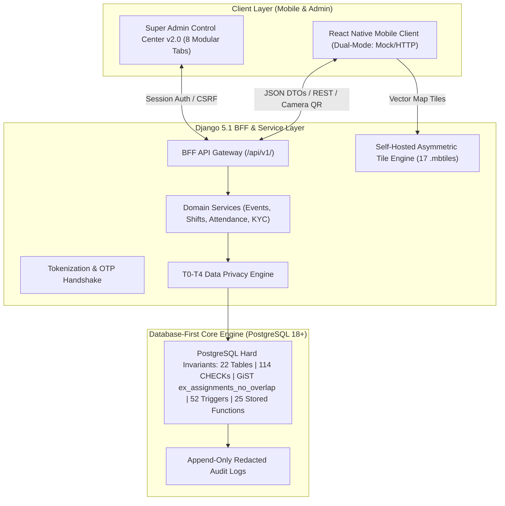
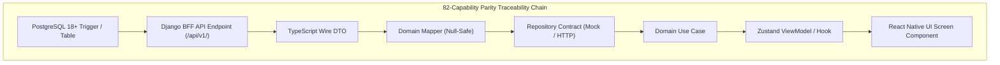
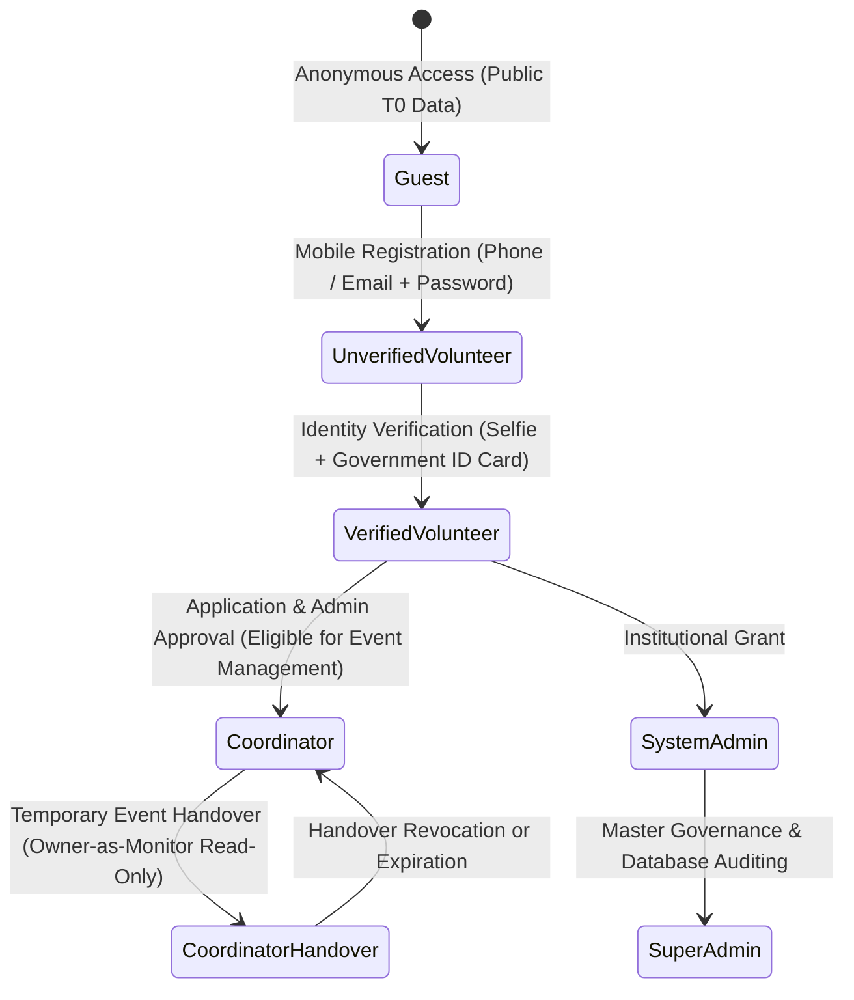

# 01 — Project Transformation Master Chronology & Architectural Roadmap

**System Name:** Volunteer HR Management & Emergency Response Coordination System  
**Timeline Covered:** v0.5.2 (Prototype Foundation) → v0.6.0 (Unified Backend) → v0.7.0/v0.8.1 (Mobile UX) → v0.10.0 (BFF Baseline) → v0.11.0 (Capability Parity) → v0.11.1 (Connection Re-Audit) → v0.12.0+ (Production Auth & Verification)  
**Document Classification:** Master Chronological & Architectural Evolution Record  
**Target Audience:** Lead Architects, Full-Stack Engineers, Product Managers, Security Auditors  

---

## 1. Executive Summary & Core Mission

The **Volunteer HR Management System** is an enterprise-grade platform engineered to manage, coordinate, and dispatch volunteer workforces across scheduled civic initiatives and rapid disaster-response scenarios. Built to operate resiliently even in low-connectivity, bandwidth-constrained environments (specifically across Myanmar administrative states with ASEAN regional integration), the platform provides verifiable volunteer identity, strict geofenced presence verification, and immutable audit tracking.

Throughout its multi-phase engineering evolution, the project underwent a radical transformation:
- **Initial State:** Fragmented database scripts, exploratory prototype views, isolated mobile mockups, and undocumented operational rules.
- **Target State:** A hardened **Database-First Invariant Engine** (PostgreSQL 18+), a decoupled **Django 5.1 BFF (Backend-For-Frontend)** service layer, and a production-grade **React Native 0.88.1 (TypeScript 6.0)** mobile client operating across 82 certified volunteer and coordinator capabilities.

---

## 2. Chronological Transformation Roadmap

The table below outlines the end-to-end evolution of the system across all documented milestones:

| Version | Milestone Title | Primary Focus & Domain | Key Architectural Deliverables |
| :--- | :--- | :--- | :--- |
| **v0.5.2** | Prototype Business Rules & Invariant Definition | PostgreSQL Schema & 214 Declared Workflows | Hard invariant schema, 22 tables, 114 CHECK constraints, GiST non-overlap schedule exclusion, 52 triggers, 14 stored functions, 11 views, self-test suite. |
| **v0.6.0** | Unified Monolith Backend, Admin Portal & Map Engine | Django 5.1, DRF 3.15, Super Admin Control Center, Offline Maps | Django app modularization, Service layer separation, AllowList serializers, Super Admin Control Center v2.0 (8 tabs), Self-hosted MBTiles server (17 regions). |
| **v0.7.0** | Mobile Architecture & BFF Implementation Plan | React Native client initialization & BFF contracts | Clean Architecture for React Native, dual HTTP/Mock repository interfaces, canonical `/api/v1/mobile/` endpoint definitions, T0–T4 data privacy model. |
| **v0.7.1** | UI-First Mobile Prototype & Audit | React Native screen scaffolding & Antigravity Prompts | Initial component trees, theme tokens, wireframes for volunteer shift discovery, QR scanner integration, and coordinator dashboards. |
| **v0.8.1** | Mobile UX Hardening, Inventory & Android QA | Route map inventory, UX edge cases, physical Android testing | Comprehensive 60-route inventory, Android back-button handling, geofence radius optimization, physical Android device QA playbook (Phase F10). |
| **v0.10.0** | BFF Integration Baseline & Gap Analysis | Backend-Mobile contract reconciliation | Read-only discovery audit identifying field-level naming discrepancies (snake_case vs camelCase), unhandled nullability, and missing endpoint parameters. |
| **v0.11.0** | 9-Phase Capability Parity & Contract Freeze | Full-stack capability parity across 82 capabilities | 9-phase execution: backend BFF exposure, mobile wire DTOs, domain models, 15 mapper defect fixes, repository parity, use-case wiring, and capability evidence ledger. |
| **v0.11.1** | BFF ↔ Mobile Connection Re-Audit | Deep verification of 114 changed files & contract audit | Source audit across 19 backend, 58 mobile, and 15 doc files. Detection of subtle semantic bugs, attendance race conditions, and T2/T3 leakage elimination. |
| **v0.12.0+**| Auth Tokenization & Production Handshake | Enterprise authentication, OTP challenge, live HTTP suite | Database migration for OTP challenge upgrade, JWT tokenization architecture, real HTTP automated test suite running against seeded fixtures. |

---

## 3. Major Architectural Paradigm Shifts

### 3.1 Shift 1: Procedural Logic → Database-First Invariant Engine
In early iterations, business rules (such as checking whether a volunteer was already booked during a shift, or ensuring an event was published before accepting applications) were partially enforced across scattered application code. This presented severe concurrency risks and data integrity leaks under high-volume operations.

In the transformed architecture:
- **All hard rules are pushed into PostgreSQL.** The database uses `btree_gist` to enforce an exclusion constraint (`ex_assignments_no_overlap`), mathematically guaranteeing that no volunteer can have overlapping active shift assignments.
- **State machine transitions** are governed by database triggers and CHECK constraints. Even if an external script or buggy API bypasses backend services, PostgreSQL immediately rejects corrupt states.

### 3.2 Shift 2: Monolithic API → Decoupled Backend-For-Frontend (BFF)
Initially, mobile and web consumers consumed identical raw Django REST Framework serializers. This caused extreme bandwidth overhead on 2G/3G mobile networks in rural Myanmar, leaked internal data fields, and created tightly coupled models.

The transformation introduced a strict **BFF Gateway Layer**:
- Payload shaping tailored specifically to mobile screen requirements.
- Strict data privacy tiering (**T0 to T4**) where sensitive volunteer personally identifiable information (PII) is automatically filtered based on relationship context.
- Dual-mode client repositories: Mobile developers can switch between offline mock fixtures and live HTTP transport via a single environment flag (`USE_MOCK_DATA=true/false`).

### 3.3 Shift 3: Ad-Hoc Screens → Clean Architecture & 82-Capability Traceability
The mobile application evolved from loosely coupled React Native components into a formal 3-layer Clean Architecture:
- **Presentation Layer:** Views, Atomic Components, and Zustand Stores.
- **Domain Layer:** Pure TypeScript Entities, Value Objects, and Business Use Cases.
- **Data Layer:** Wire DTOs, Transform Mappers, and Repository Contracts.

Every single screen feature was mapped directly to a certified capability ID (`V-01` to `V-43` for volunteers, `C-01` to `C-39` for coordinators), establishing 100% end-to-end traceability from the database trigger to the mobile button.

---

## 4. Role Hierarchy & RBAC Lifecycle Evolution

The system defines 6 distinct authorization tiers with strictly controlled promotion paths:

1. **Guest:** Unauthenticated user. Access restricted strictly to **T0** public event listings, charity categories, and public emergency notices.
2. **Unverified Volunteer:** Authenticated user with `account_status = 'active'`, but `verification_status = 'pending'` or `'unverified'`. Can browse events and update own profile, but cannot apply to restricted shifts or lead events.
3. **Verified Volunteer:** Authenticated user who has completed the KYC pipeline (approved photo identity document + face match). Eligible to apply for all active shifts, earn badges, and submit shift feedback.
4. **Coordinator:** Verified volunteer promoted to lead events. Can create shifts, inspect applicant rosters, approve/reject volunteers, trigger emergency alerts, and initiate geofenced check-in workflows.
5. **Coordinator Handover ("Owner-as-Monitor"):** When a coordinator temporarily transfers operational command of a live event to a designated co-coordinator, the primary owner transitions to a read-only monitoring state, preventing conflicting concurrent instructions.
6. **System & Super Admin:** Comprehensive portal access for system governance, user suspension, moderation audit, and database seeding.

---

## 5. Summary of Resolved Technical Debt

Across the transformation, four critical engineering hurdles were audited and solved:

| Legacy Problem | Root Cause | Solution Implemented |
| :--- | :--- | :--- |
| **Schedule Clashes & Double Booking** | Application-level validation race conditions during concurrent applications. | PostgreSQL GiST exclusion constraint (`ex_assignments_no_overlap`) with microsecond resolution. |
| **Data Privacy & PII Leakage** | Raw serializer dumps returning volunteer phone numbers and IDs to peer volunteers. | T0–T4 Data Privacy Tiering engine in the BFF service layer. |
| **Contract Incoherence (Frontend/Backend)** | Frontend camelCase vs backend snake_case; fabricated fields in mappers. | Phase 4 mapper defect elimination (15 critical bugs resolved); strict DTO specifications. |
| **Offline Rural Operation Failures** | Heavy dependence on commercial cloud tile providers (Google Maps/Mapbox). | Self-hosted offline vector tile server utilizing 17 local `.mbtiles` packages. |
