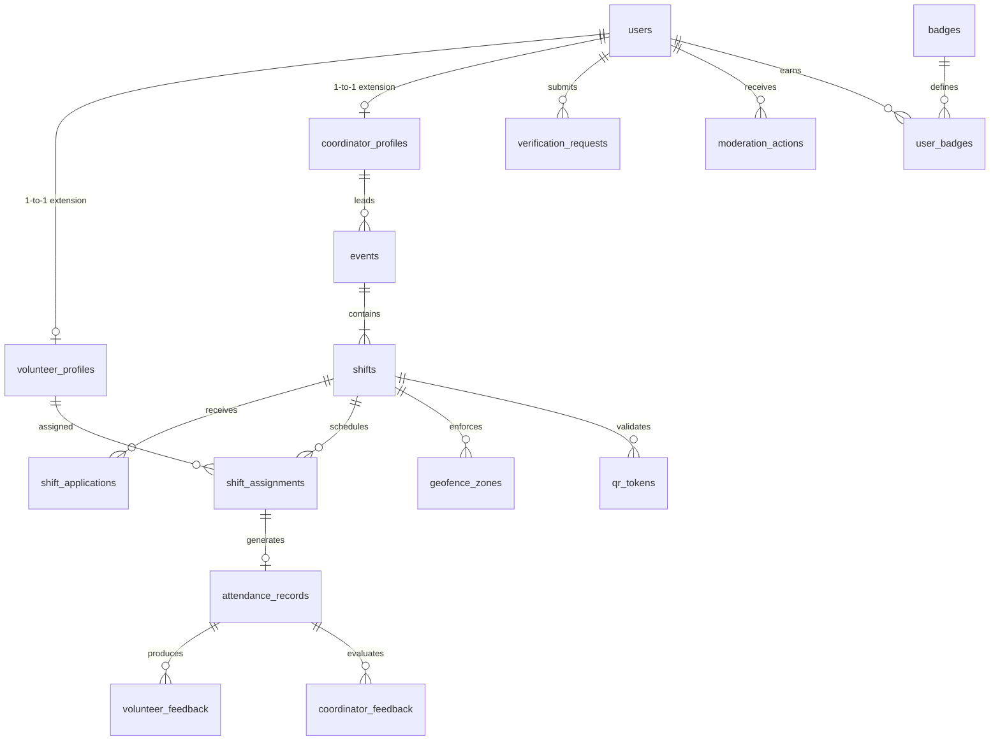

# 02 — Database & Backend Core Transformation

**Milestone Focus:** PostgreSQL v0.5.2 Engine & Django v0.6.0 Architecture  
**Document Classification:** Database Invariants, Backend Services & Admin Portal Reference  
**Target Systems:** `postgres_sql/`, `backend/`, `common/`, `services/`, `admin_portal/`  

---

## 1. Database-First Engineering Principles

The Volunteer HR Management platform adheres to a strict **Database-First Invariant Architecture**. Rather than relying on distributed application-level checks, data integrity, operational boundaries, and business rule enforcement are embedded directly into PostgreSQL 18+ via constraints, triggers, and stored procedures.

### Core Architectural Motivations
1. **Zero State Corruption:** Regardless of whether requests originate from the Django BFF, Super Admin Portal, batch CLI scripts, or manual database seeding, invalid states are rejected at the storage layer.
2. **Concurrency Safety:** Race conditions during high-volume volunteer signups and check-ins are eliminated via database-level locking and mathematical exclusion constraints.
3. **Audit Immutability:** Sensitive audit logs are append-only, tamper-proof, and automatically redact sensitive credentials.

---

## 2. PostgreSQL Schema Breakdown (22 Core Tables)

The unified database schema comprises 22 relational tables categorized into five core domains:



### Table Inventory by Domain

| Domain | Table Name | Purpose & Primary Keys | Key Invariants & Constraints |
| :--- | :--- | :--- | :--- |
| **Identity & KYC** | `users` | Primary identity record (`user_id`, `uuidv7`, `account_status`, `role`) | Role enum checks, valid international phone formatting, email uniqueness. |
| | `volunteer_profiles` | Volunteer metrics, skills, emergency contacts | Bio length limits, badge point counters, verified status sync. |
| | `coordinator_profiles` | Event organizer profiles, certifications | Organization affiliation, operational track record. |
| | `verification_requests` | Government ID, selfie photos, KYC status | Image URI validation, transition states: `pending` → `verified` / `rejected`. |
| **Events & Scheduling**| `events` | Master event definitions, category, location | `status` (`draft`, `published`, `in_progress`, `completed`, `cancelled`). |
| | `shifts` | Discrete time slots and capacity requirements | `start_time < end_time`, `max_volunteers >= min_volunteers > 0`. |
| | `shift_applications` | Volunteer requests to participate | Status: `applied`, `approved`, `rejected`, `withdrawn`. |
| | `shift_assignments` | Final confirmed volunteer roster slots | Status: `assigned`, `checked_in`, `completed`, `no_show`, `cancelled`. |
| **Location & Geofencing**| `geofence_zones` | Geofence polygons/circles around shift areas | Latitude (-90 to 90), Longitude (-180 to 180), radius in meters (10m to 5000m). |
| | `qr_tokens` | Dynamic rotating check-in QR codes | Cryptographic hash, expiration timestamp (rolling 60s windows), single-use flags. |
| | `attendance_records` | Check-in/check-out timestamps, GPS audit | Verified check-in distance, device telemetry, check-out confirmation. |
| **Gamification & Reviews**| `badges` | System award catalog (e.g. "Disaster First Responder") | Unique tier names, criteria JSON schemas. |
| | `user_badges` | Awards earned by volunteers | Timestamped awards with coordinator attestation. |
| | `volunteer_feedback` | Volunteer review of shift experience | Rating scale (1–5), multi-factor scoring (safety, clarity). |
| | `coordinator_feedback`| Coordinator evaluation of volunteer performance | Rating scale (1–5), reliability score, attendance validation. |
| **Governance & Security**| `moderation_actions` | Account flags, temporary suspensions, bans | Actor user reference, reason code, duration enforcement. |
| | `audit_logs` | Tamper-proof append-only security logs | Microsecond timestamp, actor IP, redacted sensitive payload JSONB. |

---

## 3. Critical Invariants & Concurrency Guards

### 3.1 The GiST Non-Overlap Schedule Constraint
One of the most critical bugs in early prototypes was concurrent volunteer double-booking across different events happening at the same time. This was eliminated permanently via a PostgreSQL `btree_gist` exclusion constraint:

```sql
-- Ensures no volunteer is assigned to overlapping active shifts
ALTER TABLE shift_assignments
ADD CONSTRAINT ex_assignments_no_overlap
EXCLUDE USING gist (
    volunteer_id WITH =,
    tsrange(shift_start_time, shift_end_time, '[)') WITH &&
)
WHERE (status IN ('assigned', 'checked_in'));
```

### 3.2 Automated Shift Capacity Recalculation Trigger
To prevent race conditions where 50 users apply for the final 2 slots simultaneously, capacity is maintained via atomic row-level triggers:

```sql
CREATE OR REPLACE FUNCTION fn_sync_shift_capacity()
RETURNS TRIGGER AS $$
BEGIN
    UPDATE shifts
    SET current_volunteers = (
        SELECT COUNT(*)
        FROM shift_assignments
        WHERE shift_id = COALESCE(NEW.shift_id, OLD.shift_id)
          AND status IN ('assigned', 'checked_in', 'completed')
    )
    WHERE shift_id = COALESCE(NEW.shift_id, OLD.shift_id);
    RETURN NEW;
END;
$$ LANGUAGE plpgsql;
```

---

## 4. Data Privacy Tiers (T0 to T4)

The backend enforces a strict 5-tier privacy filtering model to safeguard sensitive volunteer information:


| Tier | Visibility Scope | Data Attributes Included | Sanitization Policy |
| :--- | :--- | :--- | :--- |
| **T0** | Public & Anonymous | Event titles, descriptions, categories, public location pins. | Open to all unauthenticated requests. |
| **T1** | Authenticated Self | Volunteer profile name, points, badge collection, own shift history. | Exposed only to the authenticated owner. |
| **T2** | Operational Coordinator | Assigned volunteer names, emergency contact numbers for active shifts. | Accessible strictly to coordinators of that specific shift. |
| **T3** | Sensitive PII | National ID / NRC numbers, personal addresses, raw KYC photo URLs. | Accessible strictly to KYC verification admins. |
| **T4** | Cryptographic / System | Password hashes, JWT secrets, database connection parameters. | Stripped completely from all API outputs. |

---

## 5. Django Backend Architecture & Service Layer

The Django backend was organized into clean modular components, abandoning monolithic views in favor of an explicit **Service Layer**:

```
backend/
├── admin_portal/       # Super Admin Control Center templates & views
├── apps/               # Domain applications (accounts, events, shifts, attendance)
├── bff/                # Backend-For-Frontend serializers, permissions & routes
├── common/             # AllowListSerializerMixin, custom exceptions, formatters
├── config/             # Django settings, WSGI/ASGI, URLs
└── services/           # Pure Python business logic and domain transaction services
```

### 5.1 The `AllowListSerializerMixin`
To combat mass-assignment attacks where malicious callers inject elevated privileges (`role="admin"` or `is_verified=true`), all write serializers inherit from `AllowListSerializerMixin`, which rejects any unrecognized JSON fields with HTTP 400.

---

## 6. Super Admin Control Center v2.0

The `admin_portal` was upgraded into a comprehensive 8-tab governance interface:
1. **Overview & Metrics:** Live platform KPIs, active emergencies, and shift completion rates.
2. **Volunteer Registry:** KYC approval pipeline, identity document inspection, and badge management.
3. **Coordinator Governance:** Event organizer certification, tier assignment, and handover audits.
4. **Event Operations:** Global event creation, shift inspection, and emergency broadcast dispatch.
5. **Geofence & Mapping:** Interactive visual inspection of geofences, station markers, and offline tile cache.
6. **Moderation & Flags:** Dispute handling, user bans, and appeal processing.
7. **Audit & Compliance:** Cryptographically verifiable query engine over append-only audit logs.
8. **System Diagnostics:** Database health, connection pool statistics, and self-test execution.

---

## 7. Self-Hosted Asymmetric Offline Map Engine

To ensure full operational continuity during natural disasters or regional telecom outages in Myanmar, the platform eliminates dependencies on commercial mapping APIs (Google Maps, Mapbox).

### Map Architecture
- **Macro Layer:** ASEAN regional vector tiles (`asean_macro.mbtiles`).
- **Micro Layer:** 16 high-density Myanmar regional packages (`yangon.mbtiles`, `mandalay.mbtiles`, `shan.mbtiles`, `kachin.mbtiles`, etc.).
- **Engine:** Pure Python/Django asynchronous tile server serving standard XYZ vector and raster tiles locally on `/api/v1/map/tiles/{z}/{x}/{y}.pbf`.
