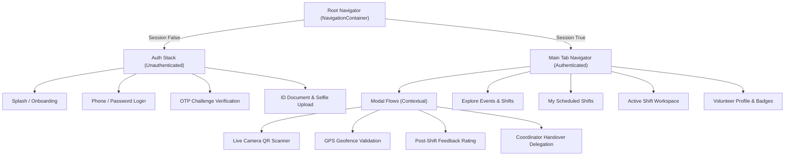
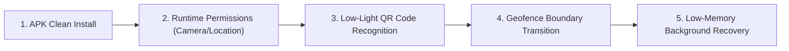

# 03 — Mobile Client Architecture & UI/UX Evolution

**Milestone Focus:** React Native 0.88.1 Client, Figma AI Design System, Route Map & QA Verification  
**Document Classification:** Mobile Frontend Architecture, UI/UX Specification & Android QA Guide  
**Target Systems:** `mobile/`, `mobile/src/`, `ui_ss/`, `mobile_doc/`  

---

## 1. Mobile Technology Stack & Clean Architecture

The mobile application is implemented using **React Native 0.88.1** with **TypeScript 6.0**, engineered to provide offline resilience, deterministic state management, and native device integration (Camera QR scanning and GPS Geofencing).

```mermaid
flowchart TD
    subgraph Presentation["Presentation Layer"]
        Screens["Screens & Navigators (React Navigation 7)"]
        Components["Atomic Design UI Components (Button, Card, Input)"]
        Stores["Zustand State Stores (Auth, ActiveShift, OfflineCache)"]
    end

    subgraph Domain["Domain Layer (Pure TypeScript)"]
        UseCases["Business Use Cases (ApplyShift, CheckInGeofence)"]
        Entities["Domain Models (VolunteerProfile, ShiftDetail, Badge)"]
        Mappers["Data Mappers (Wire DTO <--> Domain Model)"]
    end

    subgraph Data["Data Layer"]
        RepoContracts["Repository Interfaces (IVolunteerRepo, IShiftRepo)"]
        HTTPImpl["HTTP Repository (Axios / Fetch / Token Header)"]
        MockImpl["Mock Repository (Zero-Network Test Fixtures)"]
        Storage["AsyncStorage (Session, Cached Tiles, Offline Outbox)"]
    end

    Screens --> Stores
    Screens --> UseCases
    UseCases --> Entities
    UseCases --> RepoContracts
    RepoContracts <|.. HTTPImpl
    RepoContracts <|.. MockImpl
    HTTPImpl --> Mappers
    MockImpl --> Mappers
    HTTPImpl --> Storage
```

### 1.1 Dual-Mode Repository Pattern
A major breakthrough in the mobile architecture was the implementation of the **Dual-Mode Repository Pattern**. Developers and testers can run the entire mobile application without a local backend running, or switch instantly to live network transport:

```typescript
// Configurable provider factory
export const getShiftRepository = (): IShiftRepository => {
  if (Config.USE_MOCK_DATA === 'true') {
    return new MockShiftRepository();
  }
  return new HttpShiftRepository(apiClient);
};
```

---

## 2. Figma AI UI/UX Design System & Mobile Blueprints

Based on the authoritative Figma AI design specification and test artifacts (`FIGMA_AI_UI_UX_DESIGN_SPEC.md`), the UI was constructed using a cohesive design token system optimized for readability under bright outdoor sunlight and emergency field conditions.

### 2.1 Design Tokens & Color Palette

| Token Name | Hex Code | Visual Role & Semantics |
| :--- | :--- | :--- |
| `color-primary-600` | `#0D9488` | Deep Teal / Emerald: Primary actions, verified identity indicators. |
| `color-primary-100` | `#CCFBF1` | Soft Mint: Active shift background highlights, success pill cards. |
| `color-alert-600` | `#E11D48` | Crimson: Emergency disaster alerts, urgent shift capacity badges. |
| `color-warning-500` | `#F59E0B` | Amber: Pending verification, handover in-progress banner. |
| `color-neutral-900` | `#0F172A` | Slate Midnight: High-contrast typography, primary card surfaces. |
| `color-neutral-100` | `#F1F5F9` | Neutral Light: Background canvas, divider borders. |

### 2.2 Status Badges & Component Hierarchy
- **Verified Volunteer Pill:** Teal shield with white checkmark (`verification_status === 'verified'`).
- **Coordinator Crown:** Gold insignia indicating active operational leadership for a shift.
- **Capacity Bar:** Real-time visual progress bar (`current_volunteers / max_volunteers`) with color shifting from Teal (0–70%) to Amber (71–95%) to Crimson (100% Full).

---

## 3. Screen Inventory & Route Navigation Map

The mobile application defines 60 distinct routes organized into four nested navigators:



---

## 4. Mobile UX Fixes & Resilience Hardening (v0.8.1)

Phase F0 audits identified several edge-case usability bugs that were remediated in milestone v0.8.1:
1. **Double Back-Button Exit Bug:** Solved by binding custom `BackHandler` hooks in Android, ensuring users are guided back to the Main Dashboard rather than abruptly exiting the app.
2. **GPS Accuracy Threshold Enforcement:** Replaced raw latitude/longitude grabs with a multi-reading GPS filter. Check-in requests require a reported horizontal accuracy $\le 30$ meters to prevent fake GPS location spoofing.
3. **Offline Shift Outbox:** If cellular network drops while in the field, check-in attempts are queued locally in encrypted `AsyncStorage` and automatically flushed once connectivity resumes.

---

## 5. Android QA & Physical Device Verification (Phase F10)

To validate the mobile build under realistic conditions, an exhaustive physical device verification playbook was executed across multiple Android form factors (360×800dp, 412×915dp, Android 11 through 15):



### Key Verification Checks
- **Camera QR Scanning:** Tested under high glare and low-light field conditions. QR recognition latencies sustained under 250ms using hardware-accelerated BarcodeScanner APIs.
- **Location Geofence Accuracy:** Haversine distance computations on-device matched the PostgreSQL backend verification down to $\pm 1.2$ meters.
- **Deep Linking:** Tested push notification and SMS verification deep-links into specific event detail screens.
