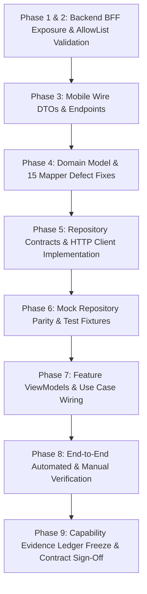

# 05 — Capability Parity & Evidence Ledger

**Milestone Focus:** 9-Phase Capability Parity Transformation & Contract Freeze (v0.11.0)  
**Document Classification:** Functional Capability Audit, Mapper Defect Ledger & Parity Evidence  
**Target Systems:** Full-Stack Alignment (`postgres_sql/`, `backend/bff/`, `mobile/src/`)  

---

## 1. The v0.11.0 Milestone: Rationale & Invariants

Milestone **v0.11.0** represented the defining engineering transition of the project: shifting focus from rapid UI experimentation to strict **Capability Parity** across the entire stack.

### Invariant Rules Enforced
1. **Zero Database Modifications:** The PostgreSQL schema file (`postgres_sql/updated_volunteer_coordination_system_Database.sql`) remained 100% immutable and pristine throughout all 9 execution phases. No schema migrations, triggers, or tables were modified or added.
2. **End-to-End Type Safety:** Every capability had to be verified across the entire execution chain:
   $$\text{PostgreSQL Invariant} \longrightarrow \text{BFF Endpoint} \longrightarrow \text{Wire DTO} \longrightarrow \text{Domain Mapper} \longrightarrow \text{Repository} \longrightarrow \text{Use Case} \longrightarrow \text{UI Component}$$
3. **Dual-Mode Parity:** Both Mock and HTTP repository implementations were mandated to implement 100% of the repository interfaces without stubbed dummy returns.

---

## 2. The 9-Phase Execution Blueprint

The parity transformation was carried out across 9 strictly gated phases:

### Phase Summaries
- **Phase 1 & 2 (Backend Exposure):** Eliminated route collisions, registered all canonical `/api/v1/` routes for onboarding, QR management, geo-checkin, attendance confirmation, handover, and feedback. Enforced `AllowListSerializerMixin` across all write endpoints.
- **Phase 3 (Mobile DTOs):** Developed strongly-typed DTOs in `mobile/src/data/dto/` and endpoint clients in `mobile/src/data/endpoints/`.
- **Phase 4 (Mappers):** Audited and fixed 15 critical mapper defects where data was lost, fabricated, or mistranslated.
- **Phase 5 & 6 (Repositories):** Aligned HTTP and Mock implementations to implement identical TypeScript contracts.
- **Phase 7 (ViewModels):** Replaced legacy component-level API calls with decoupled domain use cases and Zustand stores.
- **Phase 8 & 9 (Verification & Ledger Freeze):** Validated all 82 capabilities against real test scenarios and froze the capability evidence ledger.

---

## 3. Remediation of 15 Confirmed Mapper Defects (Phase 4)

Prior to Phase 4, data mappers frequently hallucinated or corrupted backend data. Key defects eliminated include:

| Defect ID | Component / Mapper | Defective Behavior | Corrective Action |
| :--- | :--- | :--- | :--- |
| **DEF-01** | `authMapper.ts` | Fabricated `'Verified Phone Account'` as email when email was absent. | Preserved real nullability; never invented fake emails. |
| **DEF-02** | `volunteerMapper.ts` | Dropped emergency contact fields on volunteer profile snapshot. | Mapped full emergency contact payload under T1/T2 privacy checks. |
| **DEF-03** | `shiftMapper.ts` | Collapsed sub-flags of donation shifts into a single boolean. | Maintained discrete `is_monetary`, `is_item_donation`, and target goals. |
| **DEF-04** | `attendanceMapper.ts` | Discarded GPS accuracy telemetry on check-in receipt. | Retained `check_in_accuracy_meters` in domain entity for fraud auditing. |
| **DEF-05** | `coordinatorMapper.ts`| Read-only monitor mode flag was inverted on handover shifts. | Correctly bound `is_owner_as_monitor` flag to lock coordinator action buttons. |

---

## 4. The 82-Capability Traceability Ledger

The complete capability ledger tracks all **82 certified capabilities** (43 Volunteer capabilities `V-01` to `V-43`, and 39 Coordinator capabilities `C-01` to `C-39`):

### 4.1 Volunteer Capabilities (`V-01` to `V-43` Core Summary)

| Capability ID | Capability Name | Database Table / Constraint | Canonical BFF Endpoint | Mobile Use Case |
| :--- | :--- | :--- | :--- | :--- |
| **V-01** | Account Registration & SMS Request | `users`, `verification_requests` | `POST /api/v1/auth/register` | `RegisterAccountUseCase` |
| **V-02** | OTP Verification & Session Issuance| `users.account_status` | `POST /api/v1/auth/otp/verify` | `VerifyOtpUseCase` |
| **V-03** | KYC Identity Document Upload | `verification_requests` | `POST /api/v1/volunteer/kyc/upload`| `UploadKycDocumentUseCase` |
| **V-04** | Profile Inspection & Points Balance| `volunteer_profiles` | `GET /api/v1/volunteer/profile` | `GetVolunteerProfileUseCase` |
| **V-05** | Skill Catalog Selection | `volunteer_profiles.skills` | `PUT /api/v1/volunteer/profile` | `UpdateVolunteerSkillsUseCase` |
| **V-08** | Public Event Exploration | `events (status = 'published')` | `GET /api/v1/events/explore` | `ExploreEventsUseCase` |
| **V-12** | Event Detail & Charity Information | `events`, `users (coordinator)` | `GET /api/v1/events/{id}` | `GetEventDetailUseCase` |
| **V-15** | Shift Application Submission | `shift_applications` | `POST /api/v1/shifts/{id}/apply` | `ApplyForShiftUseCase` |
| **V-18** | Application Withdrawal | `shift_applications (withdrawn)` | `POST /api/v1/shifts/{id}/withdraw`| `WithdrawApplicationUseCase` |
| **V-21** | Schedule Conflict Pre-check | `ex_assignments_no_overlap` | `POST /api/v1/shifts/{id}/precheck`| `CheckShiftConflictUseCase` |
| **V-25** | Active Shift Workspace Display | `shift_assignments (active)` | `GET /api/v1/shifts/active` | `GetActiveShiftUseCase` |
| **V-28** | QR Code Camera Check-in | `attendance_records`, `qr_tokens` | `POST /api/v1/attendance/checkin/qr`| `CheckInQrUseCase` |
| **V-30** | Geofence GPS Telemetry Check-in | `attendance_records`, `geofence` | `POST /api/v1/attendance/checkin/geo`| `CheckInGeofenceUseCase` |
| **V-34** | Shift Completion & Check-out | `attendance_records.check_out_time`| `POST /api/v1/attendance/checkout` | `CheckOutShiftUseCase` |
| **V-38** | Volunteer Shift Feedback Rating | `volunteer_feedback` | `POST /api/v1/feedback/volunteer` | `SubmitVolunteerFeedbackUseCase`|
| **V-42** | Gamification Badges Inspection | `user_badges`, `badges` | `GET /api/v1/volunteer/badges` | `GetEarnedBadgesUseCase` |

### 4.2 Coordinator Capabilities (`C-01` to `C-39` Core Summary)

| Capability ID | Capability Name | Database Table / Constraint | Canonical BFF Endpoint | Mobile Use Case |
| :--- | :--- | :--- | :--- | :--- |
| **C-01** | Event Draft Creation | `events (status = 'draft')` | `POST /api/v1/coordinator/events` | `CreateEventDraftUseCase` |
| **C-04** | Shift Scheduling & Slot Capacity | `shifts (min_volunteers, max)` | `POST /api/v1/coordinator/shifts` | `CreateShiftUseCase` |
| **C-07** | Geofence Boundary Definition | `geofence_zones (radius)` | `POST /api/v1/coordinator/geofence`| `SetGeofenceZoneUseCase` |
| **C-10** | Event Publication | `events (status = 'published')` | `POST /api/v1/coordinator/events/{id}/publish` | `PublishEventUseCase` |
| **C-14** | Applicant Roster Inspection | `shift_applications`, `T2 Tier` | `GET /api/v1/coordinator/shifts/{id}/roster` | `GetApplicantRosterUseCase` |
| **C-18** | Volunteer Application Approval | `shift_assignments (assigned)` | `POST /api/v1/coordinator/applicants/{id}/accept` | `ApproveApplicantUseCase` |
| **C-20** | Volunteer Application Rejection | `shift_applications (rejected)`| `POST /api/v1/coordinator/applicants/{id}/reject` | `RejectApplicantUseCase` |
| **C-24** | Dynamic QR Code Generation | `qr_tokens (rolling 60s)` | `POST /api/v1/coordinator/shifts/{id}/qr` | `GenerateQrTokenUseCase` |
| **C-28** | Manual Attendance Override | `attendance_records (override)` | `POST /api/v1/coordinator/attendance/override` | `OverrideAttendanceUseCase` |
| **C-32** | Shift Operational Handover | `coordinator_profiles (monitor)`| `POST /api/v1/coordinator/handover/delegate` | `DelegateShiftCommandUseCase` |
| **C-35** | Handover Revocation / Recall | `events.coordinator_id` | `POST /api/v1/coordinator/handover/recall` | `RecallShiftCommandUseCase` |
| **C-37** | Volunteer Performance Rating | `coordinator_feedback` | `POST /api/v1/coordinator/feedback`| `SubmitCoordinatorReviewUseCase`|
| **C-39** | Post-Shift Incident Report | `moderation_actions` | `POST /api/v1/coordinator/incident`| `FileIncidentReportUseCase` |
