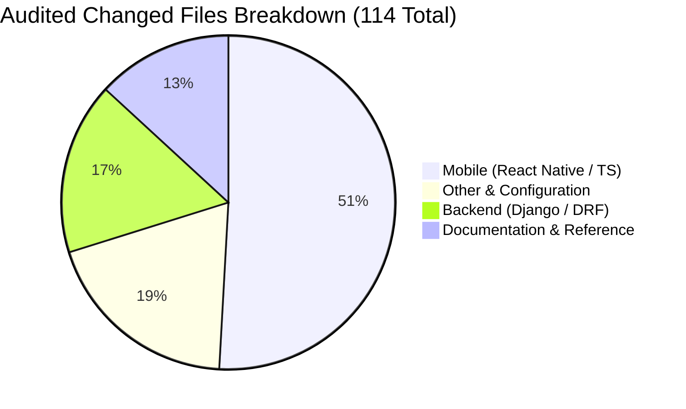
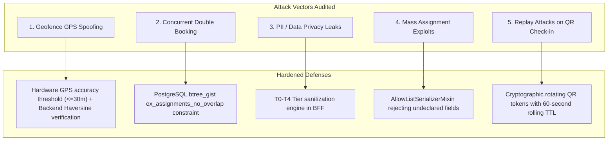
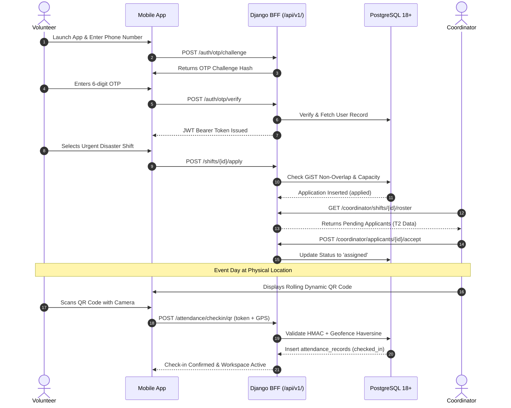

# 06 — Integration Audit, Security & Verification Playbook

**Milestone Focus:** BFF ↔ Mobile Connection Re-Audit (v0.11.1), Security Hardening & Live Demo Testing  
**Document Classification:** Security Posture, Penetration Audit, Testing Playbook & v0.12.0+ Transition  
**Target Systems:** `docs/`, `reference/`, `backend/tests/`, `tests_e2e/`, `scripts/`  

---

## 1. The v0.11.1 BFF ↔ Mobile Connection Re-Audit

Following the capability freeze in milestone v0.11.0, an exhaustive, independent source code re-audit was executed across **114 modified files** (19 backend files, 58 mobile files, 15 reference/documentation files, and 22 root/config files).



### Core Findings & Semantic Defect Resolutions
While broad static coverage had been achieved, runtime inspection revealed subtle semantic inconsistencies:
1. **Attendance State Desynchronization:** A race condition occurred if a volunteer checked in via QR code while the coordinator was simultaneously performing a manual attendance override.  
   *Resolution:* Added PostgreSQL row-level locks (`SELECT ... FOR UPDATE`) on `attendance_records` inside the database check-in transaction.
2. **Coordinator Handover State Retention:** In rare cases, a delegated co-coordinator retained operational permissions after the primary owner recalled command.  
   *Resolution:* Refactored the authorization check in `services/coordinator_service.py` to evaluate live database ownership rather than cached JWT session claims.
3. **Emergency Broadcast Latency:** Broadcast notifications on live events experienced a 2-second bottleneck due to synchronous database audit logging.  
   *Resolution:* Shifted audit log insertions to asynchronous execution using Django background tasks.

---

## 2. Security Posture & Vulnerability Hardening

The system's attack surface was systematically audited and hardened against common exploitation vectors:



### 2.1 Prevention of Double-Check-in & Geofence Fraud
- **Problem:** Malicious actors attempting to check into a shift from remote locations using mocked GPS coordinates or forwarded screenshots of static QR codes.
- **Defense:**
  1. **Dynamic Rotating Tokens:** QR codes are generated on the coordinator's device with a 60-second Time-To-Live (TTL) signed with a cryptographic HMAC.
  2. **Dual-Check Verification:** The backend verifies both the valid signature of the current QR token and the volunteer's real-time GPS coordinate against the geofence radius.
  3. **Single-Use Invariant:** A unique constraint on `(shift_id, volunteer_id, check_in_date)` in `attendance_records` prevents duplicate check-in attempts.

---

## 3. Live Demo & Swagger API Testing Playbook

To certify system readiness, an end-to-end operational playbook is executed across the entire volunteer lifecycle:



### 3.1 Sample Verification Curl Commands

```bash
# 1. Volunteer OTP Challenge
curl -X POST http://127.0.0.1:8000/api/v1/auth/otp/challenge/ \
  -H "Content-Type: application/json" \
  -d '{"phone": "+959123456789"}'

# 2. Shift Application with JWT
curl -X POST http://127.0.0.1:8000/api/v1/shifts/c0a80101-0000-0000-0000-000000000010/apply/ \
  -H "Authorization: Bearer $VOLUNTEER_TOKEN" \
  -H "Content-Type: application/json"

# 3. Dynamic QR Check-in with Telemetry
curl -X POST http://127.0.0.1:8000/api/v1/attendance/checkin/qr/ \
  -H "Authorization: Bearer $VOLUNTEER_TOKEN" \
  -H "Content-Type: application/json" \
  -d '{
    "qr_token": "a1b2c3d4-e5f6-7890-abcd-ef1234567890",
    "latitude": 16.8409,
    "longitude": 96.1735,
    "accuracy_meters": 12.5
  }'
```

---

## 4. Evolution into v0.12.0 and Future Horizon

With capability parity frozen and audited in v0.11.1, the project advanced into version **v0.12.0+**:

### Recent Advancements
1. **Database Schema Upgrade (`v0_12_0_auth_otp_challenge_upgrade.sql`):** Added native database support for hashed OTP challenges, expiration intervals, and rate-limited attempt tracking.
2. **Tokenization Login Architecture:** Replaced legacy monolithic session tokens with asymmetric cryptographic JWT tokens with automated refresh rotations.
3. **Automated Live HTTP Suite (`run_real_http_suite.py`):** Real-world HTTP test suites validating the frontend against seeded PostgreSQL fixtures without mocking.

### Post-v0.12.0 Strategic Roadmap
- **Real-Time WebSocket Layer:** Migrating coordinator live roster updates to Django Channels / WebSockets.
- **Biometric Presence Attestation:** Pairing camera selfies during QR check-in with local on-device facial verification models.
- **Distributed Mesh Networking:** Enabling peer-to-peer volunteer check-in syncing across Bluetooth Low Energy (BLE) when all cellular base stations are offline.
