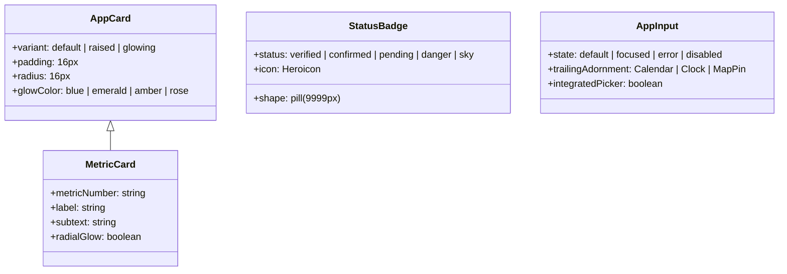

# Volunteer HR Management System — Unified UI/UX Specification & Figma AI Blueprint
**Ecosystem:** Full-Stack Alignment (Mobile React Native Client + Backend Admin Control Center)  
**Target Frames:** Mobile (390×844pt iOS / 360×800dp & 412×915dp Android) & Web Admin (1440×900 Desktop)  
**Authoritative Backend Codebase:** `backend/admin_portal/templates/admin_portal/`  
**Mobile Screenshot Inventory:** `ui_ss/` (All 26 High-Fidelity Test Artifacts: `image.png` through `image copy 25.png`)  
**Destination Path:** `c:\Users\USER\Documents\INTERN\Project\Volunteer_HR_Management\python_stack\ui_ss\FIGMA_AI_UI_UX_DESIGN_SPEC.md`  

---

## 1. Executive Summary & Design System Harmonization

The **Volunteer HR Management System** is a mission-critical platform designed for non-profit organizations, field coordinators, and volunteers. It manages the entire lifecycle of humanitarian and civic volunteering: community event provisioning, GPS-fenced check-ins, multi-tier identity verification, shift scheduling, weekly availability, and administrative escalations.

### The Inconsistency Problem: Mobile Client vs. Server Admin Portal
Prior to this analysis, the mobile application operated on a divergent visual language compared to the authoritative Django/Tailwind backend admin portal:

| Design Dimension | Server Admin Portal (`backend/admin_portal/`) | Previous Mobile Client (`mobile/`) | Unified Design System (Figma Target) |
|---|---|---|---|
| **Base Theme & Canvas** | Deep Slate Dark (`#070B14` Slate-950, `#0F172A` Slate-900) | Flat Gray Light (`#F8F9FA` / `#FFFFFF`) | **Dual-Theme Unified Tokens:** Dark Slate Canvas (mirrors server) + Light Surface mode. |
| **Primary Brand Accent** | **Electric Blue** (`#2563EB` Blue-600) to **Indigo** (`#6366F1`) Gradient | Deep Teal (`#00695C`) | **Harmonized Brand:** Electric Blue (`#2563EB`) as primary brand anchor, supported by Indigo (`#6366F1`) and Emerald (`#10B981`) for field activities. |
| **Role & Status Semantics** | • Super Admin: Amber (`#F59E0B`)<br>• Staff Admin: Sky (`#0EA5E9`)<br>• Active/Verified: Emerald (`#10B981`)<br>• Exception/Danger: Rose (`#F43F5E`)<br>• Alerts: Purple (`#A855F7`) | Monolithic Green (`#2E7D32`) & Red (`#D32F2F`) | **Full Semantic Parity:** Identical color tokens and pill styling across mobile and web. |
| **Iconography Standard** | Scalable SVG Heroicons (20×20 / 24×24dp, 2px stroke) | Inconsistent system Unicode glyphs (`◫`, `⌕`, `▼`, `☰`, `←`, `✎`) & raw emojis (`📍`) | **Lucide / Heroicons Vector Set:** Unified 24dp bounding boxes and stroke weights across all screens. |
| **Geofence & Venue UI** | Interactive Leaflet.js GPS map with dynamic radius circle (50m–2000m) | Disconnected numeric text fields without map preview | **Embedded Interactive Map Frame:** Mobile Leaflet / Mapbox preview with circular radius overlay. |

---

## 2. Server Admin Portal Architecture & Color Extraction (`backend/admin_portal/`)

An exhaustive audit of the 11 Django template modules (`base_admin.html`, `dashboard.html`, `event_create.html`, `events_detail.html`, `coordinator_board.html`, `geo_monitoring.html`, `users.html`, `user_create.html`, `feedback.html`, `settings.html`, `login.html`) yields the authoritative server design system:

### 2.1 Server Color Palette & Token Definitions

```
SERVER CORE SURFACES (DEEP SLATE)
┌───────────┬───────────┬───────────┬───────────┬───────────┐
│ Slate 950 │ Slate 900 │ Slate 850 │ Slate 800 │ Slate 700 │
│  #070B14  │  #0F172A  │  #151F33  │  #1E293B  │  #334155  │
└───────────┴───────────┴───────────┴───────────┴───────────┘
Canvas: #070B14 | Card Surface: #0F172A/90 backdrop-blur | Border: #1E293B

SERVER PRIMARY ACCENTS (ELECTRIC BLUE & INDIGO)
┌───────────┬───────────┬───────────┬───────────┬───────────┐
│  Blue 500 │  Blue 600 │  Blue 700 │ Indigo 500│ Indigo 600│
│  #3B82F6  │  #2563EB  │  #1D4ED8  │  #6366F1  │  #4F46E5  │
└───────────┴───────────┴───────────┴───────────┴───────────┘
Primary Action: #2563EB | Brand Gradient: from-blue-600 to-indigo-500 | Shadow: shadow-blue-500/20

SERVER SEMANTIC ACCENTS
┌───────────┬───────────┬───────────┬───────────┬───────────┐
│Emerald 400│ Amber 400 │  Rose 400 │  Sky 400  │ Purple 400│
│  #34D399  │  #FBBF24  │  #FB7185  │  #38BDF8  │  #C084FC  │
└───────────┴───────────┴───────────┴───────────┴───────────┘
Emerald: Active Volunteers / Verified Status / Live GPS Check-in
Amber: Super Admin / Pending Verification Queue / Action Needed
Rose: Blocked Accounts / Geofence Breach Exceptions / Revocation
Sky: Staff Admin / GPS Coordinates / Ongoing Events
Purple: Low-Score Governance Alerts / Field Feedback
```

### 2.2 Server Component Capabilities to Replicate in Mobile
1. **Glowing Metric Cards (`dashboard.html`):** Cards feature background radial blurs (`w-14 h-14 blur-xl rounded-full`) behind metrics that intensify on hover/touch (`bg-blue-600/10`, `bg-emerald-600/10`, `bg-amber-600/10`, `bg-rose-600/10`).
2. **Dual Ratio Progress Bars:** Coordinator-to-Volunteer ratio bar (`bg-blue-500` vs `bg-emerald-500` inside `#1E293B` track with `ring-1 ring-white/10`).
3. **Interactive GPS Geofence Map Picker (`event_create.html`):** Leaflet map centered at Yangon (`16.805280, 96.156110`) with dynamic radius range slider (50m to 2000m, step 25m) and coordinate readout pill.
4. **PostgreSQL Trigger Adherence:** Mandatory selection of 1 to 3 charity fields, Purpose Type (`charity_event` vs `help_wanted_event`), and Acceptance Mode (`manual` vs `auto`).

---

## 3. Comprehensive Audit of All 26 Mobile Screenshots (`ui_ss/`)

Every screenshot captured from the Android emulator has been audited for layout, typography, touch targets, and visual consistency:

```
SCREENSHOT INDEX & FEATURE MATRIX
├── Dashboard Top & Header: image copy 3.png, image copy 22.png
├── Dashboard Commitments & Shifts: image.png, image copy 4.png
├── Navigation Drawer (Volunteer vs Coord): image copy 5.png, image copy 21.png
├── Event Discovery & Filter Sheet: image copy 6.png, image copy 7.png
├── Applications & Assignments: image copy 8.png, image copy 9.png
├── Volunteer Profile & Eligibility: image copy 10.png, image copy 11.png
├── Profile Edit Full Form: image copy 12.png, 13.png, 14.png, 15.png
├── Availability & Blackout Date Defect: image copy.png, image copy 16.png
├── Verification Credentials & ID Slots: image copy 17.png, 18.png, 19.png
├── Settings & App Info: image copy 20.png
├── Coordinator Workspace & Roster Metrics: image copy 23.png, 24.png
└── Create Event Wizard (Steps 1 & 3): image copy 25.png, image copy 2.png
```

### Detailed Screen-by-Screen Teardown

| Image File | Screen & Role | Current UI Implementation | Defect / Inconsistency with Server | Figma AI Transformation Specification |
|---|---|---|---|---|
| **`image copy 3.png`** | Volunteer Dashboard (Top) | Welcome card for `Alex Morgan`, 3 plain square stat boxes (14 Shifts, 9 Events, 2 Upcoming), Community Feedback (4.9 / 26 reviews). | • Raw unicode glyph `◫` used for events.<br>• Cards flat white with no visual glow.<br>• Brand color is isolated teal rather than server electric blue. | Transform into Server-aligned Dashboard: Electric Blue header bar, 3 KPI cards with glowing radial background tint (Emerald, Sky, Amber), rich 5-star reputation widget. |
| **`image.png` & `image copy 4.png`** | Volunteer Dashboard (Bottom) | Upcoming Commitments ("Community Garden", "Food Pantry"), "Cancel participation" button, Completed activities. | • **Wrong Glyph:** Location has `◫` (calendar) instead of pin.<br>• **Dangling Punctuation:** `3:30 PM -` trailing dash.<br>• Over-prominent cancel button. | Soft green pill badge (`#10B981`), MapPin vector icon (`#38BDF8`), sanitized date string `Sun, Nov 15 • 3:30 PM MMT`, subtle secondary button. |
| **`image copy 5.png` & `image copy 21.png`** | Navigation Drawer (Volunteer & Coord) | Header avatar with dot, menu links with glyphs (`◫`, `⌕`, `●`, `✓`, `⚠`), bottom QA Profile Switcher. | • Typographic glyphs have misaligned baselines.<br>• Switching to Coordinator reveals single `Coordinator Workspace` item with warning icon `⚠`. | Refactor into Modern Slide-Over Drawer: User avatar with tier badge, Heroicons (`Home`, `Compass`, `Calendar`, `User`, `Briefcase`), tabbed Volunteer/Coordinator workspace toggle. |
| **`image copy 6.png` & `image copy 7.png`** | Discover Events & Filter Sheet | Search input + filter button `▼`. Bottom sheet with event statuses, support checkboxes, charity categories. | • Category chips wrapped inside sheet are plain gray pills.<br>• Search input has raw `⌕` glyph.<br>• Event card has generic diamond `⌖` for location. | Single top search row with integrated filter icon badge, 2-column categorized filter sheet with checkable cards, event cards with cause photo banners and verified coordinator badges. |
| **`image copy 8.png`** | My Applications | Filter pills (All, Pending, Accepted, Waitlisted, Withdrawn). Application cards with "Withdraw application". | • Horizontal tabs clip at right edge (`Withd...`).<br>• Plain amber border on `PENDING REVIEW`. | Fluid horizontal scroll with gradient edge masks, soft amber container badge (`#FEF3C7` / `#B45309`), withdraw action inside 3-dot overflow menu. |
| **`image copy 9.png`** | My Assignments | Filter pills (All, Active, Completed, Cancelled). Confirmed & Assigned shifts with red emoji `📍`. | • **Inconsistent Icon:** Uses OS emoji `📍` here while other screens use `◫` or `⌖`.<br>• Shift cards lack reporting instructions. | Standardized vector `MapPin`, check-in countdown timer, reporting coordinator contact card, and one-tap directions link. |
| **`image copy 10.png` & `image copy 11.png`** | Profile & Coordinator Program | Avatar "AM", `ACTIVE VOLUNTEER`, `VERIFIED`, rating 4.9. Coordinator Program checklist with 3 criteria. | • Eligibility criteria checks have harsh green borders.<br>• "Apply for Coordinator" button disabled with uninformative gray state. | Hero Volunteer Card with verified shield badge, structured progress checklist: (1) Verified ID [✓], (2) ≥5 Shifts [14/5 ✓], (3) Community Rating [4.9/5.0 ✓], vibrant CTA button. |
| **`image copy 12.png`–`15.png`** | Edit Profile Form (Complete) | 4-part form: Read-only statuses, Basic Info, Emergency Contact, Skills tagger, Charity Interests, Suitability, Support, Blood type. | • Monolithic vertical scroll with 20+ form controls.<br>• Plain text input for skills without auto-suggest.<br>• Blood type pills wrap to 3 uneven lines. | Segmented tabbed or accordion form sections: (1) General & Contact, (2) Skills & Causes, (3) Medical & Emergency. Blood type segmented grid (4×2 uniform cells). |
| **`image copy.png` & `image copy 16.png`** | Availability & Blackouts | Weekly recurring rules + Date Exceptions. | **CRITICAL WRAPPING DEFECT:** Fixed `exceptionBadgeWrap: 170` breaks date `2026-11-28` into 3 lines: `202 / 6-11 / -28`. Centered pop-up modal. | Redesign as a Native Bottom Sheet with 7 circular day buttons (Mon–Sun). Exception cards stack Date above Status badge with full width for zero wrapping. |
| **`image copy 17.png`–`19.png`** | Verification & Coordinator Form | Tier 1 status, Photo selfie slot, National ID slot, Driver's License slot, Coordinator Application note input. | • Slots are empty dashed gray boxes.<br>• "Demo Preview" labels clutter user experience. | Production document upload cards: Preview thumbnail slot, green checkmark for encrypted server storage, file upload button with camera/gallery sheet. |
| **`image copy 20.png`** | Settings Screen | Theme selector (System, Light, Dark), Log Out (Demo), Version string. | • Role switcher was removed, but Settings feels barren with only 3 theme buttons. | Comprehensive Settings Hub: Appearance (Light/Dark/System), Notification Preferences, Language (English/Burmese), Offline Cache, About & Privacy Policy. |
| **`image copy 23.png` & `image copy 24.png`** | Coordinator Workspace | Top Alert (7 Pending Apps), 4 Metric Cards, Create Event button, Roster actions (`Assignment\ns`), Managed Events. | • Text wrap bug: `Assignment\ns`.<br>• Metric cards lack server-style glowing blurs.<br>• Roster buttons look like plain pills. | Modern Command Dashboard: 4 KPI cards with glowing radial tints (mirroring server `dashboard.html`), polished 3-tab segment for Roster (Applications, Assignments, Attendance). |
| **`image copy 25.png` & `image copy 2.png`** | Create Event Wizard (Steps 1 & 3) | Step 1 (Basics: Title, Purpose, Categories). Step 3 (Schedule: Start/End date-time, MMT timezone, deadline). | • Stepper tabs clipped (`4. Capacit...`).<br>• Detached input and calendar button `[ Date ] [ ◫ ]`.<br>• Uppercase labels `EVENT START *`. | Step progress bar (`3 of 7 - 43%`), unified input container with integrated trailing calendar icon `[ 2026-12-10 📅 ]`, clear Myanmar Timezone pill card. |

---

## 4. Unified Mobile & Server Design Tokens (Figma Variables)

To establish complete parity between the mobile client and the server admin portal, all tokens are organized under the unified **Volunteer HR Design System** variable collection:

### 4.1 Color System Matrix

| Token Name | Light Surface Mode | Dark Slate Mode (Server Aligned) | Tailwind Class Equivalent | Purpose & Role |
|---|---|---|---|---|
| `sys/canvas` | `#F8FAFC` | `#070B14` | `bg-slate-950` | Primary application canvas |
| `sys/surface` | `#FFFFFF` | `#0F172A` | `bg-slate-900` | Card, bottom sheet, and modal containers |
| `sys/surface-raised`| `#F1F5F9` | `#151F33` | `bg-slate-850` / `bg-slate-950/60` | Nested cards, input fills, table headers |
| `sys/border` | `#E2E8F0` | `#1E293B` | `border-slate-800` | Dividers, card borders, input borders |
| `sys/border-hover` | `#CBD5E1` | `#334155` | `hover:border-slate-700` | Active borders, hover states |
| `brand/primary` | `#2563EB` | `#3B82F6` | `bg-blue-600` / `text-blue-400` | Primary buttons, active tabs, brand headers |
| `brand/primary-glow`| `rgba(37,99,235,0.15)` | `rgba(59,130,246,0.20)` | `shadow-blue-500/20` | Radial card glows, button drop shadows |
| `brand/gradient-from`| `#2563EB` | `#3B82F6` | `from-blue-600` | Header logos, hero action banners |
| `brand/gradient-to` | `#6366F1` | `#818CF8` | `to-indigo-500` | Header logos, hero action banners |
| `semantic/success` | `#16A34A` | `#34D399` | `text-emerald-400`, `bg-emerald-500/10` | Active volunteers, confirmed shifts, check-in |
| `semantic/warning` | `#EA580C` | `#FBBF24` | `text-amber-400`, `bg-amber-500/10` | Pending verification queue, action needed alerts |
| `semantic/danger` | `#DC2626` | `#FB7185` | `text-rose-400`, `bg-rose-500/10` | Shift cancellation, blackout dates, geo review |
| `semantic/info` | `#0284C7` | `#38BDF8` | `text-sky-400`, `bg-sky-500/10` | GPS coordinates, venue landmarks, live shifts |
| `semantic/purple` | `#9333EA` | `#C084FC` | `text-purple-400`, `bg-purple-500/10` | Low-score ratings, governance alerts |

---

### 4.2 Typography Hierarchy (Inter & SF Pro Display)

Base font family: **Inter** (Figma fallback: **SF Pro Display / Roboto**). Tabular figures (`tnum`) enabled for dates, coordinates, and hours.

| Token Name | Size | Line Height | Weight | Letter Spacing | Use Case |
|---|---|---|---|---|---|
| `type/display` | 32px | 38px | Bold (700) | -0.02em | Hero headers, Total metrics |
| `type/heading-lg`| 24px | 30px | Bold (700) | -0.01em | Screen headers, Workspace titles |
| `type/heading-md`| 20px | 26px | SemiBold (600) | 0 | Section headers, Modal titles |
| `type/title` | 16px | 22px | SemiBold (600) | 0 | Event titles, Card headings |
| `type/body` | 15px | 22px | Regular (400) | 0 | Descriptions, briefing notes |
| `type/body-sm` | 13px | 18px | Regular (400) | 0 | Metadata, role subtitles, location rows |
| `type/mono-code` | 12px | 16px | Medium (500) | 0 | GPS Coordinates (`16.80528, 96.15611`), MMT Times |
| `type/badge` | 11px | 14px | Bold (700) | +0.05em | Status pills (`CONFIRMED`, `VERIFIED`, `PENDING`) |

---

## 5. Reusable Component Blueprint (Figma Auto-Layout & Variants)



### 5.1 The Glowing Metric Card (Server-Aligned)
- **Container:** Auto-layout Vertical, Width: `Fill Container` (min 150px), Height: 110px, Padding: 16px, Radius: 16px, Background: `#0F172A` (Dark) / `#FFFFFF` (Light), Border: `1px solid #1E293B`.
- **Radial Glow Layer:** Top-right circular vector ellipse (`56×56px`, Fill: Semantic color with 15% opacity, Layer Blur: 20px).
- **Label Row:** Label text (`11px font-semibold uppercase tracking-wider text-slate-400`).
- **Metric Row:** Number (`26px font-black text-white`, tabular figures).
- **Subtext Row:** Caption (`10px text-slate-500 mt-0.5`).

---

### 5.2 Unified Form Input Container (`AppInput`)
Eliminates disconnected buttons seen in `image copy 2.png`:
- **Frame:** Auto-layout Horizontal, Align Items: Center, Padding: `12px 14px`, Gap: 8px, Height: 48px, Radius: 12px, Background: `#151F33` (Dark) / `#FFFFFF` (Light), Border: `1.5px solid #1E293B`.
- **Leading/Content:** Interactive text field, Placeholder color `#64748B`.
- **Trailing Slot:** Integrated vector button (`20×20dp` Calendar or Clock icon, Color `#3B82F6`, hitSlop 8px). Tapping opens bottom picker sheet.

---

### 5.3 Exception / Availability Card (Zero-Wrapping Architecture)
Permanently resolves the 3-line date wrapping bug from `image copy.png` & `image copy 16.png`:
- **Frame:** Auto-layout Vertical, Padding: 14px, Gap: 10px, Radius: 14px, Background: `#0F172A`, Border: `1px solid #1E293B`.
- **Header Row (Auto-layout Horizontal, Space-Between):**
  - Left: `StatusBadge` (e.g. `Available Slot` or `Blackout Date`).
  - Right: `Remove` action (Red vector trash icon + text button).
- **Body Row:**
  - Date Title: `Saturday, Nov 28, 2026` (Full width, Inter Bold 15px, `#F8FAFC`).
  - Time Row: Vector `Clock` icon (14px) + `09:00 - 12:00 MMT` (`#38BDF8`, Medium 13px).
  - Note Row: `Note: Available for morning relief packing only` (Slate-400, 12px).

---

## 6. Comprehensive Figma AI Prompts (Copy-Paste Ready)

Copy and paste these tailored prompt blocks directly into **Figma AI** to generate the unified ecosystem:

---

### Prompt Block 1: Unified Design System Foundation & Variables
```text
Create a comprehensive mobile and web design system for a non-profit Volunteer HR Management platform.
Ecosystem: Full-Stack (React Native Mobile + Web Admin Portal).
Primary Base Frame: 390x844pt (iOS) and 1440x900pt (Web).

Design Tokens & Variables:
1. Color Variables:
   - Deep Slate Canvas: #070B14 (Slate 950), Surfaces: #0F172A (Slate 900), Raised: #151F33 (Slate 850), Borders: #1E293B (Slate 800).
   - Brand Accents: Electric Blue (#2563EB / Blue 600) and Indigo (#6366F1 / Indigo 500) gradient.
   - Semantics: Active/Verified Emerald (#10B981 & #34D399), Warning/Pending Amber (#F59E0B & #FBBF24), Danger/Exceptions Rose (#F43F5E & #FB7185), GPS/Live Info Sky (#0EA5E9 & #38BDF8), Governance Purple (#A855F7 & #C084FC).
2. Typography (Inter):
   - Display: 32/38 Bold, Heading 1: 24/30 Bold, Heading 2: 20/26 SemiBold, Title: 16/22 SemiBold, Body: 15/22 Regular, Code/Mono: 12/16 Medium, Badge: 11/14 Bold Uppercase.
3. Core Component Library (Auto-layout):
   - GlowingMetricCard: Dark slate surface, top-right soft radial blur (20px blur, 15% opacity), large 26px bold number.
   - StatusBadge: Pill shape (9999px radius), 14px vector icon, variants for Verified (Emerald), Confirmed (Emerald), Pending (Amber), Blackout (Rose), Live Shift (Sky).
   - UnifiedAppInput: 48px height, 12px radius, dark input fill, integrated trailing vector icon for Calendar and Clock.
```

---

### Prompt Block 2: Volunteer Dashboard (Server-Aligned Dark & Light Mode)
```text
Design a high-fidelity mobile Volunteer Dashboard screen in a 390x844pt frame in Dark Slate Theme (Canvas #070B14).

Header:
- Top App Bar with hamburger menu, Title "Volunteer Coordination" with "v0.8.1" mono badge, and circular avatar pill "AM" (Alex Morgan).

Scrollable Body (Auto-layout vertical, 16px padding, 16px gap):
1. Hero Welcome Card:
   - Background #0F172A, border #1E293B, 16px radius.
   - Avatar (48x48), Name "Alex Morgan", Verified Volunteer badge (Emerald pill).
2. Operational Metrics Grid (3 columns, auto-layout horizontal, gap 10px):
   - Card 1: Shifts Completed -> Value "14" (Emerald), glowing emerald radial blur.
   - Card 2: Events Attended -> Value "9" (Indigo), glowing indigo radial blur.
   - Card 3: Upcoming -> Value "2" (Sky), glowing sky blue radial blur.
3. Community Reputation Card:
   - Title "Community Feedback (Aggregate Only)".
   - 5-Star Row (4 amber stars, 1 half star) + "4.9 (26 verified reviews)".
   - Helper text: "Individual ratings and feedback remain private per governance rules."
4. Upcoming Commitments Section:
   - Header "Upcoming Commitments" + "Browse Events" link.
   - 2 Event Cards (Dark slate surface, 14px radius, 14px padding):
     * Card 1: Status badge "✓ Confirmed Shift" (Emerald), Date "Sun, Nov 15 • 3:30 PM MMT", Title "Community Garden Revitalization", Post "Garden Tool Lead", MapPin icon + "Central Park East Kiosk". Footer: "Cancel participation" tonal button and "Directions" link.
     * Card 2: "Food Pantry Packaging", "Box Assembly Assistant", "Downtown Warehouse".
5. Bottom Tab Bar (Sticky Bottom, 64px height):
   - Tabs: Dashboard (Active Electric Blue), Discover, My Shifts, Profile.
```

---

### Prompt Block 3: Coordinator Workspace & Operations Dashboard
```text
Design the Coordinator Workspace screen in a 390x844pt frame in Dark Slate Theme (#070B14).

Header:
- Back arrow, Title "Coordinator Workspace", Subtitle "Events & roster operations", "+ New Event" button on top right.

Content Area:
1. Urgent Action Banner:
   - Soft Amber container (#F59E0B/10, border 1px #F59E0B/30, 14px radius, 14px padding).
   - Row with pulsing warning icon + "Action Needed: 7 Pending Applications".
   - Subtext: "Applicants awaiting review and roster placement for upcoming shifts."
2. Operational Metrics (2x2 Grid):
   - Metric 1: Total Events "5" (2 currently live) with Sky glow.
   - Metric 2: Pending Apps "7" (Review required) with Amber glow.
   - Metric 3: Accepted Roster "14" (Volunteers placed) with Emerald glow.
   - Metric 4: Checked-in Today "6" (Active on-site) with Indigo glow.
3. Primary CTA:
   - Full-width button: "Launch Create Event Wizard" (Solid Electric Blue #2563EB, 48px height, 12px radius, calendar icon).
4. Operational Roster Segmented Tabs:
   - 3-tab segmented control: Applications (7), Assignments (14), Attendance Check-in (6).
5. Managed Events List:
   - Card 1: Active Shift badge (Sky), "Hlaing Riverbank Conservation & Waste Audit", Location "Downtown Riverwalk Plaza, Pier 4". Metric strip: Pending 3 | Accepted 6 | Assigned 6 | Checked-in 4.
   - Card 2: Published badge (Emerald), "Youth Coding & Literacy Mentorship".
   - Card 3: Draft badge (Amber), "Inya Relief Food Box Assembly".
```

---

### Prompt Block 4: Availability Screen & Add Rule Bottom Sheet (Zero-Wrap Fix)
```text
Design two mobile screens in 390x844pt frames showing the Availability feature: Screen A (Availability List) and Screen B (Add Rule Bottom Sheet) in Dark Slate Theme (#070B14).

Screen A (Availability Screen):
- App Bar: Back arrow, Title "Availability & Schedule", Right action "+ Add Rule".
- Section 1: "Weekly Recurring Rules".
  * Card: Auto-layout horizontal, padding 14px. Indigo badge "SATURDAY", text "08:00 - 13:00 MMT", caption "Every Saturday", remove button.
- Section 2: "Date Blackouts & Exceptions" (Fixing the 3-line date wrapping bug):
  * Card: Auto-layout vertical, padding 14px, gap 8px.
    - Top row: StatusBadge "Unavailable (Blackout)" (Rose pill), right-aligned "Remove" button.
    - Second row: Full date "Saturday, Nov 21, 2026" (Bold 15px white text).
    - Third row: Caption "Note: Family commitment / Out of township".

Screen B (Add Rule Bottom Sheet):
- Dark scrim overlay (60% opacity).
- Bottom Sheet sliding up (Top radius 24px, Background #0F172A, Border 1px #1E293B, Padding 20px).
- Centered drag handle bar.
- Title: "Add Weekly Availability Rule" + close X button.
- Day Selector: Single row of 7 circular day buttons (Mon, Tue, Wed, Thu, Fri, Sat, Sun). Saturday active with solid Electric Blue #2563EB fill.
- Time Fields: Two unified inputs side-by-side: Start Time [ 08:00 🕒 ] and End Time [ 13:00 🕒 ].
- Validity Fields: Valid From [ 2026-11-01 📅 ] and Valid To [ 2026-12-31 📅 ].
- Bottom Action Dock: "Cancel" (Tonal outline) and "Save Rule" (Solid Electric Blue #2563EB).
```

---

### Prompt Block 5: Create Event Wizard (Step 3: Schedule & Interactive Geofence Map)
```text
Design Step 3 of the Create Event Wizard in a 390x844pt frame in Dark Slate Theme (#070B14).

Header & Stepper:
- App Bar: Back arrow, Title "Create Event Wizard", Subtitle "Step 3 of 7: Schedule".
- Progress Bar: Linear progress bar (4px height) filled to 43% with Electric Blue #2563EB.

Content Area (Auto-layout vertical, 16px padding, 16px gap):
1. Myanmar Timezone Card:
   - Background #151F33, border 1px #1E293B, 14px radius, 14px padding.
   - Globe icon + bold title "Myanmar Time (MMT / UTC+06:30)".
   - Caption: "All event hours are anchored to Myanmar Standard Time regardless of device locale."
2. Event Schedule Card:
   - Section Title: "Event Timing (24h MMT)".
   - Row 1: Start Date [ 2026-12-10 📅 ] and Start Time [ 08:00 🕒 ].
   - Row 2: End Date   [ 2026-12-10 📅 ] and End Time   [ 14:00 🕒 ].
   - Row 3: Application Deadline (Optional) [ 2026-12-08 📅 ] and Deadline Time [ 18:00 🕒 ].
3. Interactive Geofence Map Preview Card:
   - Map preview box (Height 160px, rounded corners, border #1E293B) showing GPS map pin at Yangon (16.80528, 96.15611).
   - Semi-transparent circular geofence overlay (150m radius).
   - Radius slider below map: "Geofence Radius: 150m (Range 50m - 2000m)".

Sticky Footer:
- Back button (Outlined, 40% width) and Continue button (Solid Electric Blue #2563EB, 60% width).
```

---

## 7. Implementation & Design Handoff Checklist

- [ ] **Ecosystem Consistency:** Mobile design system reflects the server's Electric Blue (`#2563EB`), Indigo (`#6366F1`), and Slate (`#070B14`) design language.
- [ ] **Zero Unicode Glyphs:** All `◫`, `⌕`, `▼`, `☰`, `←`, and `✎` symbols replaced with 24×24dp Heroicons / Lucide vector icons.
- [ ] **No Text Wrap Bugs:** All date strings and exception cards use full-width stacked rows, ensuring zero broken multi-line text on 360dp screens.
- [ ] **Integrated Adornments:** Date and time inputs combine text and icon triggers into a single unified input frame.
- [ ] **Map Parity:** Interactive GPS map and radius slider match the server Leaflet implementation.
- [ ] **Database Constraint Compliance:** 1 to 3 charity fields, Purpose Type, and Acceptance Mode faithfully represented.

---
*Generated by Antigravity AI — Full-Stack UI/UX Design System Specification.*
