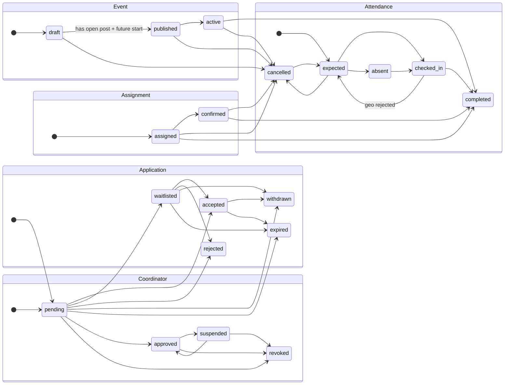
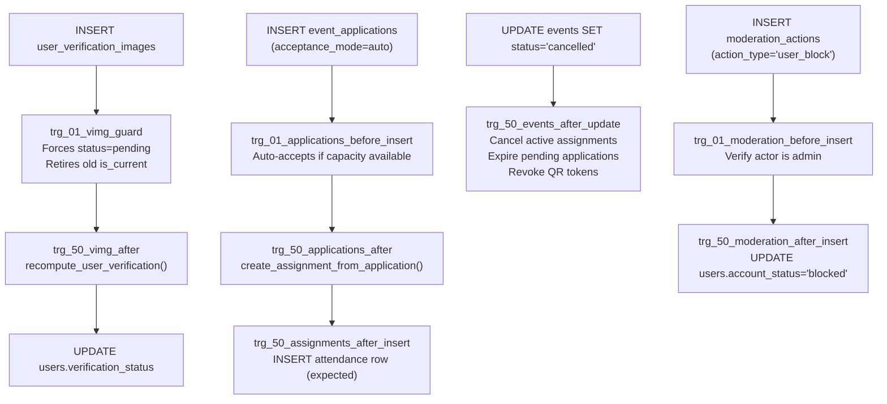

# Volunteer HR Management — Full Database Reference

> **Schema version:** v0.11.1 (Unified PostgreSQL, Database-First Engine)  
> **Updated:** 2026-11-19 | **Target engine:** PostgreSQL 14+ with `btree_gist`  
> **Source files:**
> - [updated_volunteer_coordination_system_Database.sql](file:///c:/Users/USER/Documents/INTERN/Project/Volunteer_HR_Management/python_stack/postgres_sql/updated_volunteer_coordination_system_Database.sql)
> - [self_test.sql](file:///c:/Users/USER/Documents/INTERN/Project/Volunteer_HR_Management/python_stack/postgres_sql/self_test.sql)
> - [seed_data.sql](file:///c:/Users/USER/Documents/INTERN/Project/Volunteer_HR_Management/python_stack/seeding/seed_data.sql)
> - [Qwen_sql_20261106_cf1i1orzq.sql](file:///c:/Users/USER/Documents/INTERN/Project/Volunteer_HR_Management/python_stack/seeding/Qwen_sql_20261106_cf1i1orzq.sql)
> - [tokenization_login_architecture.md](file:///c:/Users/USER/Documents/INTERN/Project/Volunteer_HR_Management/python_stack/docs/tokenization_login_architecture.md)

---

## 1. Schema Overview — Entity Map

```mermaid
erDiagram
    charity_fields {
        TEXT code PK
        TEXT label
        BOOLEAN active
        INTEGER sort_order
    }
    app_settings {
        TEXT key PK
        INTEGER value_int
        TEXT description
    }
    users {
        BIGINT id PK
        UUID uuid
        TEXT phone_hash UK
        TEXT phone_enc
        TEXT display_name
        BOOLEAN is_admin
        TEXT account_status
        TEXT verification_status
        TEXT skills_array
    }
    user_charity_interests {
        BIGINT id PK
        BIGINT user_id FK
        TEXT field_code FK
    }
    volunteer_availability_rules {
        BIGINT id PK
        BIGINT user_id FK
        INTEGER weekday
        TIME start_time
        TIME end_time
    }
    volunteer_availability_exceptions {
        BIGINT id PK
        BIGINT user_id FK
        DATE date
        BOOLEAN is_available
    }
    coordinator_profiles {
        BIGINT user_id PK_FK
        TEXT status
        BIGINT approved_by_id FK
    }
    user_verification_images {
        BIGINT id PK
        BIGINT user_id FK
        TEXT image_type
        TEXT status
        TEXT comparison_status
    }
    auth_otp {
        BIGINT id PK
        TEXT phone_hash
        TEXT code_hash
        TEXT purpose
        TIMESTAMPTZ expires_at
    }
    events {
        BIGINT id PK
        BIGINT owner_id FK
        BIGINT current_coordinator_id FK
        TEXT status
        TEXT acceptance_mode
        BOOLEAN geo_checkin_enabled
    }
    event_coordinator_history {
        BIGINT id PK
        BIGINT event_id FK
        BIGINT from_coordinator_id FK
        BIGINT to_coordinator_id FK
    }
    event_charity_fields {
        BIGINT id PK
        BIGINT event_id FK
        TEXT field_code FK
    }
    event_posts {
        BIGINT id PK
        BIGINT event_id FK
        TEXT title
        INTEGER required_headcount
        TEXT status
    }
    qr_tokens {
        BIGINT id PK
        BIGINT event_id FK
        TEXT purpose
        TEXT token_hash UK
        INTEGER used_count
    }
    event_applications {
        BIGINT id PK
        BIGINT event_id FK
        BIGINT user_id FK
        BIGINT post_id FK
        TEXT status
        TEXT source
    }
    assignments {
        BIGINT id PK
        BIGINT event_id FK
        BIGINT application_id FK
        BIGINT user_id FK
        TEXT group_code
        BOOLEAN is_group_leader
    }
    attendance {
        BIGINT id PK
        BIGINT event_id FK
        BIGINT user_id FK
        BIGINT assignment_id FK
        TEXT status
        TEXT method
        BOOLEAN geo_verified
    }
    attendance_geo_attempts {
        BIGINT id PK
        BIGINT event_id FK
        BIGINT user_id FK
        BIGINT attendance_id FK
        TEXT result
    }
    onboarding_acknowledgments {
        BIGINT id PK
        BIGINT user_id FK
        BIGINT event_id FK
        INTEGER onboarding_version
    }
    feedback {
        BIGINT id PK
        BIGINT event_id FK
        BIGINT rater_user_id FK
        BIGINT target_user_id FK
        TEXT direction
        INTEGER score
    }
    moderation_actions {
        BIGINT id PK
        BIGINT admin_user_id FK
        BIGINT target_user_id FK
        BIGINT event_id FK
        TEXT action_type
    }
    audit_logs {
        BIGINT id PK
        BIGINT actor_user_id FK
        TEXT action
        TEXT entity_type
        JSONB before_data
        JSONB after_data
    }

    users ||--o{ user_charity_interests : "has interests"
    charity_fields ||--o{ user_charity_interests : "referenced by"
    users ||--o{ volunteer_availability_rules : "weekly schedule"
    users ||--o{ volunteer_availability_exceptions : "date exceptions"
    users ||--|| coordinator_profiles : "may be coordinator"
    users ||--o{ user_verification_images : "uploads"
    users ||--o{ event_applications : "applies to"
    coordinator_profiles ||--o{ events : "owns/runs"
    events ||--o{ event_posts : "has roles"
    events ||--o{ event_charity_fields : "tagged with"
    events ||--o{ qr_tokens : "has tokens"
    events ||--o{ event_coordinator_history : "tracks handovers"
    event_applications ||--|| assignments : "leads to"
    assignments ||--|| attendance : "generates"
    attendance ||--o{ attendance_geo_attempts : "logs geo tries"
    events ||--o{ onboarding_acknowledgments : "acknowledged by"
    events ||--o{ feedback : "receives"
    users ||--o{ moderation_actions : "moderated by admin"
```

---

## 2. Tables — Full Catalogue

### 2.1 `app_settings` — Runtime Configuration

| Key | Default | Description |
|-----|---------|-------------|
| `geo_max_accuracy_m` | 100 | Reject GPS less accurate than this (m) |
| `geo_default_radius_m` | 150 | Geofence radius when event doesn't set one (m) |
| `geo_max_fix_age_sec` | 60 | Reject GPS fixes older than this (s) |
| `geo_checkin_window_before_min` | 30 | Minutes before `start_at` geo window opens |
| `otp_max_requests_per_hour` | 5 | OTP rate limit per phone/hour |
| `otp_max_attempts` | 5 | Wrong OTP attempts before lockout |
| `otp_ttl_minutes` | 5 | OTP lifetime |

Fetched via `setting_int(key TEXT)` — a stable SQL function.

---

### 2.2 `charity_fields` — Lookup Table

Pre-seeded activity categories used to tag both users (interests) and events.

**13 built-in codes:** `teaching`, `food_distribution`, `elderly_care`, `child_care`, `animal_welfare`, `environment`, `disaster_support`, `blood_donation`, `fundraising`, `logistics`, `cleaning`, `cooking`, `other`.

---

### 2.3 `users` — Accounts

The central entity. Phone is **never stored in plaintext** — only `phone_hash` (HMAC) for lookups and `phone_enc` (encrypted) for display.

| Field | Notes |
|-------|-------|
| `account_status` | `active` / `blocked` / `closed` |
| `is_active` | Derived from `account_status = 'active'` (kept in sync by trigger) |
| `is_admin / is_staff / is_superuser` | Staff/superuser imply admin; only admins can set these |
| `verification_status` | `none` / `pending` / `verified` / `rejected` — **derived by trigger** from `user_verification_images` |
| `blood_type` | `A+`, `A-`, `B+`, `B-`, `AB+`, `AB-`, `O+`, `O-`, `unknown` |
| `skills` | `TEXT[]` GIN-indexed, normalized (lowercase, ≤30 tags, ≤50 chars each) |

> [!IMPORTANT]
> `phone_hash` is immutable (enforced by trigger). `is_active` is never written directly — it syncs with `account_status`.

---

### 2.4 `user_charity_interests`

Junction table linking users to `charity_fields`. One row per (user, field). Used for event matching / volunteer dashboard filtering.

---

### 2.5 `volunteer_availability_rules`

Recurring **weekly windows** (weekday 1–7, time range). Unique on `(user_id, weekday, start_time)`.

### 2.6 `volunteer_availability_exceptions`

**Date-specific overrides** (blackouts or narrow windows). One per `(user_id, date)`.

> Both queried by `is_user_available(user, start, end)` — exception overrides rule; no rules = always available.

---

### 2.7 `coordinator_profiles`

One row per user who is or was a coordinator.

| Status | Meaning |
|--------|---------|
| `pending` | Awaiting admin approval |
| `approved` | Active coordinator, can own/run events |
| `suspended` | Temporarily disabled |
| `revoked` | Permanently removed |

**State machine:** `pending → approved/revoked`, `approved → suspended/revoked`, `suspended → approved/revoked`

> [!CAUTION]
> Approval requires the approver to be an active admin AND the user to have `verification_status = 'verified'`. Self-approval is blocked by `CHECK`.

---

### 2.8 `user_verification_images`

Stores **server-side paths** to JPEG identity documents (never the bytes).

| Field | Values |
|-------|--------|
| `image_type` | `mock_selfie`, `id_license`, `driver_license` |
| `status` | `pending` → `approved` / `rejected` |
| `comparison_status` | `pending`, `match`, `no_match`, `needs_review` |
| `is_current` | Unique index ensures one current image per type per user |

Trigger `trg_50_vimg_after` calls `recompute_user_verification()` on every change, which updates `users.verification_status`.

**Verified = approved `mock_selfie` + approved `id_license` or `driver_license`.**

---

### 2.9 `auth_otp`

Short-lived OTP tokens. Only cryptographic **hashes** are stored (`phone_hash` and `code_hash`). The database enforces strict rate limits (`trg_01_otp_rate_limit`: max 5 requests/hr per `phone_hash`) and attempt limits (max 3-5 verification attempts before invalidation).

| Field | Type | Constraints & Notes |
|-------|------|-------------------|
| `id` | `BIGINT GENERATED ALWAYS AS IDENTITY` | Primary key |
| `phone_hash` | `TEXT NOT NULL` | HMAC-SHA256 of normalized E.164 phone |
| `code_hash` | `TEXT NOT NULL` | HMAC-SHA256 of raw OTP code (never plaintext) |
| `purpose` | `TEXT NOT NULL DEFAULT 'login'` | Check: `'login'` or `'qr_registration'` |
| `attempt_count` | `INTEGER NOT NULL DEFAULT 0` | Check: between `0` and `100` |
| `expires_at` | `TIMESTAMPTZ NOT NULL` | Check: `expires_at > created_at` (default `now() + 5m`) |
| `consumed_at` | `TIMESTAMPTZ` | NULL = unconsumed; Check: `consumed_at >= created_at` |
| `created_at` | `TIMESTAMPTZ NOT NULL DEFAULT now()` | Insertion timestamp |

**Indexes:**
- `idx_auth_otp_phone_created`: `(phone_hash, created_at DESC)`
- `idx_auth_otp_open`: `(phone_hash, purpose) WHERE consumed_at IS NULL`
- `idx_auth_otp_expires`: `(expires_at)`

> [!NOTE]
> **Tokenization Architecture Compatibility:** Under the new Tokenization Login architecture (`docs/tokenization_login_architecture.md`), this table and its triggers require **zero schema changes**. The Django BFF detokenizes the incoming Client Identity Token (CIT) into `phone_hash`, issues an ephemeral `auth_session_token` in application cache, and invokes `request_otp()` and `verify_otp()` against this authoritative table.

---

### 2.10 `events`

The core operational table.

| Field | Values / Notes |
|-------|---------------|
| `status` | `draft → published → active → completed / cancelled` |
| `acceptance_mode` | `auto` (auto-accept up to capacity) / `manual` (coordinator decides) |
| `purpose_type` | `charity_event` / `help_wanted_event` |
| `leader_strategy` | `none` / `first_experienced` / `manual` |
| `geo_checkin_enabled` | Requires `latitude`/`longitude` |
| `geo_radius_m` | 20–5000 m; NULL = `app_settings.geo_default_radius_m` |
| `map_provider` | `openstreetmap` / `google` |
| `compensation_kind` | `unpaid` / `arranged_outside_system` |
| `onboarding_version` | Auto-incremented by trigger whenever `onboarding_text` changes |
| `owner_id` | Immutable after creation |
| `current_coordinator_id` | Changeable via `change_event_coordinator()` |

**Lifecycle timestamps** are enforced by `CHECK` — e.g. `published` status requires `published_at IS NOT NULL AND activated_at IS NULL`.

> [!WARNING]
> Completed and cancelled events are **frozen** — only soft-delete columns (`deleted_at`, `deleted_by_id`) may change.

---

### 2.11 `event_coordinator_history`

Append-only log of every coordinator change. First row is inserted automatically on event creation.

---

### 2.12 `event_charity_fields`

Many-to-many: event ↔ charity_fields. Cascade-deletes with event.

---

### 2.13 `event_posts` — Roles Within an Event

Each event has one or more posts representing specific jobs.

| Field | Notes |
|-------|-------|
| `required_headcount` | 1–100,000 |
| `physical_level` | `none` / `light` / `medium` / `heavy` |
| `required_skills` | `TEXT[]` matched against `users.skills` |
| `status` | `open` / `full` (auto-maintained by trigger) / `closed` (set by coordinator) |
| `priority` | Lower = filled first during auto-assignment |

---

### 2.14 `qr_tokens`

Only the **hash** of the token is stored (never the raw secret).

| `purpose` | Use |
|-----------|-----|
| `walkin_registration` | Scan to submit a walk-in application |
| `checkin` | Scan to check in to a shift |
| `join_event` | Generic event join |

Revocable. `used_count` can only increase. Event completion/cancellation auto-revokes all open tokens.

---

### 2.15 `event_applications`

| `status` | Transition |
|----------|-----------|
| `pending` | Initial; awaits coordinator or auto-accept |
| `accepted` | Triggers assignment creation |
| `waitlisted` | Capacity full; promoted if space opens |
| `rejected` | By coordinator |
| `withdrawn` | By volunteer |
| `expired` | Auto-set when event ends |

| `source` | Meaning |
|----------|---------|
| `browse` | Normal app apply |
| `qr_walkin` | Walk-in QR scan; stays `pending` even in auto mode |
| `invite` | Coordinator-initiated |

**One active application per user per event** (unique partial index on `pending/accepted/waitlisted`).

---

### 2.16 `assignments`

Created automatically when an application is accepted (if `auto_assign_enabled`) or manually by a coordinator.

| `status` | Transition |
|----------|-----------|
| `assigned` | Default |
| `confirmed` | Volunteer confirms their own shift |
| `completed` | Set when event completes |
| `cancelled` | Volunteer or coordinator |

**No scheduling overlap:** `EXCLUDE USING gist (user_id WITH =, tstzrange(...) WITH &&)` — a volunteer cannot hold two overlapping active assignments.

**Group logic:** When `events.group_size` is set, volunteers are auto-grouped into `G1`, `G2`, etc. The first experienced volunteer in a group becomes leader (if `leader_strategy = 'first_experienced'`).

---

### 2.17 `attendance`

One row per assignment. Created automatically when an assignment is inserted.

| `status` | Meaning |
|----------|---------|
| `expected` | Assignment exists, not yet present |
| `checked_in` | Present (geo/QR/manual) |
| `absent` | Marked absent by coordinator |
| `completed` | Cascaded from event completion |
| `cancelled` | Cascaded from assignment cancellation |

| `method` | Who sets it |
|----------|------------|
| `qr_scan` | Volunteer scans coordinator's QR |
| `geo` | Volunteer's device GPS |
| `coordinator_manual` | Coordinator marks manually |
| `system` | Automated |

**Geo check-ins** (`method = 'geo'`) require coordinator confirmation when `require_checkin_confirmation = TRUE`. On rejection, the status reverts to `expected` and all geo evidence is cleared (kept in `attendance_geo_attempts`).

> [!NOTE]
> Walk-in volunteers (`walk_in_flag = TRUE`) cannot use geo check-in — QR or manual only.

---

### 2.18 `attendance_geo_attempts`

**Anti-fraud evidence log** — every geo check-in attempt (accepted or rejected) is recorded here. Rows are **append-only** (delete and mutation blocked by trigger). Coordinates are purged after 90 days by `purge_geo_evidence()`.

Result codes: `accepted`, `already_checked_in`, `invalid_fix`, `low_accuracy`, `stale_fix`, `mock_location`, `outside_geofence`, `window_closed`, `event_not_active`, `geo_disabled`, `not_assigned`, `not_eligible`, `onboarding_required`.

---

### 2.19 `onboarding_acknowledgments`

Append-only. A volunteer must acknowledge the **current version** of the onboarding text before they can check in. Version auto-increments when `events.onboarding_text` changes.

---

### 2.20 `feedback`

Post-event ratings (1–5). Three directions:

| Direction | Who rates whom |
|-----------|---------------|
| `coordinator_to_volunteer` | Owner/coordinator rates an assigned volunteer |
| `volunteer_to_event` | Attended volunteer rates the event (no `target_user_id`) |
| `volunteer_to_coordinator` | Attended volunteer rates the owner/coordinator |

One feedback per (rater, event, direction, target). Only submittable after event is `completed`. **Immutable after submission** — only admins can hide via moderation.

---

### 2.21 `moderation_actions`

**Insert-only action log** — inserting a row *applies* the action via trigger.

| `action_type` | Effect |
|---------------|--------|
| `user_warning` | No status change; logged only |
| `user_block` | Sets `account_status = 'blocked'` |
| `user_unblock` | Restores `account_status = 'active'` |
| `account_close` | Sets `account_status = 'closed'` |
| `account_reinstate` | Reopens closed account |
| `event_delete` | Soft-deletes event (`deleted_at`) |
| `event_restore` | Clears soft-delete |
| `event_cancel` | Cancels event (cascades assignments/applications) |
| `feedback_hide` | Sets `feedback.status = 'hidden'` |

Admin accounts cannot be blocked/closed via this table (only warned).

---

### 2.22 `audit_logs`

Append-only audit trail written by `trg_audit_row()` triggers on all key tables. Secrets (`phone_enc`, `password`, `token_hash`, `code_hash`) and noise columns (`updated_at`, `last_login`) are stripped. Coordinates are excluded from attendance audit. Only changed columns are stored for UPDATEs.

---

## 3. Business Rules & Logic

### 3.1 State Machines



### 3.2 Key Trigger Chains



### 3.3 Auto-Assignment Algorithm

1. **Lock** the event row (serializes capacity decisions)
2. **Skip** if user already has a conflicting schedule (`user_has_schedule_conflict`)
3. **Find** the first open post matching: skills overlap, physical capability, new-volunteer policy, and remaining headcount — ordered by `priority ASC`
4. **Determine group:** find the lowest `Gn` with space (< `group_size`)
5. **Assign leader** if `has_leader_experience AND leader_strategy = 'first_experienced'` and no leader yet in that group

### 3.4 Geo Check-In Pipeline

```
Volunteer sends (lat, lon, accuracy, captured_at, is_mocked)
         ↓
1. Event must be `active` and `geo_checkin_enabled`
2. Volunteer must have an `assigned` or `confirmed` assignment (not walk-in)
3. Must be within geo window: (start_at - before_min) ≤ now ≤ end_at
4. Onboarding must be acknowledged (current version)
5. Fix must not be mocked, stale (> 60s), or low-accuracy (> 100m)
6. Distance = Haversine formula → must be ≤ geo_radius_m
         ↓
Every attempt (pass or fail) → attendance_geo_attempts
         ↓
On success: attendance.status = 'checked_in', geo fields set
  If require_checkin_confirmation: confirmation_status = 'pending'
  Coordinator must confirm_attendance() or reject_attendance()
  On reject: attendance reverts to 'expected', evidence cleared
```

### 3.5 OTP Flow

```
request_otp(phone_hash, code_hash, purpose)
  → rate-limit trigger: max 5/hr per phone
  → INSERT auth_otp (expires in otp_ttl_minutes = 5m)

verify_otp(phone_hash, code_hash, purpose)
  → SELECT latest unconsumed OTP FOR UPDATE
  → Check: not expired, attempt_count < 5
  → Match: UPDATE consumed_at → return 'ok'
  → Mismatch: increment attempt_count → return 'invalid_code'
```

### 3.6 Permission Model (Row-Level via Session Variable)

```sql
-- App layer sets before each request:
SET app.user_id = '<user_id>';
SET app.ip = '<client_ip>';
```

| Capability | Who |
|-----------|-----|
| Create events | Approved coordinator only |
| Publish/activate events | Event owner or current coordinator |
| Decide applications | Event manager (owner, coordinator, or admin) |
| Confirm/reject check-ins | Event manager |
| Change coordinator | Owner, current coordinator, or admin |
| Review verification images | Admin only |
| Moderate users/events | Admin only |
| Self-confirm assignment | Volunteer only |
| Self-acknowledge onboarding | Volunteer only |
| Self-check-in (QR/geo) | Volunteer only |

### 3.7 Privacy & Immutability Rules

| Table / Column | Rule |
|----------------|------|
| `users.phone_hash` | Immutable after creation |
| `events.owner_id` | Immutable after creation |
| `audit_logs` | Append-only (UPDATE/DELETE/TRUNCATE blocked) |
| `moderation_actions` | Append-only |
| `event_coordinator_history` | Append-only |
| `onboarding_acknowledgments` | Append-only |
| `attendance_geo_attempts` | Append-only; coordinates nullable (purge after 90 days) |
| Audit log | Never contains `phone_enc`, `password`, `token_hash`, `code_hash`, or GPS coordinates |
| `user_verification_images` | Image path/hash immutable; can only review once (pending → decided) |
| `feedback` | Immutable after submission; only admins can hide via moderation |

---

## 4. Views (11 Production Views)

The production database schema declares 11 authoritative SQL views supporting real-time coordinator operations, volunteer browsing, attendance dashboards, and administrative oversight:

| View Name | Source Tables | Key Operational Purpose |
|---|---|---|
| `v_event_post_capacity` | `event_posts`, `assignments` | Calculates total capacity, active assignments, and remaining headcount slots per post |
| `v_public_events` | `events`, `users`, `charity_fields` | Publicly browsable published/active events for volunteers; filters out draft and cancelled events |
| `v_event_summary` | `events`, `event_applications`, `assignments`, `attendance_records` | Coordinator dashboard: aggregate application counts, approved assignments, and pending confirmations |
| `v_accepted_unassigned` | `event_applications`, `users`, `events` | Actionable queue of accepted volunteer applicants awaiting shift assignments |
| `v_event_checkin_board` | `assignments`, `attendance_records`, `users`, `event_posts` | Live attendance tracking board for event coordinators during an active event |
| `v_event_checkin_status` | `events`, `assignments`, `attendance_records` | Real-time check-in state (`not_checked_in`, `checked_in`, `checked_out`, `unconfirmed`) per volunteer |
| `v_pending_confirmations` | `attendance_records`, `assignments`, `users` | Unconfirmed attendance entries requiring coordinator approval or rejection |
| `v_geo_attempts_review` | `geo_checkin_attempts`, `users`, `events` | Detailed log of geolocation attempts including calculated distance, geofence radius, and result codes |
| `v_event_coordinator_history` | `event_coordinator_history`, `users`, `events` | Complete immutable audit log of coordinator handovers, retakes, and transitions |
| `v_user_moderation_summary` | `moderation_actions`, `users` | Historical moderation record per user (warnings, temporary blocks, permanent bans) |
| `v_admin_dashboard` | `users`, `events`, `assignments`, `attendance_records` | High-level system health metrics and KPI counters for administrators |

---

## 5. Maintenance Functions

| Function | Trigger | Purpose |
|----------|---------|---------|
| `release_expired_blocks()` | Scheduled | Unblocks users whose `blocked_until` has passed |
| `expire_stale_applications()` | Scheduled | Marks pending/waitlisted applications for ended events as `expired` |
| `purge_expired_otps()` | Scheduled | Deletes OTPs older than 1 day |
| `purge_geo_evidence(interval)` | Scheduled | Nulls GPS coordinates older than the interval (default 90 days) |

---

## 6. Seed Data — What's Applied

### 6.1 `seed_data.sql` (Canonical Demo Reset)

**42 users total:**

| Group | IDs | Count | Notes |
|-------|-----|-------|-------|
| Admins | 1–2 | 2 | `is_superuser=TRUE` for ID 1; both have DRF tokens |
| Approved Coordinators | 3–7 | 5 | All `verification_status='verified'`, `coordinator_profiles.status='approved'` |
| Pending Coordinator Applicants | 8–10 | 3 | Volunteers with `coordinator_profiles.status='pending'` |
| Verified Volunteers | 11–30 | 20 | Full profiles, various skills/blood types |
| Pending Verification | 31–35 | 5 | `verification_status='pending'` |
| Rejected/Unverified | 36–38 | 3 | `rejected` or `none` |
| Warned | 39–40 | 2 | Active, have moderation warnings |
| Blocked | 41–42 | 2 | `account_status='blocked'`, `blocked_until = now()+30d` |

**10 events across all statuses:**

| # | Title | Status | Coordinator |
|---|-------|--------|-------------|
| 1 | Yangon Tech Mentorship Camp | `published` | Coord 1 (ID 3) |
| 2 | Urban Flood Emergency Relief | `completed` | Coord 1 |
| 3 | Inya Lake Cleanup Drive | `completed` | Coord 1 |
| 4 | First-Aid & Triage Workshop | `published` | Coord 2 (ID 4) |
| 5 | Cyclone Response Packaging | `completed` | Coord 2 |
| 6 | Downtown Community Food Station | `active` | Coord 3 (ID 5) |
| 7 | School Supplies Sorting Drive | `completed` | Coord 3 |
| 8 | Mangrove Reforestation Day | `draft` | Coord 4 (ID 6) |
| 9 | Wildlife Trail Maintenance | `completed` | Coord 4 |
| 10 | Monsoon Emergency Shelter Prep | `cancelled` | Coord 5 (ID 7) |

> Event 6 is currently **active** with `start_at = now()-1h`, `end_at = now()+3h` — geo check-in window is open.

**All 10 events have** event posts (1–2 per event), charity field tags, and applications/assignments for completed/active events. Attendance is recorded for all past events (status `completed` or `absent`).

---

### 6.2 `Qwen_sql_20261106_cf1i1orzq.sql` (Qwen-generated Demo Seed)

A similar but larger Yangon-themed demo seed. Key differences:

| Feature | Detail |
|---------|--------|
| **Users** | 55 accounts (2 admins + 5 coordinators + 45 volunteers, spread across Yangon townships) |
| **Verification mix** | 42 `verified`, 5 `pending`, 2 `rejected`, 1 `none` |
| **Coordinator applicants** | Volunteers 01–03 have `coordinator_profiles.status='pending'` |
| **Events** | Same 10 events but generated dynamically via temp table `_seed_events` |
| **Phone hashes** | Cryptographic HMAC values, encrypted phone values, DRF token keys all pre-computed |
| **Walk-in flow** | Includes a `qr_walkin_apply()` call + coordinator acceptance for Event 6 |
| **Geo check-in** | Event 6 has a seeded geo check-in at `(16.774600, 96.159000)` inside the City Hall geofence |
| **Moderation** | 5 rows: 2 warnings + 2 blocks + 1 hidden feedback |
| **Reset mechanism** | Disables `trg_01_audit_no_truncate` temporarily, TRUNCATEs all tables, then re-enables |

> [!NOTE]
> Both seed files create an `authtoken_token` table if not present — this is Django REST Framework's token table, not part of the core schema. It bridges the PostgreSQL schema with the Django application layer.

---

## 7. Self-Test Coverage (`self_test.sql`)

The self-test runs in a single transaction and **rolls back** at the end (non-destructive). It verifies:

| Area | Tests |
|------|-------|
| Availability rules | Time order, weekday range, exception time pair, duplicate rejection |
| `is_user_available()` | No-rules=TRUE, within-window=TRUE, exception-blocks=FALSE |
| Privilege protection | Staff flag requires admin; non-admin cannot elevate themselves |
| Event creation | Draft start, coordinator defaulting, map provider validation |
| Auto-accept + assignment | Application auto-accepted in `auto` mode, group leader assigned |
| State machine | Invalid event status transitions rejected |
| Lifecycle timestamps | `published_at`, `activated_at`, `completed_at` set correctly |
| Walk-in QR flow | Application stays pending even in auto mode, `walk_in_flag=TRUE` |
| Onboarding gate | Geo check-in blocked until onboarding acknowledged |
| Geo check-in | Outside geofence, low accuracy, mock location, stale fix, success path |
| Geo idempotency | Repeat scan does not spend another attempt |
| Geo confirmation | Volunteer cannot confirm own check-in |
| Rejection + retry | Evidence cleared on rejection; volunteer can try again |
| QR check-in | Used-count limits enforced |
| Assignment cancellation | Cascades attendance to `cancelled` |
| Coordinator handover | Non-manager cannot hand over; owner unchanged |
| Event completion | Cascades attendance + assignments; event is frozen after |
| Feedback rules | Only participants can leave feedback; excluded volunteers rejected |
| Moderation | Block applies; blocked user cannot unblock themselves |
| Audit trail | >20 rows generated; no GPS in audit log; append-only enforced |

---

## 8. How to Run

```powershell
# 1. Create database
psql -U postgres -c "CREATE DATABASE volunteer_coordination_db;"

# 2. Apply schema (single transaction — rolls back on any error)
psql -U postgres -d volunteer_coordination_db `
     -f postgres_sql/updated_volunteer_coordination_system_Database.sql

# 3. Run self-test (non-destructive, rolled back)
psql -U postgres -d volunteer_coordination_db `
     -f postgres_sql/self_test.sql

# 4a. Apply canonical seed (seed_data.sql)
psql -U postgres -d volunteer_coordination_db `
     -f seeding/seed_data.sql

# 4b. OR apply Qwen seed (larger dataset, also destructive reset)
psql -U postgres -d volunteer_coordination_db `
     -f seeding/Qwen_sql_20261106_cf1i1orzq.sql
```

> [!WARNING]
> Both seed files **truncate all operational data** before reseeding. Run only against a **development or demo database**.

> [!TIP]
> The Django application sets `app.user_id` and `app.ip` session variables before each request. If running raw SQL, set them manually:
> ```sql
> SET app.user_id = '1';   -- acts as user ID 1
> SET app.ip = '127.0.0.1';
> ```
